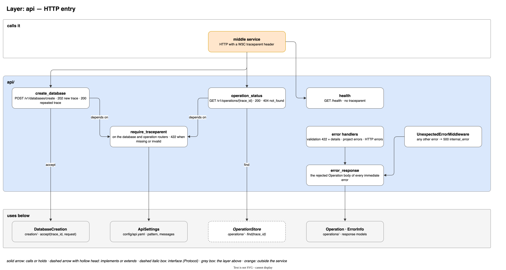
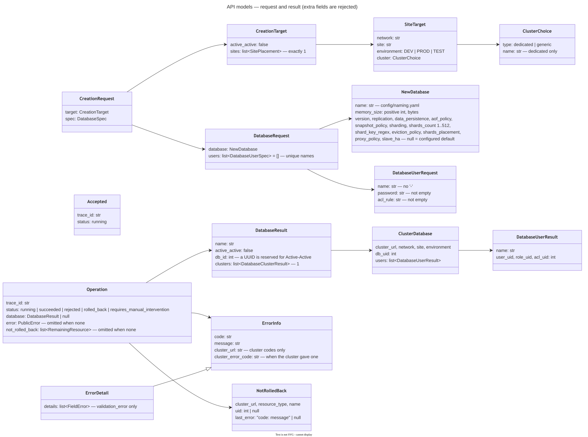

# חוזה: שירות הביניים ⇐ redis-enterprise-services

ה-API ש-redis-enterprise-services חושף לשירות הביניים: מה נשלח לכל route ומה חוזר. אותו חוזה מתואר גם ב-OpenAPI של
השירות (`/docs`), עם תיאור ודוגמה לכל שדה.

**בנוי היום:** יצירת DB באתר אחד ושאילתת סטטוס. **מתוכנן:** סעיף 7.

---

## 1. כללי

| נושא | ערך |
|---|---|
| פורמט | JSON. שדה לא מוכר בגוף הבקשה ⇐ `422 validation_error` |
| מזהה בקשה | header `traceparent` בפורמט W3C, חובה ב-routes של `/v1/`. חסר או לא תקין ⇐ `422 validation_error` על `header.traceparent`. ה-`trace_id` של הפעולה הוא ה-trace id שבו (32 תווי hex) |
| אסינכרוני | פקודה מחזירה מיד `202` עם `trace_id` ו-`status: running`. התוצאה בשאילתת הסטטוס (סעיף 5) |
| IDs | ביצירה לא שולחים IDs. הם חוזרים בתוצאה |
| סיסמאות | סיסמה של יוזר נשלחת בבקשה וחוזרת בתוצאה (הקלאסטר לא מחזיר סיסמאות, ולכן חוזרת זו שהוא קיבל). סיסמאות פנימיות של ה-DB ושל הקלאסטר לא חוזרות ולא נשמרות |
| הזדהות | אין עדיין (סעיף 7) |

| route | |
|---|---|
| `POST /v1/databases/create` | יצירת DB באתר אחד |
| `GET /v1/operations/{trace_id}` | סטטוס ותוצאה של פעולה |
| `GET /health` | `200 {"status": "ok"}`. בלי `traceparent` |

---

## 2. איך פקודה רצה



1. **בדיקות מקומיות**, בלי פנייה לקלאסטר: מבנה הגוף, כללי שם ה-DB, ושהיעד מתאים לקלאסטר בקונפיג. כשל ⇐ תשובה
   מיידית עם קוד HTTP (סעיף 6).
2. **קבלה:** `202` עם `{"trace_id", "status": "running"}`. הפעולה רצה ברקע.
3. **תוצאה:** `GET /v1/operations/{trace_id}` עד ש-`status` סופי: `succeeded`, `rejected`, `rolled_back` או
   `requires_manual_intervention`. סטטוס שלא מוכר לקורא אינו סופי.

**אותו trace id פעמיים** לא מתחיל פעולה חדשה, גם עם span id אחר. התשובה היא `200` עם המצב הנוכחי, כמו שאילתת
הסטטוס. לכן כל פקודה צריכה trace משלה.
- רק מבנה הגוף נבדק לפני החיפוש לפי trace. גוף שלא עומד בחוזה ⇐ `422`, גם אם כבר יש פעולה עם אותו trace.
  שאר הבדיקות המקומיות רצות רק כשה-trace חדש.
- פקודה שנדחתה מיד לא נשמרת. אותו trace עם גוף מתוקן מתחיל פעולה חדשה.
- אם השירות לא הצליח להעביר את הפקודה לריצה ברקע (למשל באמצע כיבוי), התשובה `500`, והפעולה נשמרת כ-`rejected`
  עם `internal_error`. אותו trace יקבל `200` עם התוצאה הזו עד שהיא פגה.
- אחרי שהתוצאה פגה (סעיף 5), אותו trace מתחיל פעולה חדשה.

---

## 3. יצירה: `POST /v1/databases/create`

```json
{
  "target": {
    "active_active": false,
    "sites": [
      {"network": "net-a", "site": "dc1", "environment": "PROD", "cluster": "generic"}
    ]
  },
  "spec": {
    "database": {"name": "orders", "memory_size": 1073741824},
    "users": [
      {"name": "app", "password": "…", "acl_rule": "+@all ~orders:*"}
    ]
  }
}
```

### `target`

| שדה | סוג | חובה | הערה |
|---|---|---|---|
| `active_active` | `false` | ✅ | `true` עוד לא נתמך |
| `sites` | list | ✅ | איבר אחד בדיוק |
| `sites[].network` | str | ✅ | |
| `sites[].site` | str | ✅ | |
| `sites[].environment` | `DEV` / `PROD` / `TEST` | ✅ | |
| `sites[].cluster` | str | ✅ | `generic`, או שם של קלאסטר ייעודי |

**איך נמצא הקלאסטר:** הבקשה מתארת את הקלאסטר ולא יודעת את הכתובת שלו. השירות מתרגם אותו לכתובת לפי
`config/clusters.yaml`, באותם `network`, `environment` ו-`site`: ב-`generic` קלאסטר מסוג `generic`, ובשם קלאסטר
הקלאסטר מסוג `dedicated` עם השם הזה. מכאן כל השלבים עובדים עם כתובת הקלאסטר.
- אין קלאסטר מתאים ⇐ `422 no_matching_cluster`.
- ב-`generic` צריך להיות בדיוק קלאסטר אחד מתאים. יותר מאחד ⇐ `500 configuration_error`. בחירה בין כמה קלאסטרים
  מתוכננת (סעיף 7).

### `spec.database`

| שדה | סוג | חובה |
|---|---|---|
| `name` | str | ✅ |
| `memory_size` | int חיובי (bytes) | ✅ |
| `version` | str | |
| `replication` | bool | |
| `data_persistence` | `disabled` / `aof` / `snapshot` | |
| `aof_policy` | `appendfsync-every-sec` / `appendfsync-always` | רק יחד עם `data_persistence: aof` |
| `snapshot_policy` | list של `{secs, writes}`, שניהם int חיובי | רק יחד עם `data_persistence: snapshot` |
| `sharding` | bool | `true` רק יחד עם `shard_key_regex` |
| `shards_count` | int, 1–1024 | מעל 1 רק יחד עם `sharding: true` |
| `shard_key_regex` | list של `{regex}` | רק יחד עם `sharding: true` |
| `eviction_policy` | אחד מעשרת הערכים של Redis (`noeviction`, `allkeys-lru`, …) | |
| `shards_placement` | `dense` / `sparse` | |
| `proxy_policy` | `single` / `all-master-shards` / `all-nodes` | |
| `slave_ha` | bool | |

**כללים:** כל שדה עומד קודם בכללים של Redis עצמו (מהסכמה של הקלאסטר, `/v1/jsonschema`, ומבדיקה מול קלאסטר אמיתי), ועליהם
השירות יכול להוסיף כללים מחמירים יותר בקונפיג. ערך שלא עומד בהם נדחה מיד עם `422`, לפני שמתחילה ריצה.

**שם ה-DB:** הכלל של Redis: אותיות באנגלית, ספרות ו-`-`, לא מתחיל ולא נגמר ב-`-`, עד 64 תווים
(`naming.redis.database`). השירות מחמיר לעד 20 תווים (`naming.database`). אחרת ⇐ `422 invalid_name`, והכללים שהופרו
ב-`error.message`.

**ברירות מחדל:** שדה שלא נשלח, או נשלח כ-`null`, מקבל את ברירת המחדל של השירות ליעד (`config/database_defaults.yaml`).
אם אין לשירות ברירת מחדל לשדה, ה-DB נוצר עם ברירת המחדל של Redis. היום:

| שדה | ברירת מחדל |
|---|---|
| `version` | `8.4` |
| `replication` | `true`, וב-`DEV` `false` |
| `data_persistence` | `aof` |
| `aof_policy` | `appendfsync-every-sec`, רק כש-`data_persistence` הוא `aof` |
| `snapshot_policy` | `[{"secs": 3600, "writes": 1}]`, רק כש-`data_persistence` הוא `snapshot` |
| `shards_placement` | `dense` |
| `proxy_policy` | `all-master-shards` |

`aof_policy` או `snapshot_policy` שנשלחים בבקשה בלי `data_persistence` של אותו מצב ⇐ `422` מיד, לפני שמתחילה ריצה.
כך גם `sharding: true` בלי `shard_key_regex` (Redis דוחה אותו), ו-`shard_key_regex` או `shards_count` מעל 1 בלי
`sharding: true`. ערכים שרק הקלאסטר יכול לבדוק (למשל זיכרון גדול מהקלאסטר, או `version` שלא קיים) נבדקים בקלאסטר, וכשהוא
דוחה, התוצאה היא `rolled_back` עם `cluster_request_failed`.

### `spec.users[]`

| שדה | סוג | חובה | הערה |
|---|---|---|---|
| `users` | list | | ברירת מחדל `[]`. כל שם פעם אחת |
| `users[].name` | str | ✅ | בלי `-` (המפריד בשמות ה-ACL וה-role). הכלל של Redis: ASCII בלי `" & < >`, עד 255 תווים (`naming.redis.user`). ושמות ה-ACL וה-role שנגזרים ממנו (`{db}-{user}-acl`, `{db}-{user}-role`) חייבים את הכלל של Redis לשמות אלה: אותיות, ספרות, רווח ו-`_ . @ # ; , ( ) [ ] -`, עד 255 תווים (`naming.redis.acl_and_role`). אחרת ⇐ `422 invalid_name` |
| `users[].password` | str | ✅ | לפחות 8 תווים: ה-`password_min_length` הנמוך ביותר של Redis. קלאסטר שמוגדר עם מינימום גבוה יותר דוחה סיסמה קצרה ממנו |
| `users[].acl_rule` | str | ✅ | כלל ACL של Redis, למשל `+@all ~orders:*`. התחביר נבדק מיד: מילים מופרדות ברווח, `+@category`, `-@category`, `+command`, `-command\|sub`, `~keys`, `%R~keys`, `%W~keys`, `%RW~keys`, `&channels`, `allkeys`, `allcommands`, `nocommands`, `resetkeys`, `allchannels`, `resetchannels`, `on`, `off`, ו-selectors בסוגריים (נבדק מול קלאסטר אמיתי). שהפקודות והקטגוריות קיימות בודק הקלאסטר |

### מה נוצר בקלאסטר

1. ה-DB, עם הסיסמה של `default_user` מהשירות.
2. לכל יוזר: ACL בשם `{db}-{user}-acl` עם ה-`acl_rule` שלו, role בשם `{db}-{user}-role`, והיוזר עם ה-role.
3. קישור כל role ל-ACL שלו על ה-DB.

לפני שמשהו נוצר, השירות בודק בקלאסטר שכל השמות האלה פנויים: ה-DB, היוזרים, ה-ACLs וה-roles. שם תפוס ⇐ `rejected`
עם `name_taken`.

**אם צעד נכשל בוודאות,** כל מה שכבר נוצר נמחק בסדר הפוך, וההרשאות על ה-DB חוזרות לערכים הקודמים. התוצאה
`rolled_back`.

**אם לא ידוע אם צעד בוצע** (למשל timeout מול הקלאסטר), השירות בודק בקלאסטר. אם הוא לא יכול לקבוע מה קרה, הוא לא
מבטל כלום, והתוצאה `requires_manual_intervention`. כך גם כשביטול נכשל.

---

## 4. התשובה



### קבלה (`202`)

```json
{"trace_id": "4bf92f3577b34da6a3ce929d0e0e4736", "status": "running"}
```

### הצלחה

```json
{
  "trace_id": "4bf92f3577b34da6a3ce929d0e0e4736",
  "status": "succeeded",
  "database": {
    "name": "orders",
    "memory_size": 1073741824,
    "active_active": false,
    "crdb_guid": null,
    "clusters": [
      {
        "cluster": "cluster-a", "cluster_url": "https://cluster-a.net-a:9443",
        "network": "net-a", "site": "dc1", "environment": "PROD",
        "access": {
          "endpoints": [ {"dns_name": "redis-12000.cluster-a.net-a", "port": 12000, "addr": ["10.0.0.5"]} ]
        },
        "db": {
          "db_uid": 7,
          "settings": {"name": "orders", "memory_size": 1073741824, "version": "8.4.0", "replication": true,
                       "data_persistence": "aof", "aof_policy": "appendfsync-every-sec", "…": "…"},
          "permissions": [
            {"user_uid": 12, "user_name": "app", "user_password": "S3cure-Passw0rd",
             "acl_uid": 9, "acl_rule": "+@all ~orders:*", "role_uid": 4, "role_name": "orders-app-role"}
          ]
        }
      }
    ]
  }
}
```

כל ערך של ה-DB, של היוזר, של ה-ACL ושל ה-role נקרא מהקלאסטר. אין ערך שמגיע מהבקשה, חוץ מהסיסמה: הקלאסטר אף פעם לא מחזיר סיסמה,
ולכן חוזרת הסיסמה שהקלאסטר קיבל כשיצר את היוזר. `cluster`, `cluster_url`, `network`, `site` ו-`environment` מגיעים
מהקונפיג. `active_active: false` ו-`crdb_guid: null` קבועים עד Active-Active.

| שדה | הערה |
|---|---|
| `database.name`, `database.memory_size` | כפי שה-DB שמר אותם |
| `database.crdb_guid` | ה-id של Active-Active. `null` ל-DB באתר אחד |
| `database.clusters[]` | ענף לכל קלאסטר. היום קלאסטר אחד |
| `clusters[].cluster` | שם הקלאסטר מהקונפיג |
| `clusters[].access.endpoints[]` | איך מתחברים: `dns_name`, `port`, `addr`. לפחות אחד, וכל אחד מלא |
| `clusters[].db.db_uid` | ה-uid של ה-DB בקלאסטר |
| `clusters[].db.settings` | כל שדות מודל היצירה (`spec.database`), כפי שה-DB שמר אותם אחרי שהפך ל-active |
| `clusters[].db.permissions[]` | לכל יוזר: היוזר, ה-ACL וה-role שלו, שנוצרים ונמחקים יחד, כל אחד עם ה-uid שלו. הקישור role ↔ ACL שלהם נבדק ב-DB שנקרא בסוף |

**מאיפה הערכים:** כל אובייקט חייב לחזור מלא כבר בתשובה ליצירה שלו: כל שדה שנשלח חוזר עם ערך. השדות שהקלאסטר אף
פעם לא מחזיר מוגדרים בקונפיג (`unreturned_fields`, היום רק סיסמת היוזר). אחרי עדכון ההרשאות, צעד אחרון קורא את ה-DB
המלא, ובודק שיש ערך לכל שדות מודל היצירה, ל-`uid`, ל-`status` ול-`endpoints`, שכל endpoint מלא, ושההרשאות שנקבעו
נמצאות ב-`roles_permissions`. אובייקט לא מלא, שדה בלי ערך, DB בלי endpoint עם `dns_name`,
`port` ו-`addr`, או הרשאות שלא נמצאות ב-DB, הם כישלון ודאי (`incomplete_cluster_object`, בציבורי `cluster_request_failed`): הכל מתבטל.

### כישלון

```json
{
  "trace_id": "4bf92f3577b34da6a3ce929d0e0e4736",
  "status": "rolled_back",
  "database": null,
  "error": {
    "code": "cluster_request_failed",
    "message": "…",
    "cluster_url": "https://cluster-a.net-a:9443",
    "cluster_error_code": "invalid_schema"
  },
  "not_rolled_back": []
}
```

| `status` | משמעות |
|---|---|
| `running` | הפעולה עוד רצה |
| `succeeded` | הכל הצליח |
| `rejected` | נדחה לפני ששום דבר השתנה. הסיבה ב-`error.code` |
| `rolled_back` | נכשל, והכל בוטל. שום דבר לא השתנה |
| `requires_manual_intervention` | נכשל, ולא הכל בוטל, או שלא ידוע מה נשאר. דורש טיפול ידני |

**שדות שתמיד קיימים** (חובה בסכמה): `trace_id`, `status` ו-`database`, שהוא `null` כל עוד אין הצלחה. `error` ו-`not_rolled_back`
מופיעים רק כשיש להם ערך.

**`error`:** השגיאה של הצעד שעצר את הפעולה. `cluster_url` ו-`cluster_error_code` מופיעים רק ב-`cluster_request_failed`,
`cluster_unavailable` ו-`cluster_timeout`. `cluster_error_code` מופיע רק כשהקלאסטר החזיר קוד שגיאה משלו.

**`not_rolled_back[]`:** מה שנשאר בקלאסטר.
- ב-`rolled_back`: רשימה ריקה.
- ב-`requires_manual_intervention`: מה שנשאר, כולל משאב שלא ידוע אם נוצר (`uid: null`, והשגיאה של הצעד). השדה
  לא מופיע אחרי קריסה שהסריקה זיהתה (הסריקה לא בונה אותו), כשה-record של הריצה לא נקרא, או כשאי אפשר לבנות ממנו את
  התוצאה. בכל המקרים האלה הקוד
  `internal_error`.
- ב-`rejected`: לא מופיע.

| שדה | הערה |
|---|---|
| `cluster_url` | כתובת ה-API של הקלאסטר |
| `resource_type` | `database`, `acl`, `role`, `user` או `permissions` (הקישור של roles ל-ACLs על ה-DB) |
| `name` | שם המשאב. ב-`permissions`: שם ה-DB |
| `uid` | ה-uid בקלאסטר, או `null` כשלא ידוע אם המשאב נוצר. ב-`permissions`: ה-uid של ה-DB |
| `last_error` | `"<code>: <message>"` של השגיאה האחרונה (של הביטול אם נכשל, אחרת של הצעד), או `null` |

---

## 5. סטטוס: `GET /v1/operations/{trace_id}`

`200` עם המצב הנוכחי (סעיף 4). `trace_id` שאינו 32 תווי hex קטנים, או שכולו אפסים ⇐ `422 validation_error` על
`path.trace_id`. `trace_id` לא מוכר ⇐ `404 operation_not_found`. גוף השגיאות כאן הוא `{"trace_id", "error"}`, בלי `status`
(סעיף 6), כדי ש-`404` לא ייקרא כמו פעולה שנדחתה.

**כמה זמן התוצאה נשמרת:** `succeeded`, `rejected` ו-`rolled_back` נשמרים 7 ימים (`state.finished_ttl_seconds`),
ואחר כך ה-`trace_id` לא מוכר. `requires_manual_intervention` נשמר עד שמטפלים בו ידנית.

**קריסה:** אם ה-pod שהריץ פעולה נפל, pod אחר מזהה את זה תוך כדקה או שתיים ומסמן אותה:
- `rejected` עם `internal_error`, אם הריצה עוד לא התחילה (לא נוצר כלום);
- `rolled_back` עם `internal_error`, אם הריצה כבר הסתיימה בביטול מלא ורק שמירת הפעולה אבדה;
- אחרת `requires_manual_intervention` עם `internal_error`, גם אם בפועל עוד לא נוצר כלום, וגם אם הריצה הצליחה ורק שמירת
  הפעולה אבדה (ה-DB קיים, אבל `database` הוא `null`).

**נעילה אחרי `requires_manual_intervention`:** בדרך כלל הנעילה על ה-DB ועל היוזרים נשארת, גם אחרי קריסה. עד שמטפלים
בפעולה ידנית, כל פקודה על אותם שמות באותו קלאסטר מסתיימת ב-`resources_locked`. יוצא מן הכלל: הריצה עצמה הסתיימה
ב-`succeeded` או ב-`rolled_back`, ורק הפעולה סומנה `requires_manual_intervention`: ב-`succeeded` כשה-pod נפל לפני ששמר
את הפעולה, ובשניהם כשאת התוצאה לא היה אפשר לבנות מה-record. ה-record הסופי כבר נכתב, ולכן הנעילה משתחררת, ופקודות חדשות על אותם שמות לא
נחסמות.

---

## 6. שגיאות

תשובה מיידית עם שגיאה:
- **בפקודה** (`POST /v1/databases/create`): בנויה כמו כישלון בסטטוס, `{"trace_id", "status": "rejected", "database": null, "error"}`,
  כי הפקודה נדחתה ושום דבר לא השתנה.
- **בכל השאר** (שאילתת הסטטוס, כתובת לא קיימת, method שגוי): `{"trace_id", "error"}`, בלי `status`, כי אין פעולה שנדחתה.
  `trace_id` הוא של הבקשה עצמה: מה-`traceparent`, או, בלי `traceparent` תקין, של ה-trace שהשירות פתח לבקשה.

ב-`validation_error` יש גם `error.details`: רשימה של `{location, message}` לכל שדה שלא עומד בחוזה, למשל
`body.spec.database.memory_size` או `header.traceparent`.

| `code` | איפה | מתי |
|---|---|---|
| `validation_error` | מיד, `422` | הבקשה לא עומדת בחוזה |
| `invalid_name` | מיד, `422` | שם ה-DB לא עומד בכללי השמות |
| `no_matching_cluster` | מיד, `422` | אין קלאסטר שמתאים ליעד |
| `not_found` | מיד, `404` | כתובת לא קיימת |
| `operation_not_found` | מיד, `404` | `trace_id` לא מוכר, או שהתוצאה שלו כבר פגה |
| `method_not_allowed` | מיד, `405` | method שהכתובת לא מקבלת |
| `http_error` | מיד, עם ה-status של ה-HTTP | שגיאת HTTP אחרת של ה-framework, שאין לה קוד משלה |
| `configuration_error` | מיד `500`, או בסטטוס | בעיה בקונפיג של השירות, למשל כמה קלאסטרים `generic` לאותו יעד. בסטטוס רק כרשת ביטחון: רשת בלי ריליי נדחית כבר בעלייה |
| `internal_error` | מיד `500`, או בסטטוס | שגיאה לא צפויה, או שגיאה פנימית בלי קוד ציבורי משלה. מיד: `message` קבוע (`internal error`). בסטטוס: כשהשגיאה הגיעה מצעד, ה-`message` שלו; אחרת (קריסה, record שלא נקרא, תוצאה שלא נבנתה) ה-`message` הקבוע. הפרטים בלוג לפי `trace_id` |
| `name_taken` | בסטטוס, `rejected` | שם של DB, יוזר, ACL או role תפוס בקלאסטר |
| `resources_locked` | בסטטוס, `rejected` | פעולה אחרת על אותו DB או אותם יוזרים, באותו קלאסטר, לא הסתיימה תוך 30 שניות |
| `cluster_request_failed` | בסטטוס | הקלאסטר דחה בקשה, DB הגיע ל-`creation-failed`, פעולה בקלאסטר הסתיימה ב-`failed`, `cancelled` או `aborted`, או אובייקט שנקרא מהקלאסטר לא מחזיק את מה שנשלח או נקבע (`incomplete_cluster_object`) |
| `cluster_unavailable` | בסטטוס | הקלאסטר או שירות הקצה לא זמינים, או שהתשובה לא קריאה |
| `cluster_timeout` | בסטטוס | הקלאסטר לא סיים פעולה בזמן, למשל DB שלא הגיע ל-`active` |

אלה הקודים היחידים שחוזרים. בסכמה הם רשימות סגורות (`enum`): ב-`error` של הסטטוס `PublicErrorCode`, כלומר כל
הקודים חוץ מחמשת הקודים של ה-API (`validation_error`, `not_found`, `operation_not_found`, `method_not_allowed`,
`http_error`); בפועל `invalid_name` ו-`no_matching_cluster` חוזרים רק מיד. ב-`error` של התשובה המיידית הרשימה כוללת
את כל הקודים. שגיאה פנימית אחרת חוזרת כ-`internal_error`. המיפוי מהקודים הפנימיים ב-`config/operation.yaml`.

---

## 7. מתוכנן

לא בנוי עדיין. העיצוב ב-`docs/design/planned.md`.

| נושא | מה ישתנה בחוזה |
|---|---|
| בחירת קלאסטר | ב-`generic` השירות יבחר קלאסטר שיש בו מקום מבין כמה. קוד חדש `insufficient_resources` |
| הזדהות | `Authorization` בכל route, אחרת `401 unauthenticated` |
| Active-Active | `active_active: true` עם כמה `sites`. `crdb_guid` יהיה ה-UUID של ה-CRDB, ו-`clusters[]` יכיל ענף לכל קלאסטר. סטטוס חדש, `pending_cleanup`, כשהיצירה נקטעה וניקוי האתרים עוד רץ. הוא לא סופי |
| עריכה ומחיקה: היעד | `target: {active_active, crdb_guid, clusters}` (עם ה-`db_uid` וה-uids של כל ענף), מהתוצאה של היצירה, שונה מה-`target` של יצירה |
| עריכה ומחיקה: קודים | `database_not_found`, `clusters_mismatch`, `sites_diverged` בסטטוס (`rejected`) |
| עריכת DB | `POST /v1/databases/update` |
| עריכת יוזרים | `POST /v1/databases/users`, עם רשימת היוזרים המלאה. סיסמה חסרה או מיותרת ⇐ `422 password_rules` |
| מחיקה | `POST /v1/databases/delete` |
| קריאה ישירה לקלאסטר | `POST /v1/cluster-requests`, בלי rollback |
