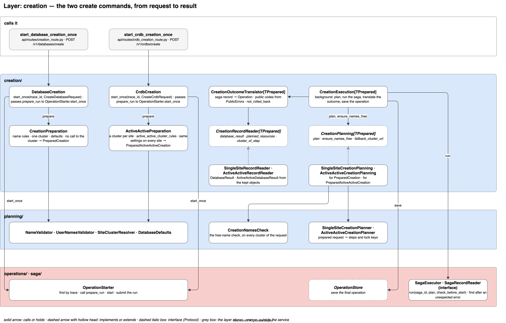
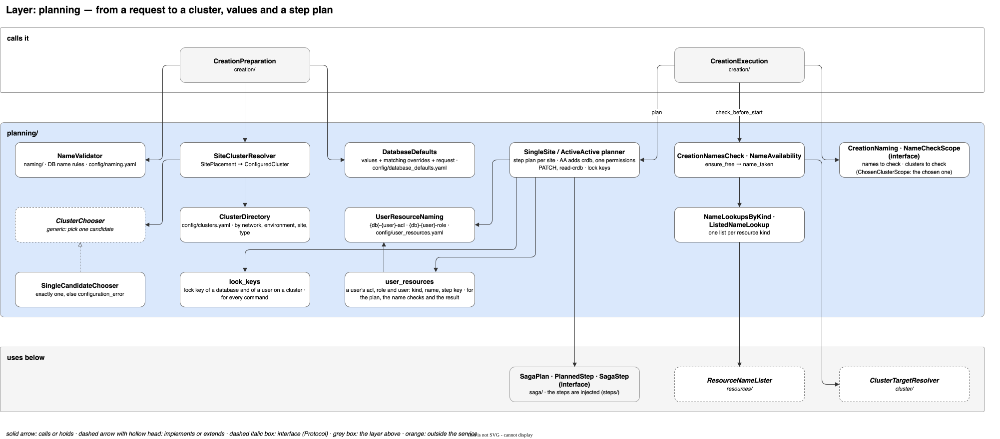
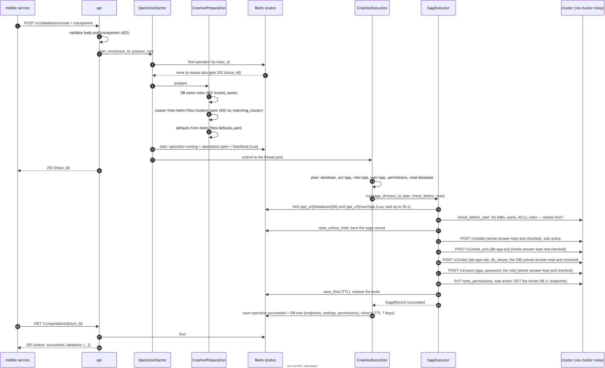

# יצירת DB: איך בקשה רצה

מה קורה מרגע ש-`POST /v1/databases/create` (אתר אחד) או `POST /v1/crdbs/create` (Active-Active, סעיף 6) מגיע ועד שהתוצאה נשמרת. החוזה עצמו (שדות, קודים): `contracts/service-api.md`.
המנוע, ה-Redis וההתאוששות: `saga-engine-and-state.md`.

**בנוי:** יצירה באתר אחד ויצירת Active-Active (סעיף 6). **לא בנוי:** `planned.md`.

---

## 1. המסלול


```
POST /v1/databases/create                              (Active-Active: POST /v1/crdbs/create)
 ├─ ולידציה של הגוף (Pydantic) ו-traceparent           ⇐ 422 מיד
 ├─ DatabaseCreation.start_once ⇐ OperationStarter.start_once
 │   ├─ יש פעולה לאותו trace?                           ⇐ 202, שום דבר לא מתחיל
 │   ├─ CreationPreparation: שם, קלאסטר, ברירות מחדל     ⇐ 422 / 500 מיד, אחרת PreparedCreation
 │   ├─ התחלה אטומית: running + heartbeat
 │   └─ העברה ל-ThreadPoolTaskRunner                          ⇐ 202
 └─ ברקע: CreationExecution.run_and_save
     ├─ CreationSagaPlanning.plan: תוכנית צעדים
     ├─ SagaExecutor: נעילה ⇐ בדיקת שמות פנויים (CreationSagaPlanning.ensure_names_free) ⇐ צעדים
     └─ CreationOutcomeTranslator: התוצאה ⇐ OperationStore
```

**לכל סוג המחלקות שלו.** אותו מסלול רץ בשני הסוגים, וכל שלב בו הוא מחלקה של הסוג:

| שלב | אתר אחד | Active-Active | תיקייה |
|---|---|---|---|
| נתיב | `POST /v1/databases/create` | `POST /v1/crdbs/create` | |
| route | `start_database_creation_once` (`creation_route.py`) | `start_crdb_creation_once` (`crdb_creation_route.py`) | `api/routes/` |
| מודל הבקשה | `CreateDatabaseRequest`: `CreateDatabaseTarget` (`site`) ו-`DatabaseSpec` | `CreateCrdbRequest`: `CreateCrdbTarget` (`sites`) ו-`ActiveActiveSpec` (`DatabaseSpec` ועוד `crdb: CrdbSpec`) | `creation/requests/`, `planning/spec/` |
| מה שה-route קורא לו | `DatabaseCreation` | `CrdbCreation` | `creation/` |
| הכנה | `CreationPreparation` | `ActiveActivePreparation`, עם הכללים של `active_active_cluster_rules.py` | `creation/preparation/` |
| מה שההכנה מחזירה | `PreparedCreation` (`cluster`, `spec`) | `PreparedActiveActiveCreation` (`clusters`, `spec`) | `creation/preparation/` |
| ריצה ברקע | `CreationExecution[PreparedCreation]` | `CreationExecution[PreparedActiveActiveCreation]` | `creation/` |
| `CreationSagaPlanning` | `SingleSiteCreationSagaPlanning` | `ActiveActiveCreationSagaPlanning` | `creation/planning/` |
| מפרק | `SingleSiteCreationPlanner` | `ActiveActiveCreationPlanner` | `planning/` |
| `CreationRecordReader` | `SingleSiteRecordReader` (`created_database_result.py`) | `ActiveActiveRecordReader` (`created_active_active_result.py`) | `creation/results/` |
| מודל התוצאה | `DatabaseResult` | `ActiveActiveDatabaseResult`: `CrdbResult` ו-`ActiveActiveClusterResult` לכל קלאסטר | `operations/results/` |

| רכיב | תיקייה | מה הוא עושה |
|---|---|---|
| `DatabaseCreation`, `CrdbCreation` | `creation/` | מה שה-route קורא לו: מעביר ל-`OperationStarter.start_once` את ההכנה, שרצה רק אחרי החיפוש לפי trace |
| `OperationStarter` | `operations/` | הסדר המשותף לכל פקודה: חיפוש לפי trace, הכנה, התחלה אטומית, העברה לרקע (`saga-engine-and-state.md` סעיף 8) |
| `CreationPreparation`, `ActiveActivePreparation` | `creation/preparation/` | כל מה שאפשר לבדוק בלי הקלאסטר. מחזירה את הבקשה המוכנה: `PreparedCreation` או `PreparedActiveActiveCreation` |
| `CreationExecution[TPrepared]` | `creation/` | הריצה ברקע, עד רשומת הפעולה הסופית. מחלקה אחת לשני הסוגים, גנרית על סוג הבקשה המוכנה |
| `CreationSagaPlanning[TPrepared]` | `creation/planning/` | ממשק: הבקשה המוכנה ⇐ תוכנית צעדים (`plan`), בדיקת השמות הפנויים (`ensure_names_free`) והקלאסטר שנרשם בשגיאה שאין לה קלאסטר (`fallback_cluster_url`). המימושים: `SingleSiteCreationSagaPlanning` ו-`ActiveActiveCreationSagaPlanning`, שקוראים למפרק ול-`CreationNamesCheck` |
| `SingleSiteCreationPlanner` | `planning/` | הבקשה ⇐ תוכנית צעדים ומפתחות נעילה |
| `ActiveActiveCreationPlanner` | `planning/` | בקשת Active-Active ⇐ תוכנית צעדים לכל האתרים ומפתחות נעילה בכל אתר |
| `CreationOutcomeTranslator[TPrepared]` | `creation/` | ה-saga record ⇐ הפעולה: עץ ה-DB, או השגיאה ומה שלא בוטל. גם הוא מחלקה אחת, גנרית על סוג הבקשה המוכנה |
| `CreationRecordReader[TPrepared]` | `creation/results/` | ממשק: מה שרק הסוג יודע לקרוא מה-record: עץ ה-DB (`database_result`), המשאבים שהתוכנית יוצרת (`planned_resources`) והקלאסטר של כל צעד (`cluster_of_step`). המימושים: `SingleSiteRecordReader` ו-`ActiveActiveRecordReader` |





**נקודת ההרכבה:** `composition/` (`app_wiring.py`, `cluster/cluster_wiring.py`, `creation/creation_wiring.py`, `state_wiring.py`, `background_wiring.py`, ולצידם ה-builders הקטנים של כל קבוצה) בונה את כל המחלקות הקונקרטיות, ובהן
`DatabaseCreation` ו-`CrdbCreation`, אחד לכל route. רק `app` ו-`server` מעליה.

---

## 2. ההכנה (לפני `202`)

`CreationPreparation` באתר אחד, `ActiveActivePreparation` ב-Active-Active (שלב 4).


1. **שם ה-DB** לפי `helm/files/defaults.yaml`. אחרת `invalid_name`.
2. **הקלאסטר** (`SiteClusterResolver`) מתוך `helm/files/clusters.yaml`: עץ של סביבה, רשת, אתר וקלאסטר. הסביבה, הרשת
   והאתר של קלאסטר הם המקום שלו בעץ. המפתח של קלאסטר הוא ה-FQDN שלו, ואין לו שם נפרד. כתובת ה-API נבנית ממנו:
   `https://<FQDN>:<api_port>`, ופורט שכתוב במפתח עצמו (`cluster-a.net-a.example.com:9444`) קודם ל-`api_port`. לקלאסטר
   יש `type`. הקונפיג נדחה בעלייה אם FQDN חוזר (בכל הקובץ), אם כתובת API חוזרת, או אם ה-FQDN של קלאסטר `dedicated` הוא
   `generic`. הבקשה שולחת ב-`target.site` אובייקט אחד: `environment`, `network`, `site`, וב-`cluster` את `generic` או FQDN של קלאסטר `dedicated`:
   - FQDN: הקלאסטר מסוג `dedicated` עם אותם סביבה, רשת, אתר ו-FQDN.
   - `generic`: כל הקלאסטרים ה-generic באותם סביבה, רשת ואתר הם מועמדים, ו-`ClusterChooser` בוחר. המימוש היום,
     `SingleCandidateChooser`, דורש מועמד אחד בדיוק. כמה ⇐ `configuration_error`. בחירה בין כמה: `planned.md`.
   - אין קלאסטר מתאים ⇐ `no_matching_cluster`.
3. **ברירות מחדל** (`DatabaseDefaults`): הבסיס ב-`helm/files/defaults.yaml`, והדריסות לפי מקום ב-`helm/files/clusters.yaml`:

   ```yaml
   database_defaults:
     single_site:
       database: {version: "8.4", replication: true, data_persistence: aof, ...}
       persistence_values:
         aof: {aof_policy: appendfsync-every-sec}
         snapshot: {snapshot_policy: [{secs: 3600, writes: 1}]}
       sharding_values: {shard_key_regex: [...], shards_count: 2}
     active_active:
       database: {version: "8.4", replication: true, eviction_policy: noeviction, ...}
       persistence_values: {...}
       sharding_values: {...}
       crdb: {causal_consistency: false, encryption: false, compression: 3}

   clusters:
     prod:                                  # סביבה (dev, prod, test)
       username: admin@example.com          # המשתמש המנהל של הקלאסטרים
       api_port: 9443
       default_user_password: <password>    # הסיסמה של default_user בכל DB חדש
       database: {replication: true}
       active_active: {database: {replication: true}}
       networks:
         net-a:                             # רשת
           password: <password>             # סיסמת המנהל של הקלאסטרים ברשת הזו
           active_active: {crdb: {compression: 6}}
           sites:
             NY:                            # אתר
               database: {version: "8.2"}
               clusters:
                 cluster-a.net-a.example.com:   # קלאסטר: ה-FQDN שלו
                   type: generic
                 orders.net-a.example.com:
                   type: dedicated
                   password: <password>     # לקלאסטר הזה סיסמת מנהל משלו
                   database: {replication: false}
   ```

   - בכל רמה (סביבה, רשת, אתר, קלאסטר) מותרים `username`, `password`, `default_user_password`, `api_port` ו-`database`.
     `active_active` (גם `database` וגם `crdb` שלו) מותר רק ברמת סביבה ורשת, לא באתר ולא בקלאסטר בודד: הגדרות ה-DB
     של Active-Active הן הגדרות ה-CRDB, שפרוס על כמה אתרים באותה רשת, ולכן הן זהות בכל האתרים. `active_active` באתר
     או בקלאסטר נדחה כבר בטעינת הקונפיג. בכל ערך, הרמה הנמוכה ביותר שכתבה אותו קובעת.
   - **פרטי גישה לקלאסטר:** כל קלאסטר חייב לצאת עם `username` ו-`password` של המשתמש המנהל, מהרמה שלו או מרמה
     מעליו (כל אחד מהם בנפרד). הם משמשים לכל קריאה אליו, וגם לפרטים שלו ב-CRDB. אין פרטי גישה כלליים מחוץ לעץ.
     קלאסטר בלי אחד מהם, בלי `default_user_password` או בלי פורט עוצר את השירות בעלייה, עם שגיאה שנוקבת בקלאסטר
     ובהגדרה החסרה.
   - **הסיסמה של `default_user`:** `default_user_password` של הקלאסטר שעליו ה-DB נוצר. ב-Active-Active יש סיסמה אחת
     לכל ה-CRDB, ולכן הקלאסטרים של אותו DB חייבים באותה סיסמה (אחרת `configuration_error`, בלי הערכים).
   - **סודות:** הקובץ מחזיק סיסמאות. משתני הסביבה היחידים שהשירות צריך הם הגישה ל-Redis של מצב ה-saga:
     `RES_STATE__URL` ו-`RES_STATE__KEY_PREFIX`.
   - **שני סוגים נפרדים, זה לצד זה:** בברירות המחדל DB באתר אחד לוקח רק את `single_site`, ו-DB ב-Active-Active רק את
     `active_active`. לכל אחד סט מלא משלו (`database`, `persistence_values`). אין ערך שעובר מסוג לסוג. ערך שצריך
     להשתנות בשני הסוגים משנים בשני הסטים: אין בדיקה שהם נשארים זהים.
   - הסדר לכל סוג: ברירת המחדל שלו, אחריה אותו סוג ברמות העץ. באתר אחד `database` בסביבה, ברשת, באתר ובקלאסטר.
     ב-Active-Active `active_active.database` בסביבה וברשת בלבד. הרמה הנמוכה ביותר שכתבה ערך קובעת. בסוף השדות שהבקשה שלחה ולא כ-`null`. התוצאה
     עוברת ולידציה ב-`NewDatabase`.
   - הגדרות ה-CRDB (`causal_consistency`, `encryption`, `compression`): `active_active.crdb` של ברירות המחדל, אחריו של
     הסביבה ושל הרשת. בסוף השדות שהבקשה שלחה ב-`spec.crdb` ולא כ-`null`: ערך מהבקשה קודם לקונפיג.
   - הדריסה היא לפי שדה ברמה העליונה. לשדות של ה-DB אין אובייקטים מקוננים שצריך למזג.
   - **שדות של מצב שמירה:** `aof_policy` שייך ל-`aof` ו-`snapshot_policy` ל-`snapshot`. אחרי המיזוג נקבע
     `data_persistence`. שדות של מצב אחר יוצאים, והשדות של המצב שנבחר מקבלים את `persistence_values` של הסט של אותו סוג אם הבקשה
     לא שלחה אותם. ב-`disabled` אין אף אחד מהם. בקשה שולחת `aof_policy` או `snapshot_policy` רק יחד עם ה-`data_persistence`
     שלהם, אחרת `422 validation_error`.
   - **שדות של Sharding** (`planning/spec/sharding_resolution.py`): `shard_key_regex` ו-`shards_count` מעל 1 שייכים
     ל-Sharding בלבד. כל רמה (ברירות המחדל, הסביבה, הרשת, האתר, הקלאסטר, הבקשה) נכנסת למיזוג בנפרד, לפי הסדר. רמה
     שכותבת `sharding: false` מוציאה אותם מהרמות שמתחתיה, ורמה ששולחת אחד מהם בלי `sharding` מוציאה את `sharding: false`
     של הרמות שמתחתיה. אחרי המיזוג: בלי `sharding`, `shards_count` מעל 1 או `shard_key_regex` מפעילים אותו. DB עם Sharding
     מקבל מ-`sharding_values` את מה שאף רמה לא קבעה: `shard_key_regex`, ו-`shards_count` (`2`, כמו ברירת המחדל של
     הקלאסטר). DB בלי Sharding נשלח עם `shards_count: 1`. `sharding` ו-`shards_count` נשלחים תמיד במפורש.
     `shards_count: 1` לא מדליק ולא מכבה Sharding: ה-`sharding` של הרמות עובר כמו שהוא. `sharding: false` יחד עם
     `shard_key_regex` או `shards_count` מעל 1 באותה רמה ⇐ `422` בבקשה, ועצירה בעלייה בקונפיג. `sharding_values` חייב
     לכלול `shard_key_regex` ו-`shards_count`, ולא `sharding`, אחרת השירות לא עולה.
   - כל רמה בקונפיג עוברת קודם את סוגי השדות של ה-DB, לפני המיזוג ולפני כל בדיקה: `null` נחשב לא נכתב, ו-`"false"` הוא
     false.
   - בעלייה: ערך שלא עובר את `DatabaseOptions` או את הגדרות ה-CRDB עוצר את השירות. כך גם הערכים שחלים יחד על כל
     קלאסטר בקונפיג, בכל אחד משני הסוגים: שתי רמות שכל אחת תקינה לבד ויחד לא, עוצרות את השירות.

4. **ב-Active-Active** (`POST /v1/crdbs/create`, `target.sites`, `ActiveActivePreparation`): כל אתר עובר את שלב 2 לבד. אחר כך, לפני ברירות המחדל: כל האתרים באותה רשת (אחרת
   `mixed_networks`), כל אתר על קלאסטר אחר (אחרת `duplicate_sites`), וקלאסטרים שונים ב-FQDN אחר, ב-host אחר ועם אותה
   `default_user_password` (אחרת `configuration_error`: הקונפיג של הקלאסטרים, לא הבקשה). הכללים האלה ב-`active_active_cluster_rules.py`. רק אז כל אתר עובר את שלב 3,
   וכל האתרים חייבים לצאת עם אותן הגדרות, של ה-DB ושל ה-CRDB (אחרת `configuration_error`, עם שמות השדות השונים). סעיף 6.

כל מה שבשלב הזה לא נוגע בקלאסטר, ולכן כשל בו הוא תשובה מיידית, ושום דבר לא נשמר.

---

## 3. התוכנית



| # | מפתח | צעד | מה נשלח | ביטול |
|---|---|---|---|---|
| 1 | `database` | `CreateResourceStep` | `POST /v1/bdbs`, ואז המתנה ל-`active` | `DELETE`, ואז המתנה ל-404 |
| 2 | `acl/{user}` | `CreateResourceStep` | `POST /v1/redis_acls` `{name: {db}-{user}-acl, acl}` | `DELETE` |
| 3 | `role/{user}` | `CreateResourceStep` | `POST /v1/roles` `{name: {db}-{user}-role, management: db_viewer, resources: [ה-DB]}` | `DELETE` |
| 4 | `user/{user}` | `CreateResourceStep` | `POST /v1/users` `{name, password, role_uids: [ה-role]}` | `DELETE` |
| 5 | `permissions` | `UpdateDatabaseStep` | `PUT /v1/bdbs/{uid}` עם `roles_permissions`: זוג role ↔ ACL לכל יוזר | `PUT` של הרשימה הקודמת |
| 6 | `read-database` | `ReadDatabaseStep` | `GET /v1/bdbs/{uid}`: ה-DB המלא | אין מה לבטל |

- צעדים 2–4 חוזרים לכל יוזר, לפי הסדר בבקשה. צעד 5 אחד לכל היוזרים, ורק כשיש יוזרים. צעד 6 תמיד אחרון.
- **אובייקט מלא:** כל צעד יצירה שומר את כל מה שהקלאסטר החזיר, חוץ מ-`secret_fields` של המשאב (ב-DB:
  `authentication_redis_pass`, `authentication_admin_pass`, `authentication_sasl_pass`), ורק אז בודק שכל שדה שנשלח חזר עם ערך (חוץ מ-
  `unreturned_fields` בקונפיג, היום סיסמת היוזר). חסר ערך ⇐ `incomplete_cluster_object`, כישלון ודאי: ה-uid כבר שמור,
  ולכן הביטול מוחק גם את האובייקט הזה וגם כל מה שנוצר לפניו. אובייקט שנמצא לפי שם (תוצאה לא ידועה) נקרא מלא לפי ה-uid.
- **צעד 6** קורא את ה-DB המלא אחרי שההרשאות עליו. כל שדה של מודל היצירה ו-`database.required_fields` (`uid`, `status`,
  `endpoints`) חייב ערך, וכל endpoint חייב `endpoint_fields` (`dns_name`, `port`, `addr`). בנוסף, `roles_permissions`
  חייב להכיל כל זוג `{role_uid, redis_acl_uid}` שצעד 5 קבע, בלי חשיבות לסדר. אחרת ⇐ אותו כישלון ודאי, והכל מתבטל.
- **כל קריאה לקלאסטר מחזירה את האובייקט המלא:** יצירה, קריאה לפי uid, רשימה (בלי `fields`), מחיקה, עדכון DB, קריאת
  DB, המתנה ל-action (ה-action האחרון) והמתנה ל-DB פעיל (ה-DB האחרון שנקרא). מי שקורא בוחר מה הוא צריך, כך שראוטים
  אחרים משתמשים באותן קריאות בלי קריאה נוספת. צעד עדכון שומר לביטול רק את השדות שהוא משנה.
- **התוצאה** (`service-api.md` סעיף 4) נבנית רק מהאובייקטים ששמורים ב-saga record: ה-DB מצעד 6, היוזר, ה-ACL וה-role
  מתשובות היצירה שלהם. הסיסמה היא זו שהקלאסטר קיבל.
- כל הצעדים הפיכים. אין pivot, ולכן כשל ודאי בכל שלב מחזיר את הקלאסטר למצב שלפני הבקשה.
- ה-role נוצר אחרי ה-DB כי `resources` חייב uid של DB קיים, והיוזר אחרי ה-role כי הוא חייב role.
- ה-uids עוברים בין צעדים דרך ה-`StepResults` (`saga-engine-and-state.md` סעיף 3).
- שמות ה-ACL וה-role וה-`management` מ-`helm/files/defaults.yaml`.
- ביצירת ACL, role ו-user, אם התשובה כוללת `action_uid`, הצעד מחכה ל-`/v1/actions/{uid}` עד `completed`.
- **המתנה בקלאסטר:** כל המתנה קוראת את המצב כל `poll_interval_seconds` עד `timeout_seconds` (`database.wait`,
  `action.wait`, `crdb.task.wait`), ובודקת פעם אחרונה בדיוק בסוף הזמן. קריאה שנכשלה בשגיאה שבטוח לקרוא אחריה שוב
  (שירות קצה שלא התחבר או לא ענה, 5xx של הקלאסטר, או קוד מ-`cluster_api.transient_error_codes`) נרשמת כ-WARNING,
  והקריאה חוזרת. כל שגיאה אחרת עוצרת את ההמתנה. אם הזמן נגמר ⇐ `cluster_action_timeout`,
  `database_activation_timeout`, `database_deletion_timeout` או `crdb_task_timeout` (בחוזה: `cluster_timeout`). אם אף
  קריאה לא הצליחה עד סוף הזמן, מדווחת שגיאת הקריאה האחרונה במקום ה-timeout, למשל `cluster_unavailable`.
- גוף ה-DB כולל גם `default_user: true`, `authentication_redis_pass` (`default_user_password` של הקלאסטר, מ-`helm/files/clusters.yaml`) ו-`tags`
  (`database.default_tags`). הסיסמה מתווספת רק ברגע השליחה, ולא נכנסת לקלט של הצעד או ל-record.

**שמות.** כל ACL ו-role שייכים ליוזר אחד ב-DB אחד. שם יוזר עם `-` נדחה בולידציה, כי אחרת שתי בקשות שונות יכולות לקבל
אותו שם נגזר (DB `orders` עם יוזר `app-x`, ו-DB `orders-app` עם יוזר `x`).

**נעילה.** מפתחות `{api_url}/database/{db}` ו-`{api_url}/user/{user}` לכל יוזר, לפי כתובת הקלאסטר שנבחר. שמות ה-ACL וה-role נגזרים משם ה-DB, ולכן
הנעילה של ה-DB מכסה אותם.

**בדיקת שמות פנויים** (`CreationNamesCheck`, שמחבר את `NameCheckScope`, `CreationNaming` ו-`NameAvailability`), כ-`check_before_start`: אחרי הנעילה ולפני הצעד הראשון. היא בודקת את ה-DB, ולכל
יוזר את השם שלו ואת שמות ה-ACL וה-role. ל-REST API אין חיפוש לפי שם, ולכן היא שולפת פעם אחת כל סוג משאב (`bdbs`,
`crdbs`, `users`, `redis_acls`, `roles`) ומסננת בקוד. שם ה-DB נבדק גם מול שמות ה-CRDBs, בכל יצירה. היא רצה תחת הנעילה, כי הקלאסטר לא אוכף שם DB ייחודי, ושתי בקשות שבודקות
לפני הנעילה היו עוברות יחד. ההיקף הוא ממשק נפרד (`NameCheckScope`), והמימוש היום (`ChosenClusterScope`)
מחזיר רק את הקלאסטר שנבחר לכל אתר. ב-Active-Active הבדיקה (`ensure_free_on_every_site`) רצה על הקלאסטר של כל
אתר. אפשר להרחיב את ההיקף לקלאסטרים נוספים בלי לשנות את הבדיקה. שם תפוס ⇐ `name_taken`, והנעילה משתחררת.

---

## 4. התוצאה


`CreationExecution` מתרגם כל סוף לרשומת פעולה, ושומר אותה:

| מה קרה | הפעולה |
|---|---|
| ה-Saga הצליח | `succeeded` עם עץ ה-DB, שה-`CreationRecordReader` של הסוג בונה. באתר אחד (`SingleSiteRecordReader`, `creation/results/created_database_result.py`): `DatabaseResult` עם `kind: "single_site"` ואובייקט `cluster` אחד: ה-DB מהקריאה האחרונה, היוזר, ה-ACL וה-role מתשובות היצירה שלהם. ב-Active-Active (`ActiveActiveRecordReader`, `created_active_active_result.py`): `ActiveActiveDatabaseResult`, סעיף 6 |
| ה-Saga `rolled_back` או `requires_manual_intervention` | אותו סטטוס, עם `error` של הצעד שעצר (`stopped_at`), ו-`not_rolled_back` |
| שגיאה של הפרויקט לפני שה-Saga התחיל (נעילה, שם תפוס, שגיאת קלאסטר בבדיקת השמות, שגיאה בבניית התוכנית) | `rejected` עם הקוד הציבורי שלה |
| שגיאה (של הפרויקט או לא צפויה) אחרי שה-Saga התחיל | יש record ⇐ כמו בסוף רגיל, מתוך ה-record (record שנשמר כ-`running` ⇐ `requires_manual_intervention`). צעד שנעצר בלי שגיאה משלו מקבל את השגיאה שקטעה את הריצה: שגיאה של הפרויקט עם הקוד וההודעה שלה, או שגיאה לא צפויה כ-`internal_error` עם `internal error: unexpected <type>`. record שלא נקרא ⇐ `requires_manual_intervention` עם אותה שגיאה |
| שגיאה לא צפויה לפני שה-Saga התחיל | אין saga record ⇐ `rejected` עם `internal_error`, וה-`message` הוא `internal error: unexpected <type>` |
| record שאי אפשר לבנות ממנו את התוצאה (למשל uid חסר) | `requires_manual_intervention` עם `internal_error`, וה-`message` הוא `internal error: unexpected <type>`. `not_rolled_back` מופיע כשאפשר לבנות אותו מה-record |

- **`not_rolled_back`** (`CreationOutcomeTranslator`): כל צעד שנשאר `done`, `unresolved`, `compensating` או
  `compensation_failed`, עם הסוג, השם והקלאסטר מהתוכנית (`CreationRecordReader.planned_resources`), וה-uid מהתוצאה. ב-`permissions` השם וה-uid הם של ה-DB (ב-Active-Active ה-uid הוא `null`, ו-`crdb_guid` מזהה את הפריט).
  `last_error` הוא `"<code>: <message>"` של השגיאה האחרונה: של הביטול אם נכשל, אחרת של הצעד, עם הקוד הציבורי.
- **קודים ציבוריים** (`PublicErrors`, `helm/files/service.yaml`): כל קוד פנימי ממופה לקוד מהחוזה. קוד בלי מיפוי ⇐
  `internal_error` ו-WARNING. `cluster_url` ו-`cluster_error_code` נוספים רק לקודים שב-`public_codes_with_cluster_details`.
  לכל קוד ציבורי יש `kind` (`error_kind_by_code`); קוד בלי סוג ⇐ `needs_investigation` ו-WARNING. `Operation.failed`
  נותן ל-`requires_manual_intervention` תמיד `needs_investigation`.
- **סדר השמירה:** המנוע משחרר את הנעילה, ורק אחר כך הפעולה נשמרת.

---

## 5. בדיקות מול קלאסטר אמיתי

הזרימה נבדקה מקצה לקצה מול השירות, cluster-relay וקלאסטר מקומי:
- **הצלחה עם שני יוזרים:** חיבור בלי סיסמה ⇐ `NOAUTH`. `default` עם הסיסמה ⇐ `PONG`. יוזר כותב תחת ה-prefix של
  ה-ACL שלו ומקבל `NOPERM` מחוץ לו. יוזר עם ACL קריאה בלבד מקבל `NOPERM` על כתיבה.
- **כשל בכל אחד מחמשת הצעדים** (DB גדול מהקלאסטר, ACL לא חוקי, role ויוזר שנוצרו מבחוץ בזמן הריצה, אחרי בדיקת השמות, ACL שנמחק לפני צעד
  ההרשאות): כל ריצה הסתיימה `rolled_back` עם קוד השגיאה של הקלאסטר, ושום דבר לא נשאר בקלאסטר.
- **התוצאה:** עץ ה-DB חזר עם ה-endpoint, הפורט וה-addr, כל שדות מודל היצירה כפי שנשמרו, וההרשאה (uids, שם, סיסמה,
  כלל ה-ACL, וה-uid והשם של ה-role). כל ערך הושווה למה שנקרא ישירות מהקלאסטר. כישלון של צעד הקריאה האחרון לא נבדק מול קלאסטר אמיתי: הוא
  מכוסה בטסטים.
- **מקביליות:** שתי בקשות עם אותו שם DB במקביל ⇐ אחת `succeeded`, השנייה `rejected` עם `name_taken`.
- **אותו trace:** בזמן ריצה, אחרי סיום, עם גוף אחר, ושתיים במקביל: בכל המקרים רצה ריצה אחת.
- **קריסה:** השירות נהרג ב-`kill -9` באמצע צעד ה-DB. pod אחר סימן את הפעולה ואת ה-Saga, והנעילה נשארה.

---

## 6. Active-Active

**חוזה** (`service-api.md` סעיף 3א): route נפרד, `POST /v1/crdbs/create`, בלי שדה שבוחר סוג. `target.sites` הוא רשימה של אתר אחד
או יותר, מאותו אובייקט אתר כמו ביצירה באתר אחד, והראשון מתאם. `spec` הוא `{crdb, database, users}`: `spec.crdb` לא חובה,
ומחזיק את `causal_consistency`, `encryption` ו-`compression` (ערך מהבקשה קודם לקונפיג, סעיף 2). בתוצאה `kind: "active_active"`,
אובייקט `crdb` עם ה-`guid` וההגדרות של ה-CRDB, ו-`clusters[]` עם ענף לכל קלאסטר, שכולל גם `instance_id` ו-`compression`.
`GET /v1/operations/{trace_id}` משותף לשני הסוגים: `Operation.database` הוא `DatabaseResult` או `ActiveActiveDatabaseResult`, וה-`kind` מבדיל ביניהם.

**מחלקות:** ה-route `start_crdb_creation_once` (`api/routes/crdb_creation_route.py`) מקבל `CreateCrdbRequest` (`CreateCrdbTarget`, ו-`ActiveActiveSpec` עם `CrdbSpec`) וקורא ל-`CrdbCreation`.
`ActiveActivePreparation` מחזירה `PreparedActiveActiveCreation`, ו-`CreationExecution` רץ עם `ActiveActiveCreationSagaPlanning` ו-`ActiveActiveRecordReader`. התוצאה היא
`ActiveActiveDatabaseResult`, עם `CrdbResult` ו-`ActiveActiveClusterResult` לכל קלאסטר.
המפרק הוא `ActiveActiveCreationPlanner`, והצעדים ב-`steps/`: `CreateCrdbStep`, `FindLocalCrdbInstanceStep`,
`UpdateCrdbInstancesStep` ו-`ReadCrdbStep`, ועוד `CreateResourceStep` ו-`ReadDatabaseStep` לכל אתר.

**יצירה:**


| # | צעד | סוג |
|---|---|---|
| 1 | `POST /v1/crdbs` עם `X-Task-ID` ו-`X-Result-TTL` שאנחנו קובעים, המתנה ל-task | הפיך: `DELETE` + task |
| 2 | לכל קלאסטר: איתור ה-bdb המקומי ו-`id` של ה-instance (`GET /v1/crdbs/{guid}` באותו קלאסטר), המתנה ל-`active` | קריאה בלבד |
| 3..N | לכל קלאסטר ולכל יוזר: ACL, role עם `resources` של ה-bdb **המקומי**, user | הפיך |
| N+1 | רק כשיש יוזרים: `PATCH` אחד ל-CRDB עם `instances[].db_config.roles_permissions`, רשימה לכל instance | הפיך: `PATCH` עם הערכים שנקראו לפני השינוי |
| N+2 | לכל קלאסטר: קריאת ה-bdb ובדיקה שההרשאות נשמרו | קריאה בלבד |
| N+3 | קריאת ה-CRDB ובדיקה ש-`default_db_config` מחזיק כל שדה שנשלח (tags משווים לפי `key` ו-`value`), וש-`causal_consistency`, `encryption` ו-`compression` של כל instance הם כמו שנשלחו | קריאה בלבד |

- **אותם צעדים, כמה קלאסטרים:** המפרק פורש כל צעד מקומי לצעד לכל קלאסטר, עם מפתח שמתחיל בקלאסטר. אותה מחלקה, פרמטר
  קלאסטר שונה. כשל באחד מבטל את האחרים כרגיל.
- **כל ההגדרות במפורש ב-`default_db_config`:** אותו גוף כמו ביצירה באתר בודד, אחרי מילוי ברירות המחדל. הקלאסטר שומר
  ב-CRDB רק מה שנשלח, ולכן רק כך ה-CRDB מחזיק את התמונה המלאה, ובדיקת drift משווה כל bdb מקומי מולו.
  `instances[].db_config` לא נשלח, חוץ מההרשאות. ברירות מחדל שנותנות ערך שונה לאתרים של אותו CRDB ⇐ שגיאת קונפיג לפני
  ששום דבר נוצר.
- **אותן הגדרות בכל אתר:** כל האתרים מקבלים אותו `default_db_config`, ולכן שדות שחייבים להיות זהים (`version`,
  `sharding`, `shard_key_regex`) לא יכולים להיות שונים.
- **אין dry_run:** יצירה שנכשלת בשלב הבדיקה של הקלאסטר (מקום, פורט, פרטי גישה), גם באתר אחד, לא משאירה כלום באף אתר
  ומחזירה אותה שגיאה שה-dry_run היה מחזיר, ולכן בדיקה מראש לא מוסיפה. אתר שנופל באמצע היצירה הוא מקרה אחר (הסעיף הבא).
- **אתר שנופל באמצע יצירה** (ה-task נשאר `started`): אחרי `crdb.task.wait.timeout_seconds` (600 שניות) ⇐
  `requires_manual_intervention`. לא שולחים cancel (החלטת הבעלים): בניסוי ישן cancel של יצירה עבד ומחק את ה-bdb
  החלקי, אבל cancel של שינוי מבנה אחר (הסרת אתר) השאיר CRDB שאי אפשר למחוק, ולכן לא מסתכנים. אדם מחליט לפי ה-task id
  ששמור ב-record.
- **אתר שנופל באמצע ביטול:** גם ביטול של CRDB (מחיקה, או שחזור ההרשאות) מחכה עד 600 שניות, ו-timeout שלו חוזר לפי
  `compensation_retry` (5 ניסיונות). מחיקת CRDB לוקחת כך כ-50 דקות, ושחזור ההרשאות יותר, כי ניסיון אחד שלו
  יכול לחכות לעד שלושה tasks. כל הזמן הזה הפעולה ב-`running`. אחר כך ⇐ `requires_manual_intervention`.
- **task שנכשל:** הקלאסטר מבטל בעצמו את מה שה-task התחיל (נבדק: כשל ב-cluster2 לא השאיר כלום ב-cluster1). בכל זאת,
  אחרי task של יצירה שנכשל השירות בודק שאין CRDB בשם ה-DB. אם יש ⇐ `requires_manual_intervention`. השם כנראה של היצירה
  הזו, כי בדיקת השמות לפני היצירה דוחה שם שתפוס על ידי CRDB. הנעילה מגינה רק מפני הרצות של השירות הזה, ולכן CRDB באותו
  שם מה-UI או מכלי אחר בזמן הזה גם הוא נגמר בהתערבות ידנית.
- **task id קבוע:** ה-`X-Task-ID` נגזר מה-saga ומהצעד. בקשה שנשלחת שוב עם אותו id נענית `406 job_exists`, כלומר
  הראשונה הגיעה, והצעד מחכה ל-task הקיים במקום להיכשל. צעד ההרשאות קורא את ה-task שלו לפני שהוא מחליט: task שעוד
  רץ ⇐ תוצאה לא ידועה, וביטול מחכה שה-task יסתיים לפני שהוא משחזר. task שכבר הסתיים ב-`failed` או `canceled` ⇐ כישלון
  ודאי, וה-saga מבטל את מה שנוצר לפניו. גם הקלאסטר חייב להחזיר את אותו id בתשובה. id אחר ⇐ מיד
  `requires_manual_intervention`, בלי חיפוש ובלי שליחה חוזרת, כי שליחה חוזרת לקלאסטר שמתעלם מה-id יכולה ליצור CRDB
  שני.
- **task id של ביטול:** הביטול (מחיקת ה-CRDB, או שחזור ההרשאות) שולח task id שני, שנגזר מה-id של הצעד
  (`undo_task_id`), כך שב-record יש עד שני task ids לכל צעד. ביטול שנכשל לא נשלח שוב עם id חדש: הוא מצטרף ל-task
  שנכשל עד שהתוצאה פגה, ונגמר בהתערבות ידנית.
- **תוצאה לא ידועה של היצירה:** מאתרים לפי ה-`X-Task-ID` שלנו, לא לפי השם, כי שמות CRDB כפולים מותרים. task
  שעוד רץ ⇐ מחכים לו עד `crdb.task.wait.timeout_seconds`, ואז ממשיכים לפי מה שהוא הסתיים. task שלא נמצא (`404`) כשקיים
  CRDB באותו שם ⇐ `requires_manual_intervention`, כי ייתכן שהוא של היצירה הזו. task שלא נמצא בלי CRDB באותו שם
  נחשב כזה שלא הגיע, ולכן לא השאיר כלום. זה לא מוכח: יצירה חלקית משאירה bdb מקומי בלי CRDB ברשימה, אבל אז ה-task
  קיים, וה-404 קורה רק אם הוא לא הגיע או שתוצאתו פגה (24 שעות).
- **בדיקת שמות:** שם ה-DB, היוזרים, ה-ACLs וה-roles פנויים בכל אתר, ושם ה-DB פנוי גם בין ה-CRDBs.
- **רשת:** כל האתרים באותה רשת. אחרת ⇐ `422 mixed_networks`.
- **סביבה מעורבת** לא נבדקת (באחריות השירות שבונה את הבקשות). תוצאה של ההחלטה: אתר DEV ואתר PROD באותה רשת מקבלים
  ברירות מחדל שונות (`replication`), והבקשה נגמרת ב-`500 configuration_error`, למרות שהטעות בבקשה.
- **מספר האתרים** מוגבל רק בקלאסטר: `id` של instance מגיע עד 31. גם אתר אחד (CRDB עם instance אחד) מותר.
- **אתרים כפולים:** שני אתרים על אותו קלאסטר ⇐ `422 duplicate_sites`. שני קלאסטרים שונים עם אותו FQDN או אותו host ⇐
  `500 configuration_error`: מפתחות הצעדים בנויים מה-FQDN של הקלאסטר, וה-`name` של ה-instance מה-host.
- **המתאם** הוא הקלאסטר הראשון ברשימה. ה-FQDN (`name` של instance) נלקח מה-URL של הקלאסטר.
- **נעילה:** את ה-DB ואת היוזרים בכל קלאסטר משתתף. `PATCH /v1/crdbs` נשלח בלי `cluster-state-id`, כך שההרשאות
  ב-AA נשענות על הנעילה בלבד, והנעילה מגינה רק מפני הרצות של השירות הזה, לא מפני שינוי מה-UI או מכלי אחר.
  **פתוח:** האם `PATCH /v1/crdbs` מכבד `cluster-state-id` (לא נבדק).
- **תוצאה** (`creation/results/created_active_active_result.py`): `crdb` מקריאת ה-CRDB (צעד N+3), וענף לכל אתר, לפי סדר ה-`sites`, מה-DB המקומי שלו, עם היוזר, ה-ACL וה-role
  שנוצרו בו. ה-instances של ה-CRDB לא חוזרים כרשימה נפרדת: השירות מתאים כל instance לענף שלו לפי `cluster_url` (בלי
  רישיות, ועם הפורט ברירת המחדל של הסכמה), שם את `instance_id` ו-`compression` שלו בענף, ובודק שכל instance שייך
  לאחד הענפים. `not_rolled_back` מראה כל משאב באתר שלו,
  ו-CRDB שנשאר עם `crdb_guid`. מפתח של צעד באתר מתחיל ב-FQDN של הקלאסטר (`cluster-a.net-a.example.com/acl/app`).
- **בדיקה מול המעבדה (2026-11-14):** יצירה דרך השירות על שני אתרים עם יוזר עברה תוך כ-21 שניות; ACL שנדחה ביטל הכל,
  כולל ה-CRDB, בלי שאריות; שום בקשה או תשובה לא נחסמה בחומת האש. Active-Active על אתר אחד (2026-11-15) עבר תוך
  כ-12 שניות, וכך גם Active-Active על שני אתרים בלי יוזרים (בלי `PATCH` של הרשאות).
- **tags:** דרך ה-CRDB (`default_db_config.tags`), לא דרך ה-bdb המקומי.
- **הסנכרון בין האתרים** רץ ישירות בין הקלאסטרים, לא דרך cluster-relay. רק הבקשות של השירות עוברות דרכו. גם
  כתובת ה-API שנבנית מה-FQDN בקונפיג נשלחת כ-URL של ה-instance, והקלאסטר המתאם קורא אליה ישירות, ולכן כל קלאסטר חייב
  להגיע לכתובת ה-API של כל האחרים. הסנכרון דורש גם שכל קלאסטר יפענח את `redis-<port>.<fqdn>` של האחרים.
