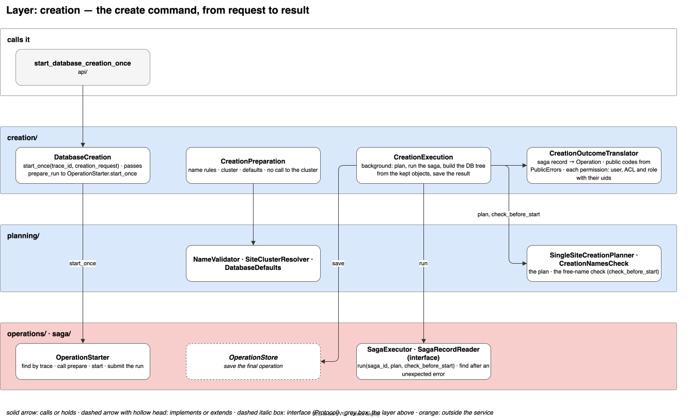
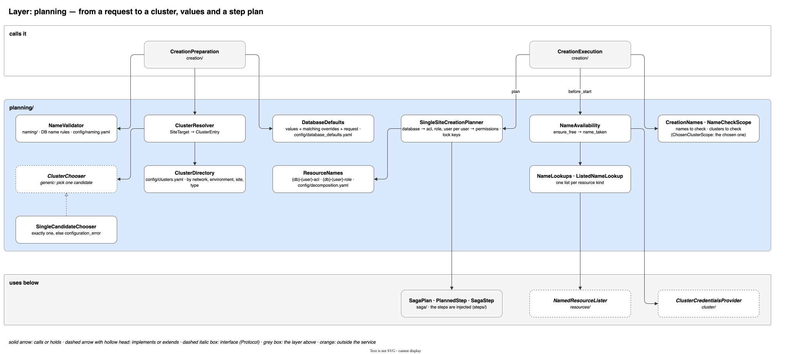
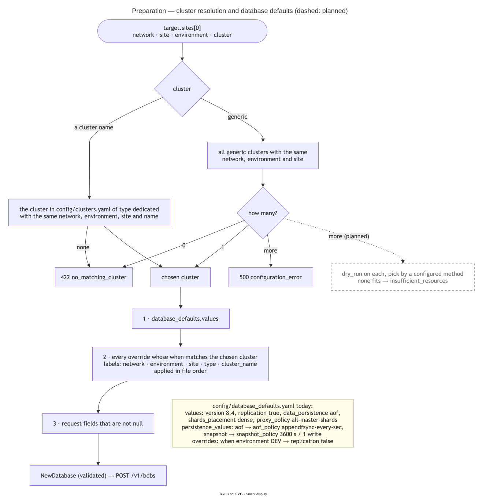
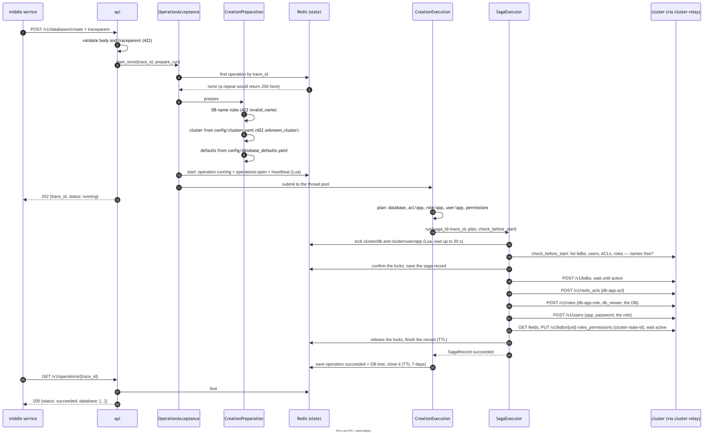
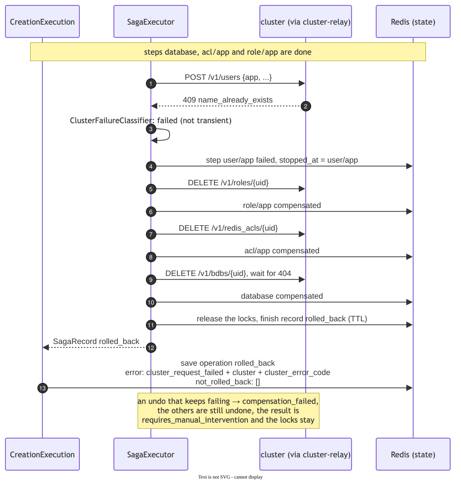

# יצירת DB: איך בקשה רצה

מה קורה מרגע ש-`POST /v1/databases/create` מגיע ועד שהתוצאה נשמרת. החוזה עצמו (שדות, קודים): `contracts/service-api.md`.
המנוע, ה-Redis וההתאוששות: `saga-engine-and-state.md`.

**בנוי:** יצירה באתר אחד. **לא בנוי:** `planned.md`.

---

## 1. המסלול


```
POST /v1/databases/create
 ├─ ולידציה של הגוף (Pydantic) ו-traceparent           ⇐ 422 מיד
 ├─ OperationStarter.start_once
 │   ├─ יש פעולה לאותו trace?                           ⇐ 200 עם המצב שלה
 │   ├─ CreationPreparation: שם, קלאסטר, ברירות מחדל     ⇐ 422 / 500 מיד
 │   ├─ התחלה אטומית: running + heartbeat
 │   └─ העברה ל-ThreadPoolTaskRunner                          ⇐ 202
 └─ ברקע: CreationExecution
     ├─ SingleSiteCreationPlanner: תוכנית צעדים
     ├─ SagaExecutor: נעילה ⇐ בדיקת שמות פנויים ⇐ צעדים
     └─ CreationOutcomeTranslator: התוצאה ⇐ OperationStore
```

| רכיב | תיקייה | מה הוא עושה |
|---|---|---|
| `DatabaseCreation` | `creation/` | מה שה-route קורא לו: מעביר ל-`OperationStarter.start_once` את ההכנה, שרצה רק אחרי החיפוש לפי trace |
| `OperationStarter` | `operations/` | הסדר המשותף לכל פקודה: חיפוש לפי trace, הכנה, התחלה אטומית, העברה לרקע (`saga-engine-and-state.md` סעיף 8) |
| `CreationPreparation` | `creation/` | כל מה שאפשר לבדוק בלי הקלאסטר |
| `CreationExecution` | `creation/` | הריצה ברקע, עד רשומת הפעולה הסופית |
| `SingleSiteCreationPlanner` | `planning/` | הבקשה ⇐ תוכנית צעדים ומפתחות נעילה |
| `CreationOutcomeTranslator` | `creation/` | ה-saga record ⇐ הפעולה: עץ ה-DB, או השגיאה ומה שלא בוטל |





**נקודת ההרכבה:** `composition/` (`app_wiring.py`, `cluster_wiring.py`, `state_wiring.py`) בונה את כל המחלקות הקונקרטיות. רק `app` מעליה.

---

## 2. ההכנה (לפני `202`)



1. **שם ה-DB** לפי `config/naming.yaml`. אחרת `invalid_name`.
2. **הקלאסטר** (`SiteClusterResolver`) מתוך `config/clusters.yaml`: רשימה שטוחה, ולכל קלאסטר `name`, `network`,
   `environment`, `site`, `type` ו-`api_url`. ההתאמה היא לפי השדות, ולכן אין היררכיה קבועה בין רשת, סביבה ואתר.
   הקונפיג נדחה בעלייה אם `api_url` חוזר, אם הצירוף של `network`, `environment`, `site` ו-`name` חוזר, או אם קלאסטר
   `dedicated` נקרא `generic`. הבקשה שולחת ב-`cluster` את `generic` או שם של קלאסטר `dedicated`:
   - שם: הקלאסטר מסוג `dedicated` עם אותם רשת, סביבה, אתר ושם.
   - `generic`: כל הקלאסטרים ה-generic באותם רשת, סביבה ואתר הם מועמדים, ו-`ClusterChooser` בוחר. המימוש היום,
     `SingleCandidateChooser`, דורש מועמד אחד בדיוק. כמה ⇐ `configuration_error`. בחירה בין כמה: `planned.md`.
   - אין קלאסטר מתאים ⇐ `no_matching_cluster`.
3. **ברירות מחדל** (`DatabaseDefaults`, `config/database_defaults.yaml`):

   ```yaml
   database_defaults:
     values: {version: "8.4", replication: true, data_persistence: aof, ...}
     persistence_values:
       aof: {aof_policy: appendfsync-every-sec}
       snapshot: {snapshot_policy: [{secs: 3600, writes: 1}]}
     overrides:
       - when: {environment: DEV}
         values: {replication: false}
   ```

   - הסדר: `values`, אחריהן כל דריסה שה-`when` שלה מתאים לקלאסטר שנבחר (לפי הסדר ברשימה), ובסוף השדות שהבקשה
     שלחה ולא כ-`null`. התוצאה עוברת ולידציה ב-`NewDatabase`.
   - `when` מתאים לפי כל צירוף של `network`, `environment`, `site`, `type` ו-`cluster_name`.
   - הדריסה היא לפי שדה ברמה העליונה. לשדות של ה-DB אין אובייקטים מקוננים שצריך למזג.
   - **שדות של מצב שמירה:** `aof_policy` שייך ל-`aof` ו-`snapshot_policy` ל-`snapshot`. אחרי המיזוג נקבע
     `data_persistence`. שדות של מצב אחר יוצאים, והשדות של המצב שנבחר מקבלים את `persistence_values` שלו אם הבקשה
     לא שלחה אותם. ב-`disabled` אין אף אחד מהם. בקשה שולחת `aof_policy` או `snapshot_policy` רק יחד עם ה-`data_persistence`
     שלהם, אחרת `422 validation_error`.
   - בעלייה: תווית לא מוכרת, או ערך שלא עובר את `DatabaseOptions`, עוצרים את השירות.

כל מה שבשלב הזה לא נוגע בקלאסטר, ולכן כשל בו הוא תשובה מיידית, ושום דבר לא נשמר.

---

## 3. התוכנית



| # | מפתח | צעד | מה נשלח | ביטול |
|---|---|---|---|---|
| 1 | `database` | `CreateResourceStep` | `POST /v1/bdbs`, ואז המתנה ל-`active` | `DELETE`, ואז המתנה ל-404 |
| 2 | `acl/{user}` | `CreateResourceStep` | `POST /v1/redis_acls` `{name: {db}-{user}-acl, acl}` | `DELETE` |
| 3 | `role/{user}` | `CreateResourceStep` | `POST /v1/roles` `{name: {db}-{user}-role, management: db_viewer, resources: [ה-DB]}` | `DELETE` |
| 4 | `user/{user}` | `CreateResourceStep` | `POST /v1/users` `{name, password, role_uids: [ה-role]}` | `DELETE` |
| 5 | `permissions` | `UpdateDatabaseStep` | `PUT /v1/bdbs/{uid}` עם `roles_permissions`: זוג role ↔ ACL לכל יוזר | `PUT` של הרשימה הקודמת |
| 6 | `read-database` | `ReadDatabaseStep` | `GET /v1/bdbs/{uid}`: ה-DB המלא | אין מה לבטל |

- צעדים 2–4 חוזרים לכל יוזר, לפי הסדר בבקשה. צעד 5 אחד לכל היוזרים, ורק כשיש יוזרים. צעד 6 תמיד אחרון.
- **אובייקט מלא:** כל צעד יצירה שומר את כל מה שהקלאסטר החזיר, ורק אז בודק שכל שדה שנשלח חזר עם ערך (חוץ מ-
  `unreturned_fields` בקונפיג, היום סיסמת היוזר). חסר ערך ⇐ `incomplete_cluster_object`, כישלון ודאי: ה-uid כבר שמור,
  ולכן הביטול מוחק גם את האובייקט הזה וגם כל מה שנוצר לפניו. אובייקט שנמצא לפי שם (תוצאה לא ידועה) נקרא מלא לפי ה-uid.
- **צעד 6** קורא את ה-DB המלא אחרי שההרשאות עליו. כל שדה של מודל היצירה ו-`database.required_fields` (`uid`, `status`,
  `endpoints`) חייב ערך, וכל endpoint חייב `endpoint_fields` (`dns_name`, `port`, `addr`). אחרת ⇐ אותו כישלון ודאי,
  והכל מתבטל.
- **כל קריאה לקלאסטר מחזירה את האובייקט המלא:** יצירה, קריאה לפי uid, רשימה (בלי `fields`), מחיקה, עדכון DB, קריאת
  DB, המתנה ל-action (ה-action האחרון) והמתנה ל-DB פעיל (ה-DB האחרון שנקרא). מי שקורא בוחר מה הוא צריך, כך שראוטים
  אחרים משתמשים באותן קריאות בלי קריאה נוספת. צעד עדכון שומר לביטול רק את השדות שהוא משנה.
- **התוצאה** (`service-api.md` סעיף 5) נבנית רק מהאובייקטים ששמורים ב-saga record: ה-DB מצעד 6, היוזר וה-ACL מתשובות
  היצירה שלהם. הסיסמה היא זו שהקלאסטר קיבל.
- כל הצעדים הפיכים. אין pivot, ולכן כשל ודאי בכל שלב מחזיר את הקלאסטר למצב שלפני הבקשה.
- ה-role נוצר אחרי ה-DB כי `resources` חייב uid של DB קיים, והיוזר אחרי ה-role כי הוא חייב role.
- ה-uids עוברים בין צעדים דרך ה-`StepResults` (`saga-engine-and-state.md` סעיף 3).
- שמות ה-ACL וה-role וה-`management` מ-`config/user_resources.yaml`.
- ביצירת ACL, role ו-user, אם התשובה כוללת `action_uid`, הצעד מחכה ל-`/v1/actions/{uid}` עד `completed`.
- **המתנה בקלאסטר:** כל המתנה קוראת את המצב כל `poll_interval_seconds` עד `timeout_seconds` (`database.wait`,
  `action.wait`), ובודקת פעם אחרונה בדיוק בסוף הזמן. קריאה שנכשלה בשגיאה שבטוח לקרוא אחריה שוב (שירות קצה שלא התחבר
  או לא ענה, 5xx של הקלאסטר, או קוד מ-`cluster_api.transient_error_codes`) נרשמת כ-WARNING, והקריאה חוזרת. כל שגיאה
  אחרת עוצרת את ההמתנה. אם הזמן נגמר ⇐ `cluster_action_timeout`, `database_activation_timeout` או
  `database_deletion_timeout` (בחוזה: `cluster_timeout`). אם אף קריאה לא הצליחה עד סוף הזמן, מדווחת שגיאת הקריאה
  האחרונה במקום ה-timeout, למשל `cluster_unavailable`.
- גוף ה-DB כולל גם `default_user: true`, `authentication_redis_pass` (הסיסמה של `default_user` מ-Secret) ו-`tags`
  (`database.default_tags`). הסיסמה מתווספת רק ברגע השליחה, ולא נכנסת לקלט של הצעד או ל-record.

**שמות.** כל ACL ו-role שייכים ליוזר אחד ב-DB אחד. שם יוזר עם `-` נדחה בולידציה, כי אחרת שתי בקשות שונות יכולות לקבל
אותו שם נגזר (DB `orders` עם יוזר `app-x`, ו-DB `orders-app` עם יוזר `x`).

**נעילה.** מפתחות `{api_url}/database/{db}` ו-`{api_url}/user/{user}` לכל יוזר, לפי כתובת הקלאסטר שנבחר. שמות ה-ACL וה-role נגזרים משם ה-DB, ולכן
הנעילה של ה-DB מכסה אותם.

**בדיקת שמות פנויים** (`CreationNamesCheck`, שמחבר את `NameCheckScope`, `CreationNaming` ו-`NameAvailability`), כ-`check_before_start`: אחרי הנעילה ולפני הצעד הראשון. היא בודקת את ה-DB, ולכל
יוזר את השם שלו ואת שמות ה-ACL וה-role. ל-REST API אין חיפוש לפי שם, ולכן היא שולפת פעם אחת כל סוג משאב (`bdbs`,
`users`, `redis_acls`, `roles`) ומסננת בקוד. היא רצה תחת הנעילה, כי הקלאסטר לא אוכף שם DB ייחודי, ושתי בקשות שבודקות
לפני הנעילה היו עוברות יחד. ההיקף הוא ממשק נפרד (`NameCheckScope`), והמימוש היום (`ChosenClusterScope`)
מחזיר רק את הקלאסטר שנבחר, כך שאפשר להרחיב אותו לקלאסטרים נוספים בלי לשנות את הבדיקה. שם תפוס ⇐ `name_taken`, והנעילה משתחררת.

---

## 4. התוצאה



`CreationExecution` מתרגם כל סוף לרשומת פעולה, ושומר אותה:

| מה קרה | הפעולה |
|---|---|
| ה-Saga הצליח | `succeeded` עם עץ ה-DB (`created_database_result.py`): ה-uids מהתוצאות של הצעדים |
| ה-Saga `rolled_back` או `requires_manual_intervention` | אותו סטטוס, עם `error` של הצעד שעצר (`stopped_at`), ו-`not_rolled_back` |
| שגיאה של הפרויקט לפני שה-Saga התחיל (נעילה, שם תפוס, שגיאת קלאסטר בבדיקת השמות, שגיאה בבניית התוכנית) | `rejected` עם הקוד הציבורי שלה |
| שגיאה (של הפרויקט או לא צפויה) אחרי שה-Saga התחיל | יש record ⇐ כמו בסוף רגיל, מתוך ה-record (record שנשמר כ-`running` ⇐ `requires_manual_intervention`). record שלא נקרא ⇐ `requires_manual_intervention` עם `internal_error` |
| שגיאה לא צפויה לפני שה-Saga התחיל | אין saga record ⇐ `rejected` עם `internal_error` |
| record שאי אפשר לבנות ממנו את התוצאה (למשל uid חסר) | `requires_manual_intervention` עם `internal_error`, בלי `not_rolled_back` |

- **`not_rolled_back`** (`CreationOutcomeTranslator`): כל צעד שנשאר `done`, `unresolved`, `compensating` או
  `compensation_failed`, עם הסוג, השם והקלאסטר מהתוכנית, וה-uid מהתוצאה. ב-`permissions` השם וה-uid הם של ה-DB.
  `last_error` הוא `"<code>: <message>"` של השגיאה האחרונה: של הביטול אם נכשל, אחרת של הצעד, עם הקוד הציבורי.
- **קודים ציבוריים** (`PublicErrors`, `config/operation.yaml`): כל קוד פנימי ממופה לקוד מהחוזה. קוד בלי מיפוי ⇐
  `internal_error` ו-WARNING. `cluster_url` ו-`cluster_error_code` נוספים רק לקודים שב-`public_codes_with_cluster_details`.
- **סדר השמירה:** המנוע משחרר את הנעילה, ורק אחר כך הפעולה נשמרת.

---

## 5. בדיקות מול קלאסטר אמיתי

הזרימה נבדקה מקצה לקצה מול השירות, cluster-relay וקלאסטר מקומי:
- **הצלחה עם שני יוזרים:** חיבור בלי סיסמה ⇐ `NOAUTH`. `default` עם הסיסמה ⇐ `PONG`. יוזר כותב תחת ה-prefix של
  ה-ACL שלו ומקבל `NOPERM` מחוץ לו. יוזר עם ACL קריאה בלבד מקבל `NOPERM` על כתיבה.
- **כשל בכל אחד מחמשת הצעדים** (DB גדול מהקלאסטר, ACL לא חוקי, role ויוזר שנוצרו מבחוץ בזמן הריצה, אחרי בדיקת השמות, ACL שנמחק לפני צעד
  ההרשאות): כל ריצה הסתיימה `rolled_back` עם קוד השגיאה של הקלאסטר, ושום דבר לא נשאר בקלאסטר.
- **מקביליות:** שתי בקשות עם אותו שם DB במקביל ⇐ אחת `succeeded`, השנייה `rejected` עם `name_taken`.
- **אותו trace:** בזמן ריצה, אחרי סיום, עם גוף אחר, ושתיים במקביל: בכל המקרים רצה ריצה אחת.
- **קריסה:** השירות נהרג ב-`kill -9` באמצע צעד ה-DB. pod אחר סימן את הפעולה ואת ה-Saga, והנעילה נשארה.
