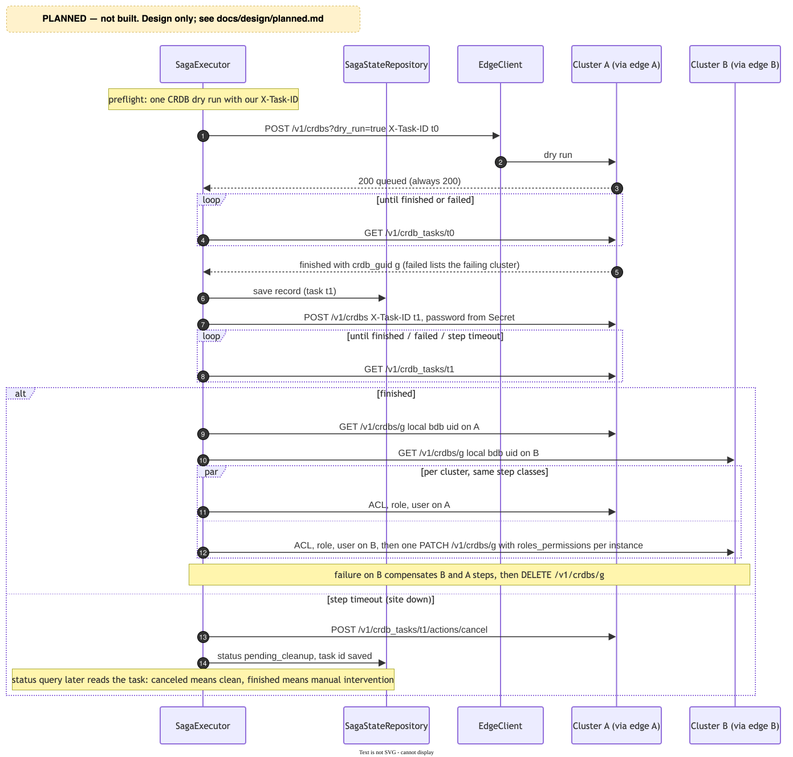
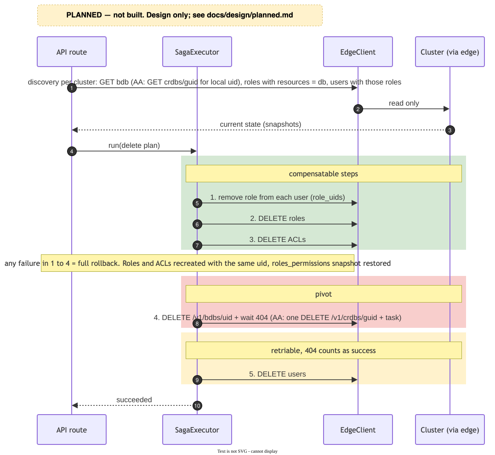
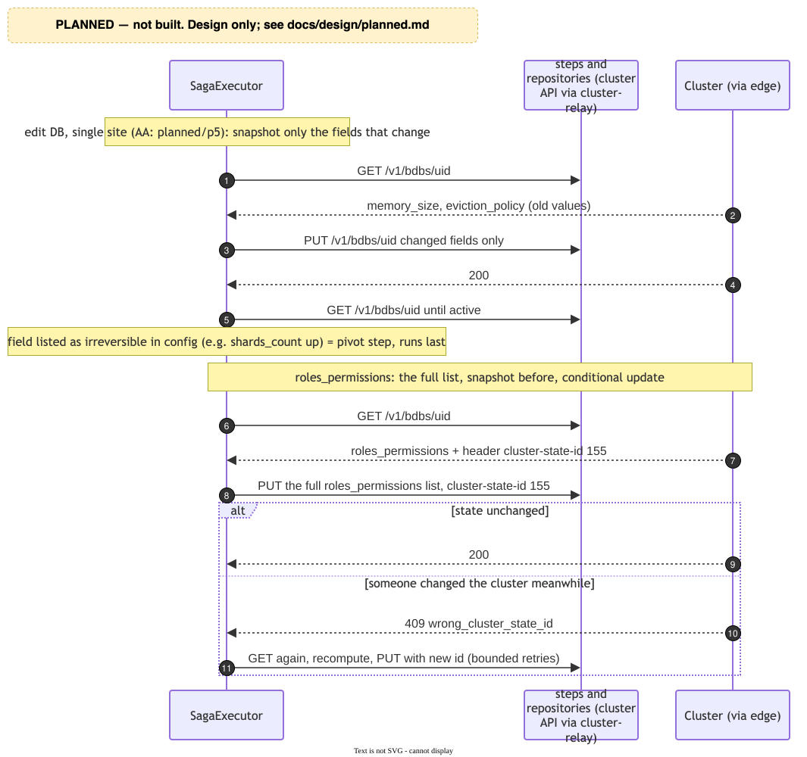
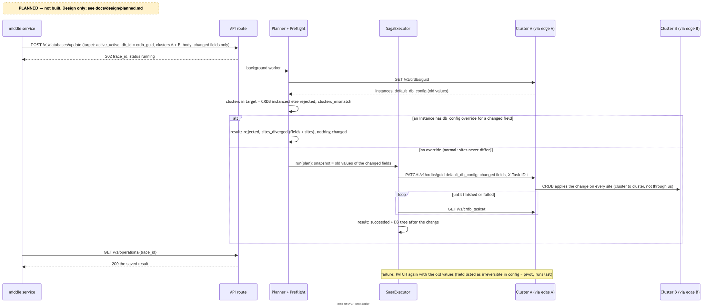
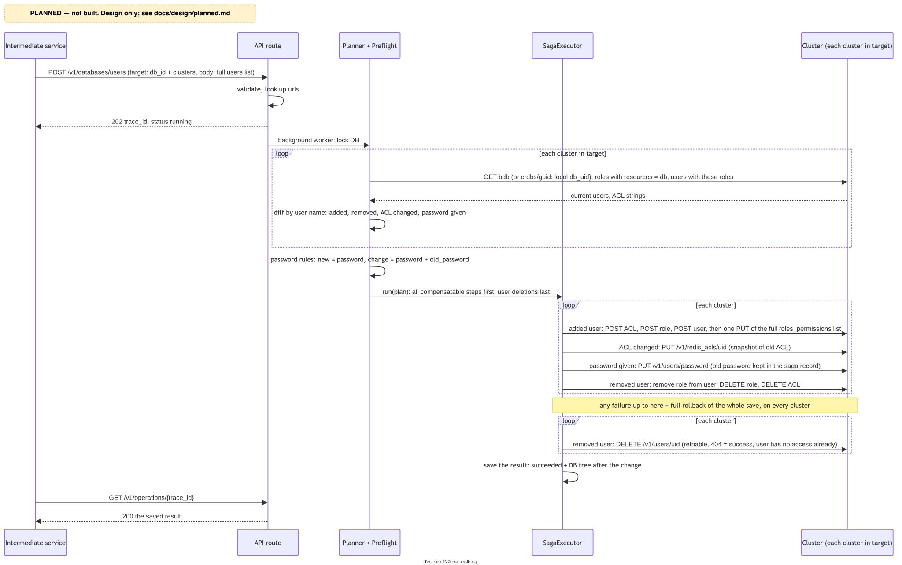
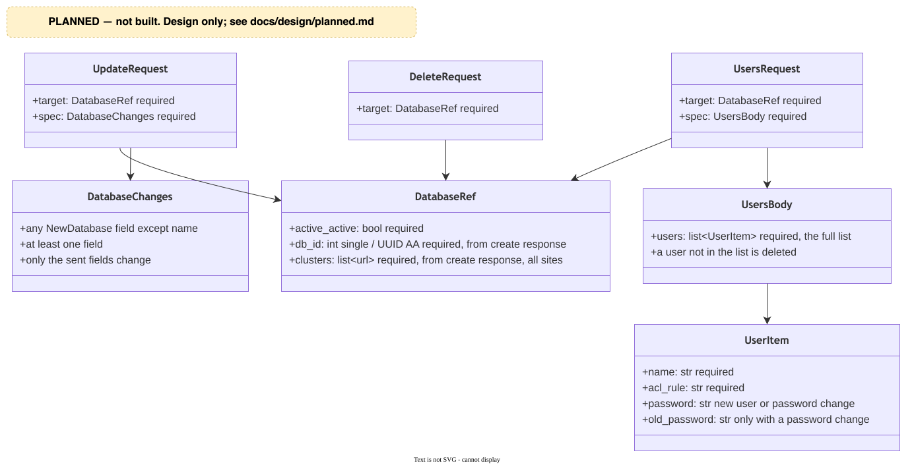

# מתוכנן: מה עוד לא בנוי

כל מה שבמסמך הזה **לא בנוי**. זה העיצוב שהקוד הקיים בנוי לאפשר: המנוע גנרי (pivot וצעדים שניתנים לחזרה כבר נתמכים),
והמשאבים, הצעדים והחוזה עם שירות הקצה משותפים. מה שבנוי: `creation.md` ו-`saga-engine-and-state.md`. העובדות על ה-REST API
של הקלאסטר שהעיצוב נשען עליהן: `redis-rest-api-behaviour.md`.

| נושא | מה חסר |
|---|---|
| בחירת קלאסטר | ב-`generic`, בחירה בין כמה קלאסטרים לפי מקום |
| הזדהות | אין הזדהות מול השירות |
| Active-Active | יצירה, עריכה ומחיקה של CRDB |
| מחיקה | מחיקת DB עם היוזרים שלו |
| עריכה | עריכת DB ועריכת רשימת היוזרים |
| קריאה ישירה לקלאסטר | route שמעביר בקשה כמו שהיא, בלי rollback |
| פרטי גישה לכל קלאסטר | היום פרטי admin אחד לכל הקלאסטרים |

---

## 1. בחירת קלאסטר

היום `SingleCandidateChooser` דורש מועמד `generic` אחד לכל יעד. המימוש הבא מחליף אותו מאחורי אותו ממשק
(`ClusterChooser`):

- **מתאים:** `POST /v1/bdbs?dry_run=1` עם ה-DB המבוקש, על כל מועמד, עם ברירות המחדל שחושבו עבורו. לא יוצר כלום.
  יש מקום ⇐ `200`. אין זיכרון ⇐ `406 insufficient_resources`. חריגה מה-shards של הרישיון ⇐ `400 invalid_license`.
- **איזה מהמתאימים:** שיטה מהקונפיג לכל יעד. **פתוח:** לפי עדיפות, או לפי מקום (הכי פנוי או הכי עמוס). הנתון למקום
  הוא `provisional_memory` מ-`GET /v1/cluster/stats/last`, והוא תואם את תוצאת ה-dry_run.
- **אין מתאים** ⇐ `rejected` עם קוד חדש, `insufficient_resources`.
- **מרוץ:** בקשה אחרת יכולה לתפוס את המקום בין הבדיקה ליצירה. צעד היצירה ייכשל ב-`insufficient_resources`, וה-Saga
  יבוטל כרגיל.
- `ClusterChooser.choose` יקבל גם את ה-DB המבוקש, כדי להריץ את ה-dry_run.

## 2. הזדהות

- שם משתמש וסיסמה (`Authorization: Basic`) מ-Secret, dependency אחד על כל router, אחרת `401 unauthenticated`.
  מעבר לטוקן יחליף רק את ה-dependency.
- השירות לא בודק הרשאות עסקיות. הבקשה כבר אושרה ב-UI, וההזדהות רק מוודאת שהיא הגיעה משירות הביניים.

## 3. Active-Active

**חוזה:** `active_active: true` עם כמה `sites`. `db_id` הוא ה-UUID של ה-CRDB, ו-`clusters[]` כולל קלאסטר לכל אתר.

**יצירה:**

| # | צעד | סוג |
|---|---|---|
| 1 | `POST /v1/crdbs` עם `X-Task-ID` שאנחנו קובעים, המתנה ל-task | הפיך: `DELETE` + task |
| 2 | לכל קלאסטר: איתור ה-bdb המקומי (`GET /v1/crdbs/{guid}` באותו קלאסטר) | קריאה בלבד |
| 3..N | לכל קלאסטר ולכל יוזר: ACL, role עם `resources` של ה-bdb **המקומי**, user | הפיך |
| N+1 | `PATCH` אחד ל-CRDB עם `instances[].db_config.roles_permissions`, רשימה לכל instance | הפיך |

- **אותם צעדים, כמה קלאסטרים:** המפרק פורש כל צעד מקומי לצעד לכל קלאסטר, עם מפתח שמתחיל בקלאסטר. אותה מחלקה, פרמטר
  קלאסטר שונה. כשל באחד מבטל את האחרים כרגיל.
- **כל הערכים ב-`default_db_config`.** `instances[].db_config` לא נשלח (חוץ מההרשאות). ברירות מחדל שנותנות ערך שונה
  לאתרים של אותו CRDB ⇐ שגיאת קונפיג לפני ששום דבר נוצר.
- **שדות שחייבים להיות זהים:** `version`, `sharding`, `shard_key_regex`. מומלץ: `memory_size`, `eviction_policy`,
  `shards_count`, `shards_placement`, `proxy_policy`.
- **בדיקה מראש:** dry_run אחד של CRDB (`POST /v1/crdbs?dry_run=true`). התשובה תמיד `200`, והתוצאה רק ב-task. כשכמה
  אתרים נכשלים, מדווח רק הראשון. **פתוח:** האם לבדוק גם כל אתר בנפרד (ב-generic זה חלק מבחירת הקלאסטר).
- **timeout ביצירה:** task שאתר נפל באמצעו נשאר `started` בלי הגבלה. שולחים cancel (לא `force`), והפעולה מסתיימת
  בסטטוס חדש, `pending_cleanup`. שאילתת הסטטוס קוראת את ה-task: `canceled` ⇐ נוקה, `finished` ⇐ ה-CRDB קיים,
  והפעולה עוברת להתערבות ידנית.
- **נעילה:** את ה-DB בכל קלאסטר משתתף. **פתוח:** האם `PATCH /v1/crdbs` מכבד `cluster-state-id`. עד שייבדק, ההרשאות
  ב-AA נשענות על הנעילה בלבד.
- **tags:** דרך ה-CRDB (`default_db_config.tags`), לא דרך ה-bdb המקומי.
- **השירות שלנו צריך לשלוח `x-task-id` ו-`x-result-ttl`** (החוזה מול שירות הקצה כבר מעביר אותם).
- **הסנכרון בין האתרים** רץ ישירות בין הקלאסטרים, לא דרך cluster-relay. רק הבקשות של השירות עוברות דרכו.

## 4. עריכה ומחיקה: היעד וגילוי

**היעד:** `target: {active_active, db_id, clusters}`, מהתוצאה של היצירה. `db_id` int באתר בודד ו-UUID ב-AA. כתובת
קלאסטר שלא בקונפיג ⇐ `unknown_cluster` מיד. בעריכת יוזרים, סיסמה חסרה או מיותרת לפי הטבלה בסעיף 6 ⇐
`password_rules` מיד (`422`).

**גילוי:** לפני שבונים תוכנית, השירות קורא את המצב הקיים מהקלאסטר. הקלאסטר הוא מקור האמת, לא התוצאה השמורה.
קודים חדשים בסטטוס (`rejected`):

| קוד | מתי |
|---|---|
| `database_not_found` | `db_id` לא נמצא |
| `clusters_mismatch` | `clusters` לא תואם לאתרים של ה-DB |
| `sites_diverged` | ב-AA, אתר שונה מהאחרים בשדה שבעריכה |

## 5. מחיקה

`POST /v1/databases/delete`.

**הכלל: כל מה שהפיך קודם, ומחיקת ה-DB אחרונה.** כשל לפניה מחזיר הכל, והתשובה "המחיקה נכשלה, שום דבר לא השתנה".

| # | צעד | סוג | ביטול |
|---|---|---|---|
| 1 | לכל יוזר: הסרת ה-role מ-`role_uids` | הפיך | החזרת ה-role |
| 2 | מחיקת ה-roles | הפיך | יצירה מחדש עם אותו uid, והחזרת `resources` והזוגות ב-`roles_permissions` |
| 3 | מחיקת ה-ACLs | הפיך | יצירה מחדש עם אותו uid |
| 4 | **מחיקת ה-DB / CRDB** | pivot | - |
| 5 | מחיקת היוזרים | ניתן לחזרה. `404` = הצלחה | - |

- אחרי צעד 4 נשארת רק מחיקת יוזרים, בלי role, ולכן בלי גישה לשום דבר. לא נדרשות סיסמאות.
- **היוזרים של DB** מאותרים דרך ה-role: roles שה-`resources` שלהם מכיל את ה-DB, ויוזרים שה-`role_uids` שלהם כולל אותם.
- role ו-ACL נוצרים מחדש עם אותו uid, ולכן כל הפניה אליהם נשארת תקינה. מחיקה של role או ACL שמחוברים ל-DB מסירה
  את הזוגות שלהם מ-`roles_permissions`. הזוגות נשמרים בצעד 2, לפני מחיקת ה-roles, ומוחזרים בביטול שלו. הביטול רץ
  בסדר הפוך, אז ה-ACLs (צעד 3) כבר קיימים כשה-roles והזוגות חוזרים.

## 6. עריכה

**עריכת DB** (`POST /v1/databases/update`): כל שדה של ה-DB חוץ מ-`name`, לפחות אחד. ברירות מחדל לא מוחלות.

| # | צעד | סוג |
|---|---|---|
| 1 | עדכון השדות ההפיכים | הפיך (`DatabaseUpdate`, כבר בנוי) |
| 2 | עדכון שדות שאי אפשר להחזיר | pivot |

- רשימת השדות שאי אפשר להחזיר תהיה בקונפיג. ידוע היום: הגדלת `shards_count`.
- הקלאסטר דוחה שינויים שהוא לא תומך בהם (למשל הקטנת `shards_count`), והשגיאה שלו חוזרת.
- **AA:** `PATCH /v1/crdbs/{guid}` אחד עם `default_db_config`. לפני כן בודקים שאין override באתר לשדות האלה.

**עריכת יוזרים** (`POST /v1/databases/users`): **הרשימה המלאה** אחרי העריכה. השירות קורא את היוזרים הקיימים ומשווה
לפי שם:

| מה נמצא | צעדים | סוג |
|---|---|---|
| יוזר ברשימה ולא בקלאסטר | ACL, role, user, הרשאה | הפיך |
| `acl` שונה | עדכון ACL | הפיך |
| `password` בבקשה | החלפת סיסמה, עם `old_password` מהבקשה לביטול | הפיך |
| יוזר בקלאסטר ולא ברשימה | הסרת role, מחיקת role ו-ACL, ובסוף מחיקת user | הפיך, והמחיקה האחרונה ניתנת לחזרה |

- כל הצעדים ההפיכים קודם, ומחיקות ה-user בסוף. אין pivot.
- שינוי שם של יוזר = מחיקה והוספה. רשימה זהה למצב בקלאסטר = תוכנית ריקה והצלחה.
- ב-AA ההשוואה נעשית לכל קלאסטר בנפרד, כי ה-ACLs, ה-roles וה-users מקומיים לכל קלאסטר.
- **סיסמאות:** ה-API לא מחזיר סיסמאות, ולכן הסיסמה הישנה מגיעה מהבקשה, נשמרת ב-saga record (היא לא סוד), ומשמשת
  לביטול. חדש: `password` חובה. קיים בלי שינוי: לא נשלח. החלפה: `password` ו-`old_password`.

## 7. קריאה ישירה לקלאסטר

`POST /v1/cluster-requests` עם `{cluster, method, path, body}`. מועבר כמו שהוא דרך אותו client לשירות הקצה, והתשובה של
הקלאסטר חוזרת כמו שהיא. בלי Saga, בלי rollback, בלי הגבלה על method או path. הכתובת חייבת להיות בקונפיג.

## 8. פרטי גישה לכל קלאסטר

היום `SharedCredentialsTargetResolver` נותן את אותם פרטי admin לכל קלאסטר. ספק לכל קלאסטר יחליף אותו מאחורי
`ClusterTargetResolver`, בלי שינוי בצעדים.

---

## שאלות פתוחות

| נושא | שאלה |
|---|---|
| בחירת קלאסטר | לפי עדיפות או לפי מקום? ואם לפי מקום, הכי פנוי או הכי עמוס? |
| CRDB | לבדוק כל אתר בנפרד, בנוסף ל-dry_run של CRDB? |
| שמות יוזרים | איך נאכפת ייחודיות, ואיך כל לקוח מקבל רק את שלו (למשל קידומת לשם)? החלטת מוצר |
| היקף בדיקת השמות | רק הקלאסטר שנבחר (היום), או גם קלאסטרים נוספים באותה רשת וסביבה? |
| שינוי שם של DB | לא הוחלט. אם יתאפשר, גם שמות ה-ACL וה-role שנגזרים ממנו ישתנו |
| התראות | `email_alerts` של ה-DB ושל יוזרים (דלוק כברירת מחדל ביוזר חדש) |

## להמשך בקוד

| מתי | מה |
|---|---|
| כשתהיה תשובת streaming | להחליף את `UnexpectedErrorMiddleware` (על `BaseHTTPMiddleware`) ב-middleware של ASGI טהור |
| כשתופעל שליחת telemetry | להוציא את `/health` מה-traces וה-metrics |
| טיפול ידני ב-Saga | כלי (endpoint או פקודה) במקום `redis-cli` |
