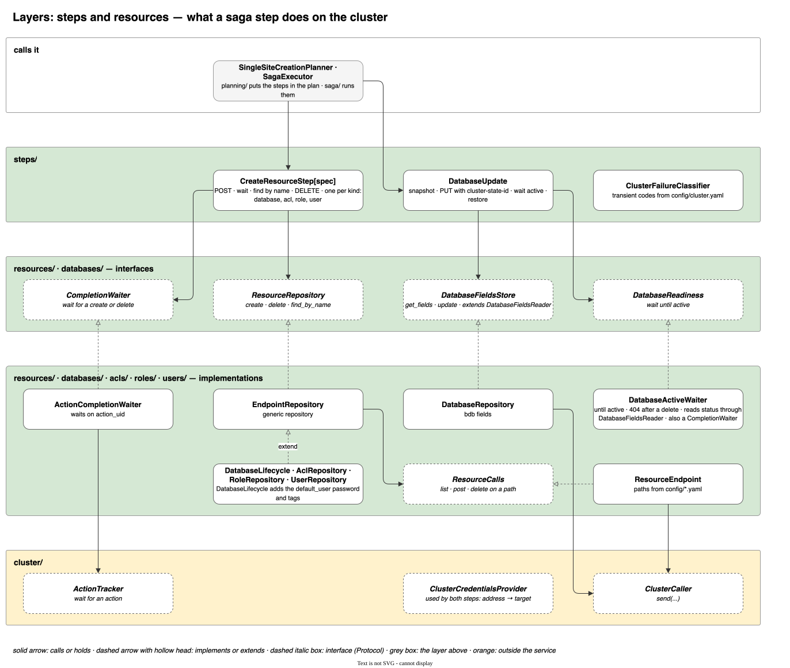
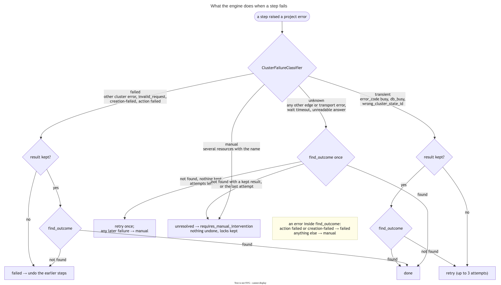
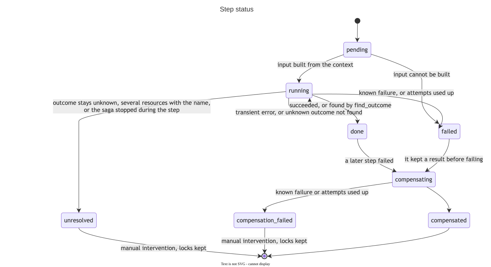
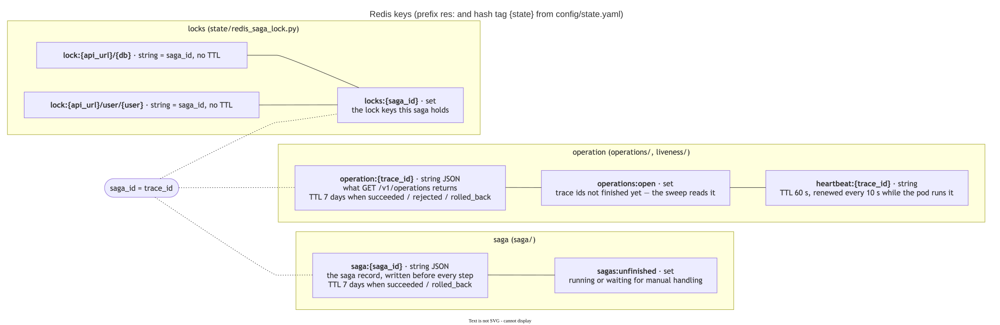
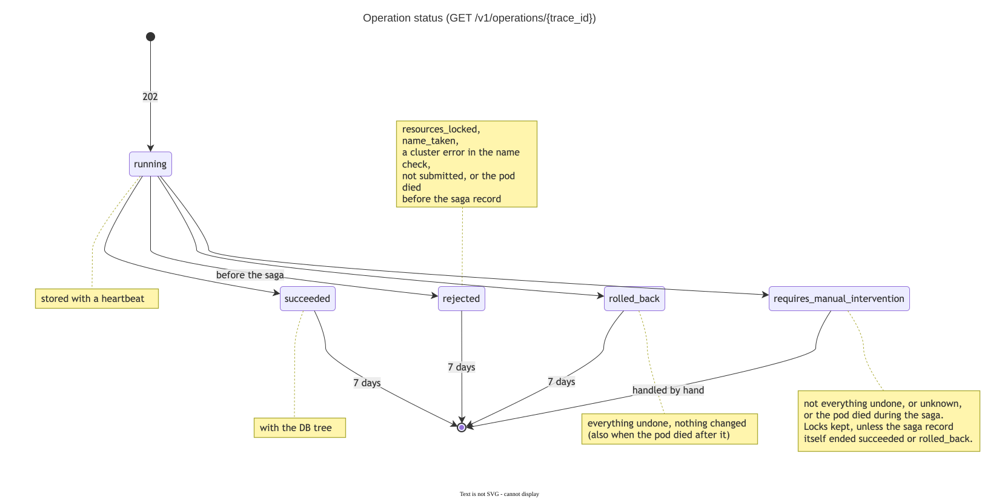
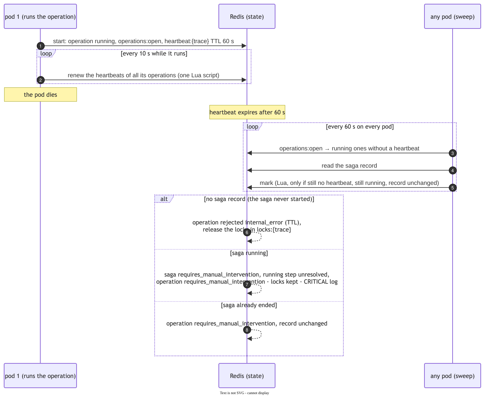
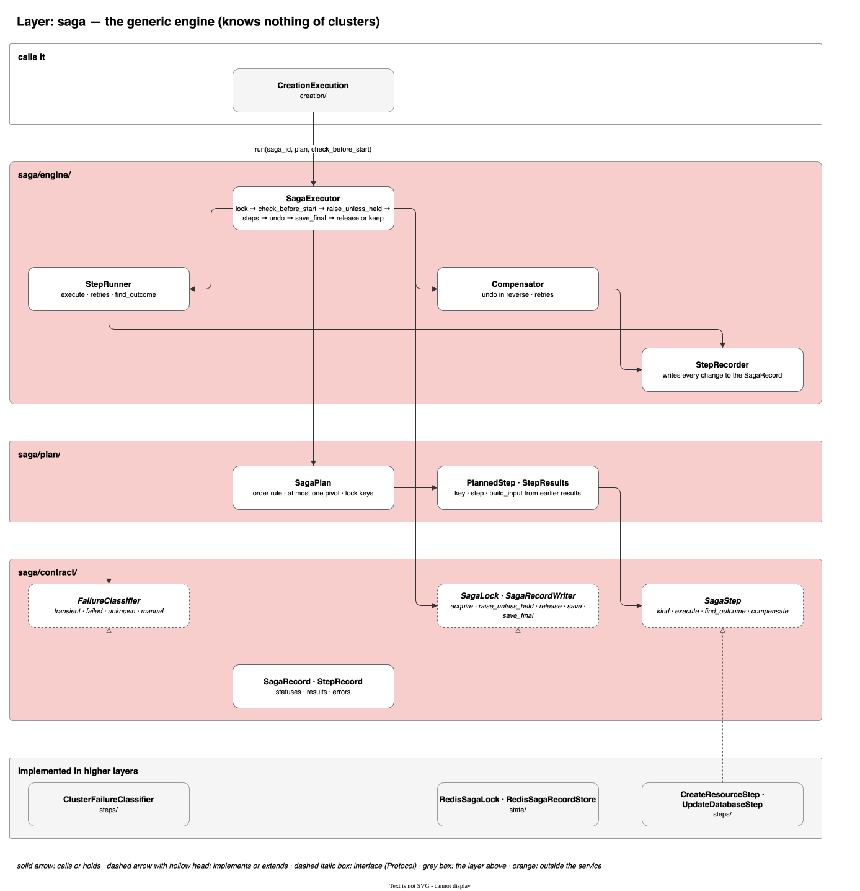
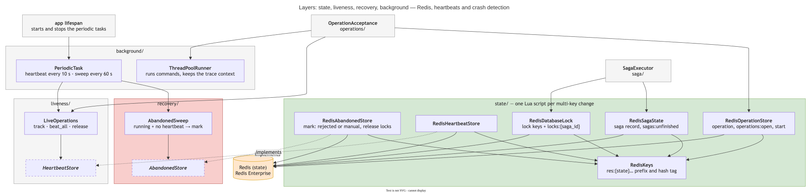

# מנוע ה-Saga, המצב וההתאוששות

איך המנוע מריץ תוכנית של צעדים, מה נשמר ב-Redis, ומה קורה כשמשהו נכשל או ש-pod נופל. מה כל צעד עושה מול הקלאסטר:
`creation.md`. התנהגות ה-REST API של הקלאסטר: `cluster-api.md`.

---

## 1. עקרונות

- **מנוע אחד מריץ את הצעדים (orchestration).** הצעדים לא מכירים זה את זה.
- **המצב נשמר לפני כל פעולה:** ה-saga record נכתב לפני כל צעד, ומיד כשיש תוצאה.
- **סדר קבוע:** צעדים הפיכים, אחריהם לכל היותר pivot אחד, ובסוף צעדים שניתנים לחזרה.
- **ביטול idempotent:** 404 בביטול = כבר בוטל.
- **timeout הוא לא כישלון:** תוצאה לא ידועה מבררים מול הקלאסטר לפני ניסיון חוזר (`find_outcome`).
- **אחרי קריסה לא ממשיכים ולא מבטלים.** הפעולה מסומנת להתערבות ידנית, והנעילה נשארת. לכן אין צורך בספריית
  durable execution (Temporal, Dapr וכו'): החלק שהן פותרות לא נדרש, והמנוע הוא מימוש שלנו.
- **המנוע גנרי.** הוא לא יודע מה זה DB, קלאסטר או יצירה. הוא מכיר רק `SagaStep`, `StepKind`, `SagaPlan` ו-`FailureClassifier`.

---

## 2. החוזה של צעד

```python
class StepKind(StrEnum):
    COMPENSATABLE = "compensatable"
    PIVOT = "pivot"
    RETRIABLE = "retriable"


class SagaStep[TInput: BaseModel, TResult: BaseModel](Protocol):
    @property
    def kind(self) -> StepKind: ...

    def execute(self, *, step_input: TInput, keep_result: KeepResult[TResult]) -> None: ...

    def find_outcome(
        self, *, step_input: TInput, kept: TResult | None, keep_found: KeepResult[TResult]
    ) -> TResult | None: ...

    def compensate(self, *, step_input: TInput, result: TResult) -> None: ...
```

- **תלויות בקונסטרקטור, נתונים ב-`step_input`.** הצעד בלי מצב.
- **`step_input` ו-`result` הם מודלי Pydantic,** ועותק שלהם נשמר ב-record. המנוע מחזיק את האובייקטים בזיכרון; ה-record
  לא נקרא בחזרה כדי להמשיך ריצה.
- **`step_input` מחזיק רק כתובת קלאסטר** (רשת ו-URL), בלי פרטי גישה. הצעד מקבל אותם בזמן הריצה מ-
  `ClusterCredentialsProvider`, ולכן הם לא מגיעים ל-record. היום `SharedCredentialsProvider` נותן את אותם פרטי admin
  לכל קלאסטר.
- **`keep_result`** נקרא ברגע שהתוצאה ידועה, לפני ההמתנה לסיום הפעולה בקלאסטר. צעד שיש לו תוצאה מבוטל גם אם לא הגיע
  ל-`done`. רק ה-`keep_result` הראשון של צעד נשמר, כך שניסיון חוזר לא מחליף snapshot.
- **`find_outcome`** עונה על "האם הפעולה כבר בוצעה?" אחרי תוצאה לא ידועה, ומחזיר את התוצאה אם כן. `None` = לא נמצא.
  הוא מקבל את מה שכבר נשמר (`kept`), כי snapshot של עדכון אי אפשר לבנות מחדש מהקלאסטר. הוא מחזיר תוצאה רק אחרי שהפעולה
  הסתיימה בקלאסטר, כדי שהביטול לא ירוץ במקביל לפעולה שעוד רצה.
- **`keep_found`** נקרא כשנמצא משאב לפי שם, לפני ההמתנה. משאב שנמצא ונכשל בהמתנה (למשל DB ב-`creation-failed`)
  נשאר תוצאה של הצעד ומבוטל.
- **`compensate`** idempotent. אם אין מה לבטל, לא עושה כלום.

**הצעדים שקיימים:**



| צעד | `result` | `find_outcome` | `compensate` |
|---|---|---|---|
| `CreateResourceStep` (DB, ACL, role, user) | `CreatedResource`: `uid`, `name`, `action_uid` | יש תוצאה שמורה ⇐ היא, אחרי המתנה לסיום. אחרת חיפוש לפי שם; יותר ממשאב אחד ⇐ `AmbiguousResourceError`. ACL, role או user שנמצאו לפי שם אין להם `action_uid`, ולכן לא ממתינים להם | `DELETE`, והמתנה ל-`action_uid` אם יש. ב-DB המתנה ל-404 |
| `DatabaseUpdate` (היום: ההרשאות על ה-DB) | snapshot של השדות שמשתנים. שדה שלא מוגדר ב-DB ⇐ `UnrestorableFieldsError` לפני ה-`PUT`, כי אין מה להחזיר. ה-`PUT` נשלח עם `cluster-state-id`, ואחריו המתנה ל-`active` | הערכים בקלאסטר שווים לחדשים ⇐ ה-`kept` | `PUT` של ה-snapshot. אם ה-DB כבר בערכים הישנים, לא עושה כלום |

---

## 3. התוכנית

```python
PlannedStep(key="role/app", step=create_role, build_input=RoleInput(...))
```

- **`build_input`** בונה את הקלט של צעד כשמגיע תורו, מתוך ה-`SagaContext`: מיפוי מ-`key` לתוצאה של כל צעד שכבר רץ.
  כך ה-role מקבל את ה-uid של ה-DB, והיוזר את ה-uid של ה-role. הצעד עצמו לא קורא מה-context.
- **אי אפשר לבנות את הקלט** (למשל תוצאה חסרה) ⇐ הצעד `failed`, ומה שלפניו מבוטל.
- **`SagaPlan` נבדק כשהוא נבנה:** לפחות צעד אחד, מפתחות ייחודיים, כלל הסדר, לכל היותר pivot אחד, ולפחות מפתח נעילה
  אחד. תוכנית שלא עומדת בזה נדחית.

---

## 4. המנוע

`SagaExecutor.run(saga_id, plan, before_start)`:

1. **נועל** את כל מפתחות הנעילה של התוכנית (סעיף 6). תפוס ⇐ מחכה עד `state.lock.wait_timeout_seconds` (30), ואז
   `DatabaseLockedError`.
2. **`before_start`:** בדיקה שהקורא מעביר, אחרי הנעילה ולפני שה-record נשמר. נכשלה ⇐ הנעילה משתחררת והשגיאה עולה,
   ושום צעד לא רץ. ביצירה זו בדיקת השמות הפנויים.
3. **מוודא שהנעילה עדיין שלו** (`DatabaseLock.confirm`). pod שנעצר יותר מ-TTL של ה-heartbeat בזמן הבדיקה מאבד את
   הנעילה לסריקה (סעיף 9). במקרה כזה הוא לא מתחיל, והשגיאה `DatabaseLockedError`.
4. **לכל צעד:** בונה קלט, שומר `running`, מריץ `execute`. הצליח ⇐ `done`. נכשל ⇐ לפי המיון (סעיף 5).
5. **צעד נכשל:** מבטל בסדר הפוך כל צעד `COMPENSATABLE` שיש לו תוצאה.
6. **סוף:** `succeeded`, `rolled_back` או `requires_manual_intervention`. הנעילה משתחררת רק ב-`succeeded` וב-
   `rolled_back`. בהתערבות ידנית היא נשארת, כדי שבקשה אחרת לא תיגע במשאבים במצב חלקי.

**נקודת האל-חזור:** הצעד הראשון שאינו הפיך (pivot, או retriable כשאין pivot). כשל שלו כשהוא לא בוצע מבטל את מה
שלפניו. אחרי שהוא הצליח אין ביטול: כשל ⇐ ניסיונות חוזרים, ואז התערבות ידנית.

| סוג | בכשל של צעד מאוחר יותר | בכשל שלו |
|---|---|---|
| `COMPENSATABLE` | מבוטל בסדר הפוך | ניסיונות, ואז ביטול של מה שלפניו |
| `PIVOT` | לא מבוטל | ניסיונות, ואז ביטול של מה שלפניו. אם שמר תוצאה ⇐ התערבות ידנית |
| `RETRIABLE` | - (בסוף התוכנית) | ניסיונות. אם הוא הראשון שאינו הפיך ולא בוצע ⇐ ביטול של מה שלפניו. אחרת ⇐ התערבות ידנית |

---

## 5. מיון כשלים



המנוע לא מכיר את השגיאות של הקלאסטר. `FailureClassifier` ממיין כל שגיאה לאחת מארבע קטגוריות. המימוש לקלאסטר הוא
`ClusterFailureClassifier` (`steps/failure_classifier.py`):

| קטגוריה | שגיאות | המנוע |
|---|---|---|
| **זמנית** | שגיאת קלאסטר עם `error_code` מ-`cluster.transient_error_codes` (`busy`, `db_busy`, `wrong_cluster_state_id`) | ניסיון חוזר. אם יש תוצאה שמורה, קודם `find_outcome`: נמצא ⇐ `done` |
| **נכשלה** | כל שגיאת קלאסטר אחרת; `invalid_request` של שירות הקצה; DB ב-`creation-failed`; action שהסתיים ב-`failed`; כל שגיאה אחרת של הפרויקט | הצעד `failed` ⇐ ביטול. אם הצעד כבר שמר תוצאה: `find_outcome` קודם. נמצא ⇐ `done`. לא נמצא ⇐ `failed` |
| **לא ידועה** | כל שגיאה אחרת של שירות הקצה או של התקשורת אליו; timeout של המתנה; תשובה שלא נקראת | `find_outcome` פעם אחת. נמצא ⇐ `done`. לא נמצא, אין תוצאה שמורה ונשארו ניסיונות ⇐ ניסיון חוזר אחד, וכל כישלון אחריו ⇐ התערבות ידנית. לא נמצא ויש תוצאה שמורה, או שזה היה הניסיון האחרון ⇐ התערבות ידנית |
| **ידנית** | `AmbiguousResourceError`: כמה משאבים באותו שם | התערבות ידנית מיד, בלי ביטול |

- **שגיאה מתוך `find_outcome`** ממוינת אחרת (`classify_lookup`): רק action שנכשל או DB ב-`creation-failed` הם "נכשלה", ו-`AmbiguousResourceError` ידנית. כל השאר, כולל שגיאת קלאסטר רגילה, `busy` ו-`invalid_request`, ⇐ התערבות ידנית, כי ייתכן שהפעולה בוצעה.
- **אחרי תוצאה לא ידועה, כל מה שאינו הצלחה ⇐ התערבות ידנית.** הבקשה הראשונה אולי עוד תגיע לקלאסטר.
- **"לא נשלח" לא אמין:** חיבור מוצפן שנשבר אחרי השליחה נראה כמו כישלון התחברות. לכן גם שירות קצה שלא זמין הוא
  תוצאה לא ידועה, וה-Saga עובר להתערבות ידנית עם הנעילה, ולא מבטל לבד.
- **pivot או retriable ששמר תוצאה ונכשל ⇐ `unresolved`,** כי אין לו ביטול וההשפעה שלו אולי קיימת.
- **שגיאות של ה-Redis של המצב הן לא שגיאות של הפרויקט.** הן לא נעטפות, כדי שהמנוע לא יבטל וישחרר נעילה כשהוא לא
  יכול לכתוב record. הן עולות, וה-Saga נעצר.

**ניסיונות חוזרים** (`config/saga.yaml`): `step_retry` (3 ניסיונות) לצעדים, `compensation_retry` (5) לביטולים.
ביטול מנסה שוב רק על שגיאה זמנית או לא ידועה. ביטול שנכשל ⇐ `compensation_failed`, והמנוע ממשיך לבטל את השאר, כי כל
ביטול שמצליח מצמצם את מה שנשאר. בסוף: `requires_manual_intervention` ולוג `CRITICAL`.

**זמן מרבי של צעד:** כל ניסיון יכול לחכות ל-action, ואחריו `find_outcome` שגם הוא מחכה. עם 3 ניסיונות: עד 6 המתנות.

### מחזור החיים של צעד



צעד שנשאר `compensating` כשה-Saga נעצר: ייתכן שהביטול שלו בוצע בחלקו. זה שונה מ-`unresolved`, שבו ייתכן שהצעד
עצמו לא רץ.

---

## 6. ה-saga record

| שדה | תוכן |
|---|---|
| `saga_id` | ה-trace id של הבקשה |
| `status` | `running`, `succeeded`, `rolled_back`, `requires_manual_intervention` |
| `stopped_at` | המפתח של הצעד שעצר את ה-Saga, או `null` |
| `steps[]` | `key`, `kind`, `status`, `step_input`, `result`, `obtained_by`, `error`, `compensation_error` |
| `steps[].obtained_by` | `kept` (מ-`execute`) או `found` (מ-`find_outcome`). ביטול של תוצאה `found` נרשם כ-WARNING |
| `steps[].error` | `code` (הקוד שלנו), `message`, `remote_code` (הקוד של הקלאסטר, אם יש) |
| `steps[].compensation_error` | השגיאה האחרונה של הביטול, בנפרד מ-`error` |

**סודות לא נכנסים ל-record:** הסיסמה של `default_user` מתווספת לגוף רק ברגע השליחה, ופרטי הגישה לקלאסטר לא חלק מהקלט.
תוצאה של יצירה היא רק `uid`, `name` ו-`action_uid`, כי תשובות ה-bdb כוללות סיסמאות בטקסט גלוי. סיסמאות של יוזרי DB
כן נכנסות: הן לא סוד, והלקוח רואה אותן ב-UI.

---

## 7. Redis



ה-Redis של המצב הוא Redis Enterprise של צוות אחר, ונחשב זמין. אין טיפול בנפילה שלו.

**מפתחות.** כולם נבנים במקום אחד (`RedisKeys`) עם prefix ו-hash tag מהקונפיג (`res:` ו-`{state}`). ה-prefix נדרש כי
ה-ACL של המשתמש מתיר רק אותו. ה-hash tag שם את כל המפתחות באותו slot, כדי שהסקריפטים יעבדו גם ב-DB עם כמה shards.

| מפתח | סוג | תוכן | TTL |
|---|---|---|---|
| `res:{state}saga:{saga_id}` | JSON | ה-saga record | 7 ימים אחרי `succeeded` או `rolled_back`. אחרת בלי |
| `res:{state}sagas:unfinished` | set | Sagas שעוד רצים או מחכים לטיפול ידני. אינדקס לטיפול ידני | |
| `res:{state}lock:{cluster}/{db}` | string | ה-`saga_id` שמחזיק בנעילה | בלי |
| `res:{state}lock:{cluster}/user/{user}` | string | כנ"ל, לכל יוזר שהפקודה יוצרת | בלי |
| `res:{state}locks:{saga_id}` | set | מפתחות הנעילה שה-Saga מחזיק. מתמלא בנעילה ומתרוקן בשחרור | בלי |
| `res:{state}operation:{trace_id}` | JSON | הפעולה, כפי ששאילתת הסטטוס מחזירה אותה | 7 ימים ב-`succeeded`, `rejected`, `rolled_back`. אחרת בלי |
| `res:{state}operations:open` | set | פעולות שעוד לא הסתיימו, לזיהוי קריסה | |
| `res:{state}heartbeat:{trace_id}` | string | קיים כל עוד ה-pod שמריץ את הפעולה חי | 60 שניות, מתחדש כל 10 |

**סקריפטי Lua.** כל שינוי שנוגע ביותר ממפתח אחד הוא סקריפט אחד:

| סקריפט | מה הוא עושה |
|---|---|
| נעילה | נועל את כל המפתחות, או אף אחד אם אחד תפוס, ומוסיף אותם ל-`locks:{saga_id}` |
| שחרור | מוחק רק מפתחות שה-`saga_id` שלו מחזיק, ומוציא אותם מ-`locks:{saga_id}` |
| שמירת record | כותב את ה-record, ומעדכן את `sagas:unfinished` ואת ה-TTL לפי הסטטוס |
| התחלת פעולה | אם יש רשומה לאותו trace, מחזיר אותה ולא כותב. אחרת כותב `running`, מוסיף ל-`operations:open` ויוצר heartbeat |
| שמירת פעולה | כותב את הפעולה, ומעדכן את `operations:open` ואת ה-TTL |
| heartbeat | מחדש את המפתחות של כל הפעולות של ה-pod |
| סימון נטושה | סעיף 9 |

**חיבור:** `redis-py` סינכרוני, עם שם משתמש וסיסמה. קונפיג ב-`config/state.yaml`, והסיסמה רק מ-`RES_STATE__PASSWORD`.
המשתמש צריך `+@all -@dangerous +info ~res:*`.

---

## 8. רשומת הפעולה



הפעולה (`operations/`) נפרדת מה-saga record. `rejected` (לפני שה-Saga התחיל) ועץ ה-DB הם לא מושגים של ה-Saga, וכך
המנוע נשאר גנרי.

| `status` של הפעולה | מאיפה |
|---|---|
| `running` | נשמר כשהבקשה מתקבלת |
| `rejected` | שגיאה לפני שה-Saga התחיל: נעילה תפוסה, שם תפוס, כישלון בהעברה לרקע, או קריסה לפני שה-Saga התחיל |
| `succeeded`, `rolled_back`, `requires_manual_intervention` | הסטטוס של ה-Saga |

**`OperationAcceptance.admit`**, משותף לכל פקודה:
1. חיפוש לפי trace. קיימת ⇐ מוחזרת כמו שהיא (`200`).
2. ההכנה של הפקודה, בלי שינוי בקלאסטר. נכשלה ⇐ תשובה מיידית, ושום דבר לא נשמר.
3. התחלה אטומית (Lua). רשומה שנוצרה בינתיים ⇐ מוחזרת, ושום דבר לא נשלח לרקע.
4. העברה ל-`TaskRunner`. נכשלה ⇐ הפעולה נשמרת `rejected` עם `internal_error`.

הפעולה נשמרת כ-`running` לפני ההעברה לרקע, כך ששאילתת הסטטוס מוצאת אותה מיד, וריצה מהירה לא נדרסת.

**שגיאה לא צפויה (באג) גם מסיימת את הפעולה,** והפרטים בלוג:
- לפני שה-Saga התחיל (אין record) ⇐ `rejected` עם `internal_error`.
- אחרי שהתחיל ⇐ הפעולה נבנית מה-saga record שנשמר, כמו בסוף רגיל: הסטטוס שלו, ה-`error` של הצעד שעצר (למשל
  `step_rejected`, אם הבאג קרה באמצע ביטול), ו-`not_rolled_back`. אם אין לצעד שעצר שגיאה ⇐ `internal_error`.
- record שלא נקרא ⇐ `requires_manual_intervention` עם `internal_error`.

**הרצה ברקע:** `ThreadPoolRunner`, בגודל `background.max_workers`. מעביר את ה-context (ה-trace ממשיך בלוגים ובקריאות
לשירות הקצה), ורושם `CRITICAL` על כל שגיאה שיצאה ממשימה. בכיבוי מחכה לריצות שהתחילו ומבטל את אלה שבתור. הן נשארות
`running`, וזיהוי הקריסה מסמן אותן.

---

## 9. heartbeat וזיהוי קריסה



**heartbeat.** סקריפט ההתחלה של פעולה כותב גם `heartbeat:{trace_id}`, כך שאין רגע שבו פעולה פתוחה בלי heartbeat, גם
כשהיא מחכה בתור. `LiveOperations` (`liveness/`) רושם את הפעולה של ה-pod, ו-thread אחד (`PeriodicTask`) מחדש את המפתחות של
כל הפעולות שלו בסקריפט אחד. כשהמשימה מסתיימת, גם בשגיאה, המפתח נמחק. החידוש והמחיקה רצים תחת אותה נעילה, כך שחידוש
לא מחזיר מפתח שנמחק. הקונפיג (`config/liveness.yaml`) דורש לפחות `min_beats_per_ttl` (3) חידושים בתוך TTL אחד.

**הסריקה.** כל pod מריץ `AbandonedSweep` (`recovery/`) כל `sweep_interval_seconds` (60). הסריקה הראשונה רצה אחרי
מרווח אחד, לא בעלייה. היא לוקחת מ-`operations:open` פעולות ב-`running` בלי heartbeat, קוראת את ה-saga record של כל
אחת, ומסמנת אותה בסקריפט אחד. הסקריפט כותב רק אם ה-heartbeat עדיין חסר, הפעולה עדיין `running`, וה-record עדיין
אותה מחרוזת בדיוק שנקראה. השוואה למחרוזת הגולמית, ולא ל-record שנבנה ממנה, כדי ש-record מגרסה קודמת לא ייתקע.
record שהשתנה בינתיים ⇐ WARNING, והסריקה הבאה תבדוק שוב.

| מה נמצא | מה מסומן |
|---|---|
| אין saga record (ה-Saga לא התחיל) | הפעולה `rejected` עם `internal_error`, עם TTL, ויוצאת מ-`operations:open`. הנעילות שב-`locks:{saga_id}` משתחררות, אם הן עדיין שלו. כך pod שנפל בין הנעילה לשמירת ה-record לא משאיר שמות נעולים |
| ה-Saga `running` | ה-Saga `requires_manual_intervention`, וצעד שרץ ⇐ `unresolved`. הפעולה `requires_manual_intervention` עם `internal_error`. לוג `CRITICAL`. **הנעילה נשארת** |
| ה-Saga כבר הסתיים (הקריסה הייתה לפני שמירת הפעולה) | הפעולה `requires_manual_intervention`. ה-record לא משתנה |

**מקרים ידועים:**
- **pod שנעצר יותר מ-60 שניות ואז ממשיך** (GC, הקפאת מכונה): מסומן כאילו מת.
  - נעצר אחרי הנעילה ולפני `confirm`: הנעילות שלו שוחררו, והוא לא מתחיל. נעצר בין `confirm` לשמירה הראשונה של
    ה-record (שתי קריאות Redis רצופות): הוא מריץ את ה-Saga בלי נעילה.
  - נעצר לפני הנעילה: הפעולה כבר סומנה `rejected` ויצאה מ-`operations:open`, אבל הוא נועל ומריץ את ה-Saga, והתוצאה
    הסופית דורסת את הסימון. אם הוא גם קורס באמצע ה-Saga, הסריקה כבר לא תגיע אליו, והנעילה נשארת עד טיפול ידני.
  - נעצר אחרי שה-Saga התחיל: הוא ממשיך, והתוצאה הסופית דורסת את הסימון.
  עצירה של יותר מ-60 שניות גבוהה בכמה סדרי גודל מעצירה רגילה, ולכן אין לזה מנגנון נוסף.
- **Saga שהצליח, והשמירה האחרונה שלו נכשלה:** הנעילה שוחררה, וה-record נשאר `running`. הסריקה תסמן אותו. מי שבודק ימצא
  שכל הצעדים `done`.

---

## 10. שחרור ידני

1. קוראים את `res:{state}saga:{saga_id}`: אילו צעדים `done`, איזה `unresolved` או `compensation_failed`, ומה הקלט
   והתוצאה שלהם.
2. בודקים בקלאסטר מה קיים לפי השמות שבקלט, ומשלימים או מוחקים ידנית.
3. מוחקים את מפתחות הנעילה של ה-`saga_id` (הרשימה ב-`locks:{saga_id}`) ואת ה-set, רק כשהקלאסטר במצב נקי או מלא.
4. מוציאים את ה-trace מ-`sagas:unfinished` ומ-`operations:open`, ומעדכנים את `operation:{trace_id}` לתוצאה.

אין עדיין כלי לזה. זה נעשה ב-`redis-cli` של מי שמורשה.

---

## 11. מבנה הקוד





| תיקייה | מה יש בה | מייבאת |
|---|---|---|
| `saga/contract/` | `SagaStep`, `StepKind`, `KeepResult`, `Failure`, `FailureClassifier`, `DatabaseLock`, `SagaStateRepository`, `SagaRecordReader`, ה-record | כלום מתוך `plan` או `engine` |
| `saga/plan/` | `SagaPlan`, `PlannedStep`, `RunnableStep`/`PreparedStep`, `SagaContext` | `contract` |
| `saga/engine/` | `SagaExecutor`, `StepRunner`, `Compensator`, `StepRecorder` | `contract`, `plan` |
| `operations/` | `Operation`, `OperationStore`, `OperationAcceptance`, `PublicErrors` | |
| `liveness/` | `LiveOperations`, `HeartbeatStore` | |
| `recovery/` | `AbandonedSweep`, `AbandonedStore` | |
| `state/` | המימושים ב-Redis של כל הממשקים | |

`saga/` לא מייבאת שום שגיאה של הקלאסטר או של שירות הקצה. כיווני הייבוא בין כל השכבות נאכפים ב-`import-linter`
(`pyproject.toml`), שרץ ב-pre-commit.
