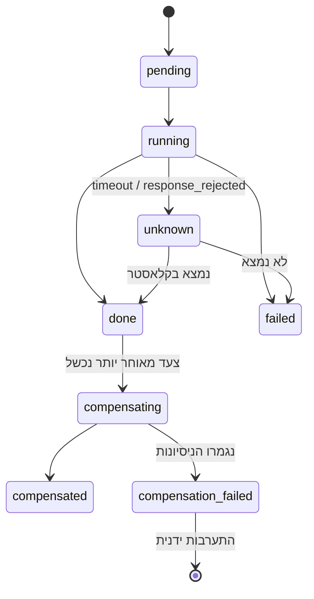
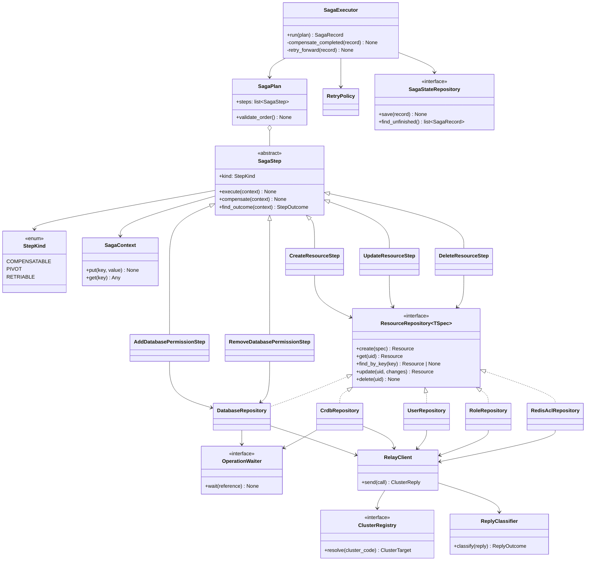

# תכנון: שכבת ה-Saga ומה שמתחתיה

**סטטוס:** טיוטה לדיון
**תאריך:** 2026-10-20
**מקור הנתונים:** `docs/reference/redis-rest-api/` (Redis Software, גרסת latest)

המסמך מתאר איך כל פעולה על כל משאב מתבצעת, ואיך מבטלים אותה. הוא לא עוסק בשכבת הכניסה (routes) ולא
בשדות שה-UI שולח. אלה ייקבעו במסמך האפיון.

---

## 1. איך בקשה עוברת במערכת

```
בקשה
 └─ 1. תרגום    : קוד קלאסטר ⇐ כתובת API, שירות קצה, FQDN, פרטי גישה
 └─ 2. גילוי     : קריאת המצב הקיים בקלאסטר (GET), רק בעריכה ובמחיקה
 └─ 3. פירוק     : המפרק בונה תוכנית: רשימת צעדים מסודרת
 └─ 4. בדיקה מוקדמת: התנגשויות שמות ו-dry_run, בלי שום שינוי בקלאסטר
 └─ 5. הרצה      : מנוע ה-Saga מריץ את הצעדים, ובכשל מבטל או ממשיך קדימה
```

שלבים 2 ו-4 לא משנים כלום בקלאסטר. רוב הכשלים הצפויים, כמו שם תפוס או קונפיגורציה לא חוקית, נתפסים בהם,
עוד לפני שנוצר משהו שצריך לבטל.

**dry_run:** קיים ביצירה ובעריכה של `bdbs`, `users`, `roles`, `redis_acls` ו-`crdbs`. הוא בודק את הבקשה מול
הקלאסטר בלי לבצע אותה. מגבלה: צעד שתלוי בתוצאה של צעד קודם (למשל יוזר שמקבל `role_uids` של role שעוד לא
נוצר) לא ניתן לבדיקה ב-dry_run מראש.

---

## 2. מושגים

| מושג | הגדרה |
|---|---|
| **תוכנית (Plan)** | רשימה מסודרת של צעדים שהמפרק בונה מבקשה אחת |
| **צעד (Step)** | פעולה אחת מול קלאסטר אחד, ויחד איתה הדרך לבטל אותה |
| **הקשר (Context)** | מקום שבו צעד שומר תוצאות (uid, guid, snapshot) לצעדים שאחריו ולפיצוי שלו |
| **Snapshot** | המצב של משאב לפני שצעד שינה אותו. נלקח ב-GET בתוך הצעד, ממש לפני השינוי. |
| **Saga record** | הרישום של ריצה: הבקשה (בלי סיסמאות), הצעדים, הסטטוס של כל צעד, ה-snapshots וה-uids שנוצרו |

### שלושה סוגי צעדים

| סוג | מה מאפיין אותו | מה עושים בכשל |
|---|---|---|
| **הפיך (Compensatable)** | יש לו פיצוי שמחזיר את המצב הקודם | מבטלים אותו בסדר הפוך |
| **נקודת אל-חזור (Pivot)** | אי אפשר לבטל אותו: מחיקת נתונים, החלפת סיסמה שלא ידועה | אין פיצוי. אחריו ה-Saga רק ממשיך קדימה. |
| **ניתן לחזרה (Retriable)** | בא אחרי ה-pivot, ומובטח שיצליח אם מנסים שוב (idempotent) | חוזרים עליו עד שמצליח. אם הניסיונות נגמרו, הפעולה מסומנת להתערבות ידנית. |

**כלל הסדר:** כל הצעדים ההפיכים קודם, אחריהם לכל היותר pivot אחד, ובסוף צעדים שניתנים לחזרה. המנוע בודק
את הכלל הזה כשהוא מקבל תוכנית, ודוחה תוכנית שלא עומדת בו.

### מחזור החיים של צעד



---

## 3. תוצאה לא ידועה

ייתכן שצעד נכשל מבחינתנו, אבל בוצע בפועל בקלאסטר:
- timeout אחרי שהבקשה נשלחה.
- `response_rejected` של cluster-relay על פעולת כתיבה.

**הפתרון:** לכל משאב יש מפתח זיהוי דטרמיניסטי (שם או email), ולכל repository יש `find_by_key`. כשהתוצאה לא ידועה,
המנוע מאתר את המשאב לפי המפתח:
- **נמצא:** הצעד נחשב הצליח, וה-uid נלקח מהרשומה שנמצאה.
- **לא נמצא:** הצעד נחשב נכשל.

**ל-REST API של Redis אין חיפוש לפי שם.** `find_by_key` שולף את **כל** הרשימה של אותו סוג משאב, ומסנן אותה
בקוד שלנו לפי המפתח. ב-`bdbs` הפרמטר `fields` רק מצמצם את השדות שחוזרים לכל DB. הוא לא מסנן את הרשימה. שליפת
הרשימה המלאה מתבצעת רק כשהתוצאה לא ידועה, כלומר לעיתים רחוקות.

| משאב | מפתח | שליפה | סינון בקוד שלנו |
|---|---|---|---|
| ACL | `name` | `GET /v1/redis_acls` | `name` שווה למפתח |
| Role | `name` | `GET /v1/roles` | `name` שווה למפתח |
| User | `email` (הקלאסטר אוכף ייחודיות: `email_already_exists`) | `GET /v1/users` | `email` שווה למפתח |
| DB | `name` (הפונה אחראי לייחודיות, ראו 5.4) | `GET /v1/bdbs?fields=uid,name` | `name` שווה למפתח |
| CRDB | מזהה task שאנחנו קובעים (`X-Task-ID`), ובנוסף `name` | `GET /v1/crdb_tasks/{id}` (שליפה ישירה לפי מזהה). אם ה-task לא נמצא: `GET /v1/crdbs` | `name` שווה למפתח |

**CRDB:** `X-Task-ID` מאפשר לנו לבחור את מזהה ה-task. בקשה חוזרת עם אותו מזהה מחזירה את אותו task, ולא
יוצרת CRDB שני (לאמת, ראו סעיף 11). ברירת המחדל לשמירת תוצאת task היא 500 שניות, ולכן נשלח
`X-Result-TTL` ארוך יותר.

---

## 4. פעולות אסינכרוניות

| פעולה | איך יודעים שהסתיימה |
|---|---|
| יצירה ועדכון של DB | `status` חוזר ל-`active` (בזמן הפעולה: `pending`, `active-change-pending`). התשובה כוללת גם `action_uid` (V3). נמדד: 2–6 שניות. |
| מחיקת DB | `status: delete-pending`, ואז `404`. נמדד: כ-4 שניות. |
| ACL, role | אם התשובה כוללת `action_uid`, ממתינים ב-`/v1/actions/{action_uid}` |
| CRDB, כל פעולה | `GET /v1/crdb_tasks/{task_id}` עד `finished` או `failed`. ב-`failed` יש `errors` לכל קלאסטר. |

ההמתנה היא חלק מהצעד: צעד לא נחשב `done` לפני שהפעולה הסתיימה בקלאסטר. הזמנים (מרווח בדיקה, timeout)
מוגדרים בקונפיגורציה.

**409 busy:** DB שנמצא באמצע שינוי אחר מחזיר `409`. זה מצב זמני, ולכן הצעד מנסה שוב לפי מדיניות ה-retry,
ולא נכשל מיד.

---

## 5. כל משאב, כל פעולה, ואיך מבטלים

סימונים: ✅ הפיך במלואו · ⚠️ הפיך חלקית · ⛔ לא הפיך (pivot)

### 5.1 Redis ACL

| פעולה | API | Snapshot לפני | ביטול | הפיכות |
|---|---|---|---|---|
| יצירה | `POST /v1/redis_acls` `{name, acl}` | - | `DELETE /v1/redis_acls/{uid}` | ✅ |
| עריכה | `PUT /v1/redis_acls/{uid}` | `GET`: `name`, `acl` (הכל קריא) | `PUT` עם ה-snapshot | ✅ |
| מחיקה | `DELETE /v1/redis_acls/{uid}` | `GET`: `name`, `acl`, **וכל זוגות `roles_permissions` שמפנים אליו בכל DB** | `POST` עם ה-snapshot **כולל `uid`**, ואז החזרת הזוגות | ✅ |

- ACLs מובנים (למשל `Full Access`) הם read-only: עריכה או מחיקה שלהם מחזירה `409`. המפרק לא בונה צעד כזה.
- **יצירה מחדש עם אותו uid עובדת** (נבדק מול הקלאסטר).
- **מחיקה של ACL שמחובר ל-DB מצליחה, והקלאסטר מסיר בעצמו את הזוגות שלו מ-`roles_permissions`** (V1b). לכן
  הביטול חייב להחזיר גם את הזוגות, ולא רק את ה-ACL.

### 5.2 Role

| פעולה | API | Snapshot לפני | ביטול | הפיכות |
|---|---|---|---|---|
| יצירה | `POST /v1/roles` `{name, management, resources: [{type: db, uids: [DB]}]}` | - | `DELETE /v1/roles/{uid}` | ✅ |
| עריכה | `PUT /v1/roles/{uid}` | `GET`: `name`, `management`, `resources` | `PUT` עם ה-snapshot | ✅ |
| מחיקה | `DELETE /v1/roles/{uid}` | `GET`: כל השדות שאפשר לכתוב, **וכל זוגות `roles_permissions` שמפנים אליו** | `POST` עם ה-snapshot **כולל `uid`**, ואז החזרת הזוגות | ✅ |

- **יצירה מחדש עם אותו uid עובדת** (נבדק מול הקלאסטר). לכן `role_uids` של יוזרים ו-`roles_permissions` של DBs
  נשארים תקינים.
- **`resources` מגביל את הגישה הניהולית (UI ו-REST API)** של role מסוג `db_member` או `db_viewer` ל-DBs
  מסוימים. בלי השדה, ה-role חל על כל ה-DBs. לכן ה-role נוצר אחרי ה-DB, עם ה-uid שלו. זה נפרד מ-`roles_permissions`
  (5.6), שקובע את הגישה לנתונים.
- **`resources` ריק מול חסר:** `uids: []` פירושו אף DB, ושדה שחסר לגמרי פירושו כל ה-DBs (נבדק). כשמוחקים DB,
  הקלאסטר מסיר אותו בעצמו מ-`resources` של ה-roles, וה-role נשאר בלי גישה (V9).
- **role עם `resources` של DB שלא קיים נדחה:** `404 db_not_found`. לכן ה-role נוצר רק אחרי שה-DB קיים.
- **מחיקה של role שמחובר ל-DB מצליחה, והזוגות שלו נמחקים מ-`roles_permissions`** (V1b), כמו ב-ACL.
- **role שיוזר משתמש בו לא נמחק:** הקלאסטר מחזיר `406 role_in_use` (נבדק). במחיקה, קודם מוחקים את היוזר,
  או מסירים ממנו את ה-role.

### 5.3 User

| פעולה | API | Snapshot לפני | ביטול | הפיכות |
|---|---|---|---|---|
| יצירה | `POST /v1/users` `{email, name, password, role_uids, auth_method}` | - | `DELETE /v1/users/{uid}` | ✅ |
| עריכה (בלי סיסמה) | `PUT /v1/users/{uid}` | `GET`: `name`, `email`, `role_uids`, `email_alerts`, `bdbs_email_alerts`, `auth_method` | `PUT` עם ה-snapshot | ✅ |
| החלפת סיסמה | `PUT /v1/users/password` | **הסיסמה הישנה לא קריאה מה-API.** ה-UI שולח אותה בבקשה. | `PUT /v1/users/password` עם הסיסמה הישנה | ✅ |
| מחיקה | `DELETE /v1/users/{uid}` | `GET`: כל השדות שאפשר לכתוב. הסיסמה מגיעה מה-UI. | `POST` עם ה-snapshot והסיסמה | ✅ (ה-uid משתנה) |

**הסיסמה הישנה מגיעה מה-UI.** ה-API לא מחזיר סיסמאות, ולכן כשצריך לבטל החלפת סיסמה או מחיקת יוזר, ה-UI
שולח את הסיסמה הנוכחית בבקשה. היא נשמרת **בזיכרון בלבד** לאורך ה-Saga, ולא נכתבת ל-saga record (סעיף 9). אם
השירות קורס לפני שהביטול רץ, אי אפשר להחזיר את הסיסמה, והצעד מסומן להתערבות ידנית.

**חלופה כשה-UI לא שולח את הסיסמה הישנה:** החלפה בשני צעדים, בעזרת התמיכה בכמה סיסמאות ליוזר (`/v1/users/password`):

| # | צעד | סוג | ביטול |
|---|---|---|---|
| 1 | `POST /v1/users/password`: הוספת הסיסמה החדשה. הישנה עדיין עובדת. | הפיך | `DELETE /v1/users/password` עם הסיסמה החדשה, שידועה לנו |
| 2 | `PUT /v1/users/password`: החלפת כל הסיסמאות בחדשה בלבד | pivot | - |

אם צעד 2 נכשל, היוזר נשאר במצב תקין: גם הישנה וגם החדשה עובדות. הצעד ניתן לחזרה.

**מחיקת יוזר בלי הסיסמה מה-UI היא pivot,** כי יוזר שנמחק לא יכול לחזור עם אותה סיסמה.

**ה-uid של יוזר לא נשמר ביצירה מחדש:** `POST /v1/users` מתעלם מ-`uid` בשקט, בלי שגיאה (נבדק). זה לא שובר
הפניות, כי אף משאב לא מפנה ל-uid של יוזר. היוזר מפנה ל-roles, ולא להפך. ההשפעה היא רק על ה-saga record שלנו.

### 5.4 Database (bdb)

| פעולה | API | Snapshot לפני | ביטול | הפיכות |
|---|---|---|---|---|
| יצירה | `POST /v1/bdbs`, ואז המתנה ל-`active` | - | `DELETE /v1/bdbs/{uid}`, ואז המתנה ל-`404` | ✅ |
| עריכה | `PUT /v1/bdbs/{uid}` (רק השדות שמשתנים), ואז המתנה ל-`active` | `GET`: **רק השדות שהצעד משנה** | `PUT` עם הערכים הישנים של אותם שדות | ✅ / ⛔ תלוי בשדה |
| מחיקה | `DELETE /v1/bdbs/{uid}`, ואז המתנה ל-`404` | `GET` מלא, לתיעוד בלבד | - | ⛔ הנתונים נמחקים |

- **ה-snapshot בעריכה כולל רק את השדות שמשתנים,** כי ה-bdb כולל שדות רבים שהם read-only. החזרה של אובייקט
  שלם הייתה נכשלת, או דורסת שינויים שמישהו אחר עשה במקביל.
- **הפיכות של שדות** (V7, נבדק על DB עם מפתח קיים):

  | שינוי | תוצאה | נתונים נשמרו | הפיך |
  |---|---|---|---|
  | `memory_size` למעלה ולמטה | הצליח | כן | ✅ |
  | `eviction_policy` | הצליח | כן | ✅ |
  | `data_persistence` (`aof` וחזרה) | הצליח | כן | ✅ |
  | הפעלת `sharding` (shard אחד) | הצליח | כן | ✅ |
  | `shards_count` 1 ⇐ 2 | הצליח | כן | ⛔ החזרה נכשלת |
  | `shards_count` 2 ⇐ 1 | `406`: "Scaling down requires asm_scaling" | - | - |
  | כיבוי `sharding` עם 2 shards | `406 invalid_sharding` | - | - |
  | `replication` | `406`: צריך לפחות 2 nodes | - | לא נבדק |

  צעד עריכה שמגדיל `shards_count` מסומן pivot. הרשימה נשמרת בקונפיגורציה. `replication` ייבדק כשתהיה סביבה
  עם כמה nodes.
- **לא קובעים `uid` ביצירה רגילה.** לפי התיעוד, מי שקובע uid חייב לקבוע אותו בכל ה-DBs שאחריו, כי המספור
  האוטומטי עלול להתנגש בו.
- **ייחודיות שם DB:** הקלאסטר לא אוכף אותה ב-API (V2), בניגוד ל-UI. הפונה לשירות אחראי לוולידציה, והשירות
  לא בודק אותה. אם `find_by_key` מוצא יותר מ-DB אחד באותו שם, הצעד לא מבוטל אוטומטית, וה-Saga מסומן להתערבות
  ידנית. כך ביטול לא ימחק DB של מישהו אחר.
- **ביצירה מחדש בתוך פיצוי כן קובעים `uid`.** ה-uid הזה כבר היה בשימוש, ולכן אין התנגשות. רלוונטי רק
  לעריכה ולמחיקה שעוד לא הגיעו ל-pivot.
- **`default_user`:** כבוי ב-defaults שלנו. נבדק: כש-`default_user: true`, כל אחד מתחבר בלי סיסמה, גם אחרי
  שההרשאות של היוזר הוסרו.
- **סודות בתשובות:** תשובת `DELETE /v1/bdbs/{uid}` (וכנראה גם `GET`) כוללת את `authentication_admin_pass`.
  חייבים להסתיר את השדה הזה בלוגים וב-saga record. זה רלוונטי גם ל-failure log של cluster-relay.
- **Modules:** בגרסה 8.x כל DB נוצר עם `bf`, `ReJSON`, `timeseries` ו-`search` כברירת מחדל.

### 5.5 CRDB (Active-Active)

| פעולה | API | Snapshot לפני | ביטול | הפיכות |
|---|---|---|---|---|
| יצירה | `POST /v1/crdbs` + `X-Task-ID`, ואז המתנה ל-task | - | `DELETE /v1/crdbs/{guid}` + task | ✅ |
| עריכה | `PATCH /v1/crdbs/{guid}` + task | `GET /v1/crdbs/{guid}`: השדות שמשתנים ב-`default_db_config` / `db_config` | `PATCH` עם הערכים הישנים | ✅ / ⛔ כמו ב-bdb |
| הוספה או הסרה של קלאסטר | `POST /v1/crdbs/{guid}/updates` | `instances` | הפעולה ההפוכה | ⚠️ מחוץ לשלבים 1–4 |
| מחיקה | `DELETE /v1/crdbs/{guid}` + task | `GET` מלא, לתיעוד | - | ⛔ |

- **הבקשה ליצירה כוללת לכל קלאסטר משתתף** URL, FQDN (`name`) ופרטי גישה. ה-registry מספק את כולם. הבקשה
  מכילה סיסמאות, ולכן אסור לרשום את ה-body שלה ללוג או ל-saga record.
- **ביטול task שעוד לא הגיע ל-commit:** `POST /v1/crdb_tasks/{id}/actions/cancel`. במקרה של timeout
  ביצירה, עדיף לנסות ביטול לפני `DELETE`. **לא משתמשים ב-`force`,** כי הוא עלול לשבור את ה-CRDB.
- **ACL, roles ו-users הם מקומיים לכל קלאסטר.** ראו סעיף 6.

### 5.6 הרשאות DB (`roles_permissions`)

הן לא משאב נפרד. זו רשימה בתוך ה-bdb: `[{role_uid, redis_acl_uid}]`.

| פעולה | API | ביטול | הפיכות |
|---|---|---|---|
| הוספת זוג | `GET` לרשימה הנוכחית, ואז `PUT /v1/bdbs/{uid}` עם הרשימה והזוג החדש | `GET` לרשימה הנוכחית, ואז `PUT` בלי הזוג **שהוספנו** | ✅ |
| הסרת זוג | `GET`, ואז `PUT` בלי הזוג | `GET`, ואז `PUT` עם הזוג | ✅ |

- **הביטול מסיר או מחזיר רק את מה שהצעד שינה,** ולא משחזר את כל הרשימה מ-snapshot. כך שינוי שמישהו אחר
  עשה במקביל לא נדרס.
- **ב-AA** אין `roles_permissions` בקונפיגורציה של CRDB. לכל קלאסטר יש bdb מקומי משלו: ה-uid שלו נמצא
  ב-`local_databases` (או ב-`instances[].db_uid`) של `GET /v1/crdbs/{guid}` באותו קלאסטר. מעדכנים כל אחד מהם
  בנפרד.
- **אין צורך להחליף uid:** role ו-ACL נוצרים מחדש עם אותו uid (5.1, 5.2), ולכן כל הפניה אליהם נשארת תקינה.

---

## 6. Active-Active: אותם צעדים על כמה קלאסטרים

המנוע לא יודע מה זה AA. המפרק פורש כל צעד מקומי לצעד נפרד לכל קלאסטר:

```
צור ACL "app-rw"   ⇒   צור ACL "app-rw" @ cluster-a
                       צור ACL "app-rw" @ cluster-b
```

- **כשל חלקי:** כל צעד כזה הוא צעד רגיל עם פיצוי משלו. אם `@ cluster-b` נכשל, הפיצוי של `@ cluster-a` רץ
  כרגיל. לא צריך מנגנון מיוחד.
- **מפתחות בהקשר מקבלים קידומת של קלאסטר,** למשל `cluster-a/acl/app-rw/uid`, כי לאותו משאב יש uid שונה בכל
  קלאסטר.
- **בלי קוד כפול:** צעד ה-ACL של אתר בודד וצעד ה-ACL של AA הם אותה מחלקה, עם פרמטר קלאסטר שונה.

---

## 7. תרחישים: מה כל פקודה מריצה

ב-AA כל צעד מקומי (ACL, role, user, הרשאה) מוכפל לכל קלאסטר, לפי סעיף 6.

### 7.1 יצירת DB עם N יוזרים (אתר בודד)

| # | צעד | סוג |
|---|---|---|
| 1 | יצירת DB, המתנה ל-`active` | הפיך |
| 2..N | לכל יוזר: יצירת ACL, יצירת role עם `resources` של ה-DB, יצירת user עם `role_uids` | הפיך |
| N+1 | לכל יוזר: הוספת זוג `role ↔ ACL` ל-`roles_permissions` | הפיך |

אין בה pivot, ולכן כשל בכל שלב מחזיר את הקלאסטר למצב שלפני הבקשה.

### 7.2 יצירת CRDB עם N יוזרים

| # | צעד | סוג |
|---|---|---|
| 1 | יצירת CRDB (`X-Task-ID`), המתנה ל-task | הפיך |
| 2 | לכל קלאסטר: איתור ה-bdb המקומי, ושמירת ה-uid בהקשר | קריאה בלבד |
| 3..N | לכל קלאסטר ולכל יוזר: ACL, role עם `resources` של ה-bdb **המקומי**, user | הפיך |
| N+1 | לכל קלאסטר ולכל יוזר: הרשאה על ה-bdb המקומי | הפיך |

### 7.3 יצירת DB בלי יוזרים / יצירת יוזר בלבד

שתיהן תת-קבוצה של 7.1. יוזר בלבד מוסיף ACL, role, user והרשאה ל-DB קיים, והמפרק מקבל את ה-uid של ה-DB
בשלב הגילוי.

### 7.4 עריכת יוזר, role או ACL

צעד עריכה אחד, עם snapshot וביטול (5.1–5.3). בעריכת יוזר שכוללת סיסמה, השיטה של שני צעדים מ-5.3 באה אחרון.

### 7.5 עריכת DB / CRDB

| # | צעד | סוג |
|---|---|---|
| 1 | עריכת שדות הפיכים | הפיך |
| 2 | עריכת שדות לא הפיכים, אם יש | pivot |

### 7.6 מחיקת יוזר

| # | צעד | סוג | ביטול |
|---|---|---|---|
| 1 | הסרת ה-role מ-`role_uids` של היוזר | הפיך | החזרת ה-role |
| 2 | מחיקת ה-role `{db}-{user}-role` | הפיך | יצירה מחדש עם אותו uid, והחזרת `resources` והזוג ב-`roles_permissions` |
| 3 | מחיקת ה-ACL `{db}-{user}-acl` | הפיך | יצירה מחדש עם אותו uid, והחזרת הזוג |
| 4 | **מחיקת user** | pivot (הפיך אם ה-UI שלח סיסמה, 5.3) | - |

### 7.7 מחיקת DB / CRDB עם היוזרים שלו

**הכלל: כל מה שהפיך קודם, ומחיקת ה-DB אחרונה.** כל כשל לפני מחיקת ה-DB מחזיר את הכל למצב הקודם, והתשובה
ל-UI היא "המחיקה נכשלה, שום דבר לא השתנה" (הוחלט).

| # | צעד | סוג | ביטול |
|---|---|---|---|
| 1 | לכל יוזר: הסרת ה-role מ-`role_uids` | הפיך | החזרת ה-role ליוזר |
| 2 | מחיקת ה-roles | הפיך | יצירה מחדש עם אותו uid, והחזרת `resources` והזוגות ב-`roles_permissions` |
| 3 | מחיקת ה-ACLs | הפיך | יצירה מחדש עם אותו uid, והחזרת הזוגות |
| 4 | **מחיקת ה-DB / CRDB** | pivot | - |
| 5 | מחיקת היוזרים | ניתן לחזרה. `404` נחשב הצלחה. | - |

- **כשל בצעדים 1–4:** rollback מלא. ה-DB, היוזרים, ה-roles וה-ACLs חוזרים בדיוק למצבם.
- **אחרי צעד 4 נשארת רק מחיקת היוזרים.** הצעד הזה נכשל רק בגלל תקלת רשת או קלאסטר, ואז מנסים שוב. יוזר שנשאר
  בינתיים חסר נזק: אין לו role, ולכן אין לו גישה לשום דבר.
- **לא נדרשות סיסמאות מה-UI,** כי יוזרים נמחקים רק אחרי ה-pivot, ואף פעם לא נוצרים מחדש.

**היוזרים של ה-DB:** כל יוזר שייך ל-DB אחד. מאתרים אותם דרך ה-role: roles שה-`resources` שלהם מכיל את ה-uid
של ה-DB, ואז יוזרים שה-`role_uids` שלהם כולל את ה-roles האלה. השיטה לא תלויה בשם היוזר (שאלה פתוחה 15).

---

## 8. מיון תשובות וכשל של פיצוי

### מיון של כל תשובה (ב-transport)

| מצב | איך מזהים | מה המנוע עושה |
|---|---|---|
| הצלחה | 2xx מהקלאסטר | ממשיך |
| שגיאה זמנית | `409` עם `busy`, או שגיאה שמוגדרת בקונפיגורציה כזמנית | retry |
| שגיאת קלאסטר | 4xx/5xx אחר מהקלאסטר, עם `error_code` | הצעד נכשל |
| שגיאת relay | סימון של cluster-relay (דרישה R1) | timeout ⇐ תוצאה לא ידועה; כשל חיבור ⇐ הצעד נכשל |
| תוצאה לא ידועה | timeout, או `response_rejected` על כתיבה | `find_by_key` (סעיף 3) |

### כשל של הפיצוי עצמו

1. retry לפי מדיניות שמוגדרת בקונפיגורציה, עם backoff.
2. אם הניסיונות נגמרו: הצעד עובר ל-`compensation_failed`, וה-Saga ממשיך לפצות את שאר הצעדים. לא עוצרים
   באמצע, כי כל פיצוי נוסף שמצליח מצמצם את מה שנשאר "יתום".
3. בסוף, ה-Saga מסומן `requires_manual_intervention`. נרשם לוג `CRITICAL`, ו-saga record מלא מאפשר לדעת
   בדיוק מה נשאר בקלאסטר.

---

## 9. מצב ה-Saga ומה קורה כשהשירות קורס

| | המלצה |
|---|---|
| **ממשק** | `SagaStateRepository`: שמירה ועדכון של saga record |
| **שלב 1** | מימוש בזיכרון. מספיק כדי לבנות ולבדוק את המנוע. |
| **לפני production** | מימוש מתמשך (הוחלט). הטכנולוגיה תיבחר אחרי בדיקה. אם השירות ירוץ בכמה עותקים, אותו storage יחזיק גם את נעילת ה-DB (סעיף 10). |
| **מתי כותבים** | לפני כל צעד (`running`) ואחריו (`done` + תוצאות). כך אחרי קריסה ידוע בדיוק איזה צעד היה באוויר. |
| **סיסמאות** | **לא נשמרות אף פעם** ב-saga record |

**אחרי קריסה (הוחלט):** בעלייה, המנוע מחפש Sagas שלא הסתיימו. **הוא לא ממשיך ולא מבטל אותם אוטומטית.**
- ה-Saga מסומן `requires_manual_intervention`, ונרשם לוג `CRITICAL`.
- מי ששלח את הבקשה מקבל כישלון ברור, שכולל את מזהה ה-Saga ואת רשימת הצעדים שהסתיימו. הקלאסטר נשאר
  במצב שבו ה-Saga נעצר, והרישום מאפשר לדעת בדיוק מה נוצר ומה לא.
- הנעילה על ה-DB נשארת עד שמישהו מטפל ב-Saga, כדי שבקשה אחרת לא תשנה DB שנמצא במצב חלקי.

---

## 10. שמות משאבים וריצות במקביל

### שמות

כל ACL וכל role שייכים ליוזר אחד ב-DB אחד, ואף פעם לא משותפים בין DBs או בין יוזרים. השמות נגזרים מהבקשה:

| משאב | שם |
|---|---|
| ACL | `{db}-{user}-acl` |
| Role | `{db}-{user}-role` |

- **ייחודיות:** הקלאסטר אוכף ייחודיות שמות של ACL ו-role (`name_already_exists`). שם תפוס נתפס בבדיקה המוקדמת,
  לפני שה-Saga מתחיל.
- **איתור:** השם הוא המפתח של `find_by_key` (סעיף 3). לכן אחרי תוצאה לא ידועה, ובמחיקה, אפשר לאתר כל משאב
  בלי לשמור את ה-uid שלו מראש.

### נעילה

לכל בקשה יש Saga משלה, עם saga record משלה. ה-rollback של בקשה קורא רק את הרישום שלה, ולכן מבטל רק את מה
שהיא עצמה עשתה.

הסכנה היא בשתי ריצות שמשנות את אותו DB בו-זמנית. `roles_permissions` הוא רשימה אחת בתוך ה-DB, ושינוי שלו נעשה
בקריאה ואחר כך כתיבה. שתי ריצות במקביל עלולות לדרוס זו את השינוי של זו:

| זמן | Saga A (מוסיף זוג A) | Saga B (מוסיף זוג B) | הרשימה ב-DB |
|---|---|---|---|
| 1 | `GET` ⇐ `[X]` | | `[X]` |
| 2 | | `GET` ⇐ `[X]` | `[X]` |
| 3 | `PUT [X, A]` | | `[X, A]` |
| 4 | | `PUT [X, B]` | `[X, B]`: **הזוג A נעלם** |

**הפתרון: נעילה ברמת DB.** כל משאב ששייך ל-DB נשאר בתוכו, ולכן מספיק לנעול את ה-DB:

- **המפתח:** `{cluster}/{db}`. ב-AA נועלים את ה-DB בכל קלאסטר משתתף. DB חדש ננעל לפי השם שלו, כך ששתי
  בקשות ליצור אותו DB לא ירוצו יחד.
- **משך הנעילה:** מתחילת ה-Saga ועד סופו, כולל rollback.
- **כשה-DB נעול:** הבקשה מחכה, כי ייתכן שהנעילה תשתחרר בינתיים. אם עבר ה-timeout שמוגדר בקונפיגורציה, היא
  נדחית ב-`409` (הוחלט).
- **בקשות על DBs שונים** רצות במקביל בלי הפרעה.
- **איפה הנעילה נשמרת:** ב-instance אחד מספיקה נעילה בזיכרון. בכמה replicas צריך נעילה משותפת, למשל ב-Redis עם
  `SET NX` ו-TTL. ההחלטה צמודה להחלטה על שמירת מצב ה-Saga (סעיף 9).

**מה הנעילה לא פותרת:** שינוי שמגיע מחוץ לשירות, למשל דרך ה-UI של Redis או דרך הקריאה הישירה. ההגנה כאן היא
שהביטול מבוסס דלתא (5.6), ועדכון מותנה דרך `cluster-state-id`.

### עדכון מותנה (`cluster-state-id`, נבדק V11)

כל תשובה מהקלאסטר כוללת header בשם `cluster-state-id`. כששולחים אותו בחזרה ב-`PUT /v1/bdbs/{uid}` והמצב השתנה
בינתיים, העדכון נדחה ב-`409 wrong_cluster_state_id` ולא דורס.

| מה נבדק | תוצאה |
|---|---|
| `PUT` עם המזהה הנוכחי | עובר |
| `PUT` אחרי שמישהו שינה את `roles_permissions` של אותו DB | **נדחה**. השינוי של האחר נשמר. |
| `PUT` אחרי שינוי ב-DB **אחר** | **נדחה**. המזהה שייך לכל הקלאסטר, ולא ל-DB אחד. |
| `PUT` אחרי יצירת ACL | עובר. יצירת ACL לא משנה את המזהה. |

**השימוש:** כל צעד שקורא ואחר כך כותב את ה-DB (הוספה והסרה של זוג ב-`roles_permissions`, וגם הביטולים שלהן) שולח
את המזהה שקיבל ב-`GET`. כשמתקבל `wrong_cluster_state_id`, הצעד קורא שוב, מחשב מחדש ומנסה שוב, עד מספר ניסיונות
שמוגדר בקונפיגורציה. המזהה שייך לכל הקלאסטר, ולכן יהיו גם דחיות מיותרות, כששינוי ב-DB אחר שינה את המזהה. במקרה
כזה הניסיון הבא פשוט עובר.

---

## 11. לאמת מול הקלאסטר לפני המימוש

התיעוד לא עונה על השאלות האלה. כל אחת היא בדיקה קצרה מול הקונטיינר `RE`:

### נבדק (2026-10-20)

| # | שאלה | תשובה |
|---|---|---|
| V1a | אפשר למחוק role שיוזר משתמש בו? | **לא.** `406 role_in_use` |
| V1b | אפשר למחוק role או ACL שמחוברים ל-DB? | **כן.** הקלאסטר מסיר את הזוגות שלהם מ-`roles_permissions`. |
| V2 | שם DB ייחודי? | **לא נאכף ב-API.** הפונה אחראי לייחודיות. |
| V3 | `POST /v1/bdbs` מחזיר `action_uid`? | **כן,** וגם `status: pending` ⇐ `active` |
| V7 | אילו שינויי DB הפיכים? | ראו הטבלה ב-5.4 |
| V8 | יצירה מחדש עם אותו `uid` | role ו-ACL: **כן**. user: **לא**, ה-uid נבלע בשקט. |
| V9 | מה קורה ל-`resources` של role כשה-DB נמחק? | ה-DB מוסר מ-`uids`. `uids: []` = אף DB (לא כולם). |
| V11 | עדכון מותנה עם `cluster-state-id` | **עובד.** מזהה ישן נדחה ב-`409 wrong_cluster_state_id`. המזהה שייך לכל הקלאסטר. ראו סעיף 10. |

### עוד לא נבדק (דורש קלאסטר שני או כמה nodes)

| # | שאלה | למה זה חשוב |
|---|---|---|
| V4 | `X-Task-ID` שנשלח פעמיים: האם חוזר אותו task או נוצר CRDB נוסף? | idempotency של CRDB |
| V5 | CRDB task שנכשל באמצע: האם הקלאסטר מנקה בעצמו, או שנשארים bdbs מקומיים? | פיצוי של יצירת CRDB |
| V6 | האם אפשר לקבוע `guid` של CRDB ביצירה? | פותר את התוצאה הלא ידועה גם בלי task |
| V10 | `replication` הפעלה וכיבוי | דורש לפחות 2 nodes |

---

## 12. מבנה המחלקות



**איך זה מונע קוד כפול:**
- **שלושה צעדים גנריים מכסים את כל המשאבים.** `CreateResourceStep`, `UpdateResourceStep` ו-`DeleteResourceStep`
  עובדים על כל `ResourceRepository`. ACL, role, user, DB ו-CRDB לא צריכים מחלקות צעד משלהם.
- **הפיצוי של יצירה הוא אותו `delete`** שמשמש את פעולת המחיקה, והפיצוי של עדכון הוא אותו `update`.
- **AA לא מוסיף מחלקות.** אותו צעד מקבל קלאסטר אחר (סעיף 6).
- **הקריאה הישירה ששמה בתוכנית** משתמשת ישירות ב-`ClusterRegistry` וב-`RelayClient`, בלי Saga.

---

## 13. החלטות שמחכות לך

| # | החלטה | המלצה |
|---|---|---|
| D1 | ~~מחיקה~~ **הוחלט:** כל מה שהפיך קודם, מחיקת ה-DB אחרונה. כשל לפניה ⇐ rollback מלא. | סעיף 7.7 |
| D2 | ה-UI שולח את הסיסמה הישנה, וכך החלפת סיסמה ומחיקת יוזר הפיכות. שני צעדים רק כשהיא לא נשלחת. | כן (סעיף 5.3) |
| D3 | ~~הסרת הרשאה בביטול~~ **הוחלט:** הביטול מבטל רק את השינוי של הצעד עצמו, ולא נוגע בשינויים של אחרים. | סעיף 5.6 |
| D4 | ~~מצב Saga~~ **הוחלט:** רישום מתמשך. הטכנולוגיה (Redis או אחרת) תיבחר אחרי בדיקה. ממשק מהיום הראשון, ומימוש בזיכרון לפיתוח בשלב 1. | סעיף 9 |
| D5 | ~~אחרי קריסה~~ **הוחלט:** לא ממשיכים ולא מבטלים. עוצרים להתערבות ידנית ומחזירים כישלון ברור. | סעיף 9 |
| D6 | כשל של פיצוי: ממשיכים לפצות את השאר, ומסמנים להתערבות ידנית | כן (סעיף 8) |
| D7 | רשימת השדות הלא הפיכים של DB נשמרת בקונפיגורציה | כן, אחרי V7 |
