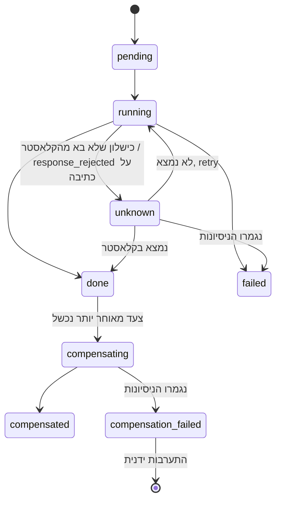
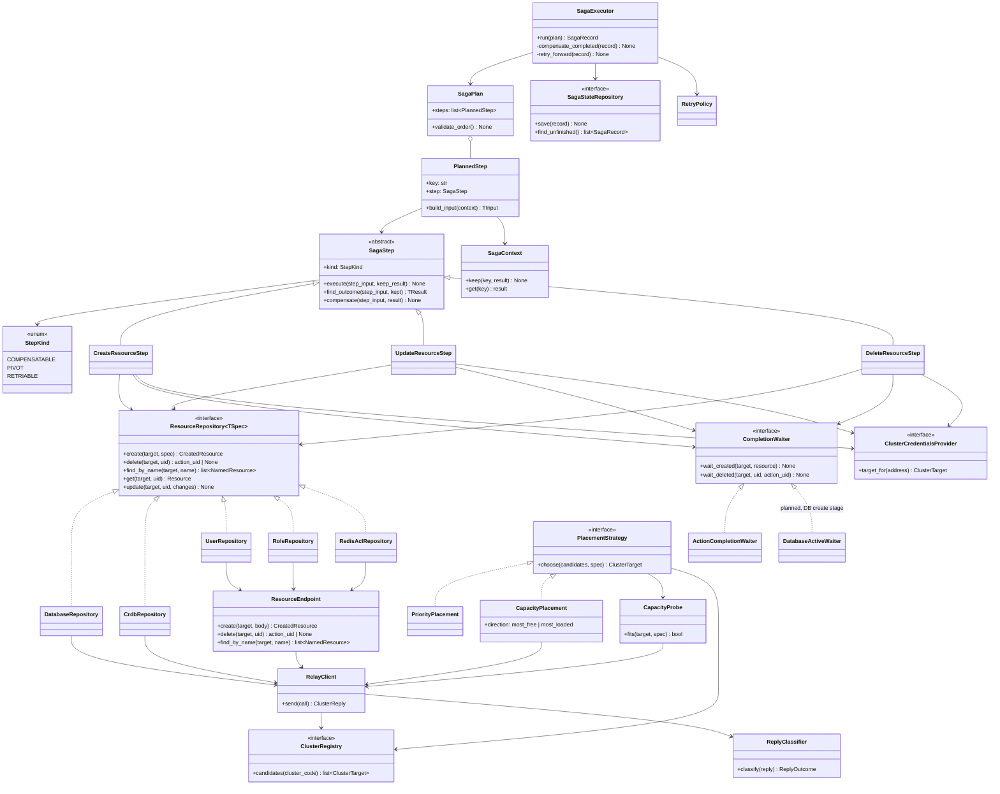

# תכנון: שכבת ה-Saga ומה שמתחתיה

**סטטוס:** טיוטה לדיון
**תאריך:** 2026-10-20
**מקור הנתונים:** [Redis Software REST API](https://redis.io/docs/latest/operate/rs/references/rest-api/) (גרסת latest)

המסמך מתאר איך כל פעולה על כל משאב מתבצעת, ואיך מבטלים אותה. הוא לא עוסק בשכבת הכניסה (routes) ולא
בשדות שה-UI שולח. אלה ייקבעו במסמך האפיון.

---

## 1. איך בקשה עוברת במערכת

```
בקשה
 └─ 1. תרגום    : ביצירה: יעד לוגי ⇐ בחירת קלאסטר. בשאר: כתובת ⇐ רשומה בקונפיג.
                  בשניהם: כתובת API, שירות קצה, FQDN, פרטי גישה
 └─ 2. גילוי     : קריאת המצב הקיים בקלאסטר (GET), רק בעריכה ובמחיקה
 └─ 3. פירוק     : המפרק בונה תוכנית: רשימת צעדים מסודרת
 └─ 4. בדיקה מוקדמת: התנגשויות שמות ו-dry_run, בלי שום שינוי בקלאסטר
 └─ 5. הרצה      : מנוע ה-Saga מריץ את הצעדים, ובכשל מבטל או ממשיך קדימה
```

שלבים 2 ו-4 לא משנים כלום בקלאסטר. רוב הכשלים הצפויים, כמו שם תפוס או קונפיגורציה לא חוקית, נתפסים בהם,
עוד לפני שנוצר משהו שצריך לבטל.

**בחירת קלאסטר (בשלב 1, תרגום):** קוד קלאסטר בבקשה ממופה בקובץ הקונפיגורציה לרשימה של קלאסטרים. לכל קלאסטר
ברשימה מוגדרים כתובת API, FQDN, שירות קצה והפניה לפרטי גישה. הסיסמאות עצמן ב-Secret או ב-vault. השירות בוחר
קלאסטר שיש בו מקום למה שהתבקש:

- **הבדיקה:** `POST /v1/bdbs?dry_run=1` עם ה-DB המבוקש. הבדיקה רצה על כל קלאסטר ברשימה ולא יוצרת כלום (נבדק).
  - יש מקום ⇐ `200`.
  - אין מספיק זיכרון ⇐ `406 insufficient_resources`.
  - חריגה ממספר ה-shards שהרישיון מתיר ⇐ `400 invalid_license`.
- **שיטת בחירה** כשכמה קלאסטרים עברו את הבדיקה. **ההחלטה עוד לא התקבלה (שאלה פתוחה 16).** התכנון תומך בכל
  האפשרויות, והבחירה נעשית בקובץ הקונפיגורציה לכל קוד קלאסטר, בלי שינוי קוד:

  | שיטה | כיוון | איך בוחרים |
  |---|---|---|
  | `priority` | - | לפי שדה `priority` של כל קלאסטר בקובץ |
  | `capacity` | `most_free` | הכי הרבה זיכרון פנוי להקצאה. העומס מתפזר בין הקלאסטרים. |
  | `capacity` | `most_loaded` | הכי מעט זיכרון פנוי, מבין אלה שעדיין יש בהם מקום. קלאסטר מתמלא לפני שעוברים לבא, ונשארים קלאסטרים ריקים לבקשות גדולות. |

  הנתון של `capacity` הוא `provisional_memory` מ-`GET /v1/cluster/stats/last`, כלומר הזיכרון שעוד אפשר להקצות
  ל-shards חדשים. נבדק: 7.52GB, ו-dry_run עבר ב-1GB ונכשל ב-8GB, כך ששני הנתונים מתאימים זה לזה. dry_run קובע אם
  קלאסטר **מתאים**, והשיטה קובעת **איזה** מהמתאימים נבחר.
- **מרוץ:** בין הבדיקה ליצירה, בקשה אחרת יכולה לתפוס את המקום. במקרה כזה צעד היצירה נכשל ב-`insufficient_resources`,
  וה-Saga מתבטל כרגיל.
- **CRDB:**
  1. **הבדיקה:** dry_run אחד של **CRDB** על הצירוף, `POST /v1/crdbs?dry_run=true` עם `X-Task-ID` שאנחנו
     קובעים. הוא בודק כל קלאסטר משתתף: מקום, פורט תפוס, פרטי גישה (נבדק, V12, V14).
  2. **מלכודת:** התשובה המיידית היא תמיד `200` עם task בסטטוס `queued`. התוצאה מגיעה רק ב-task:
     `GET /v1/crdb_tasks/{X-Task-ID}` עד `finished`, או `failed` עם `errors` שכל אחד מהם כולל `cluster_name`.
     נמדד: כשנייה. חייבים להמתין ל-task, ולא להסתמך על ה-HTTP status.
  3. **מגבלה:** כשכמה אתרים נכשלים, מדווח **רק הראשון** (V14). התוצאה אומרת שהצירוף נכשל ואיפה לפחות אתר אחד,
     לא את כל האתרים הבעייתיים.
  4. **בדיקה של כל אתר בנפרד** (dry_run של DB בודד בכל קלאסטר): **ההחלטה עוד לא התקבלה (שאלה פתוחה 17).**
     - קלאסטר dedicated: לא נדרשת לבדיקה עצמה. נדרשת רק אם הודעת השגיאה צריכה לפרט את כל האתרים שנכשלו.
     - קלאסטר generic: חלק מבחירת הקלאסטר בכל אתר. בלעדיה בוחרים צירוף ובודקים אותו, צירוף אחרי צירוף.
       תלוי בשיטת הבחירה (שאלה פתוחה 16).
  5. **שם הפרמטר שונה:** ב-`crdbs` רק `dry_run=true`. `dry_run=1` נדחה ב-`400` ולא נוצר task. ב-`bdbs` עובד
     `dry_run=1`.

**dry_run:** קיים ביצירה ובעריכה של `bdbs`, `users`, `roles`, `redis_acls` ו-`crdbs`. הוא בודק את הבקשה מול
הקלאסטר בלי לבצע אותה. מגבלה: צעד שתלוי בתוצאה של צעד קודם (למשל יוזר שמקבל `role_uids` של role שעוד לא
נוצר) לא ניתן לבדיקה ב-dry_run מראש.

---

**ברירות מחדל (בשלב 1, אחרי בחירת הקלאסטר):** מודל Pydantic אחד מגדיר את צורת ה-DB, ולכל שדה יש ברירת מחדל.
הערכים עצמם לא כתובים בקוד. הם נטענים מקובץ הקונפיגורציה, בעץ של רמות:

```
global ⇐ סביבה (DEV/PROD/TEST) ⇐ רשת ⇐ אתר ⇐ קלאסטר ⇐ הבקשה
```

- **ירושה:** כל רמה מגדירה רק את מה ששונה אצלה, וכל השאר יורש מהרמה שמעליה. הרמה הנמוכה יותר מנצחת.
- **שדות מקוננים:** הדריסה היא לפי שדה, גם בתוך אובייקט מקונן. רמה שמגדירה שדה אחד באובייקט לא מוחקת את שאר
  השדות שלו.
- **הבקשה:** השדות שנשלחו דורסים את כל הרמות. התוצאה הסופית עוברת ולידציה במודל.
- **ההבדלים הצפויים** הם בעיקר ברמת הסביבה. רמות הרשת, האתר והקלאסטר קיימות כדי לאפשר חריגה בלי שינוי קוד.
- **קלאסטר generic:** ברירות המחדל תלויות בקלאסטר, ולכן ה-dry_run של כל מועמד רץ עם ההגדרות שחושבו עבורו.
- **CRDB:** אין הבדל בין אתרים, חוץ מהיוזרים. כל הערכים נשלחים ב-`default_db_config`, ו-`instances[].db_config`
  לא נשלח אף פעם. אם עץ ברירות המחדל נותן ערך שונה לאתרים של אותו CRDB, זו שגיאת קונפיג, והיצירה נדחית לפני
  ששום דבר נוצר.

---

**מזהה בקשה:** ה-trace ID (`traceparent`) שנפתח ב-UI ועובר דרך שירות הביניים. לכל פעולה ב-UI יש בקשה אחת
אלינו, ולכן ה-trace ID מזהה בקשה עסקית אחת:
- **saga record:** נשמר לפי ה-trace ID.
- **בקשה שמגיעה שוב עם אותו trace:** לא מריצים אותה שוב. אם הריצה עדיין פעילה, מחכים לה. אם היא הסתיימה,
  מחזירים את התוצאה השמורה.
- **endpoint הסטטוס:** שואלים בו לפי ה-trace ID.
- **מועבר הלאה:** ה-trace ID ממשיך לשירות הקצה ולקלאסטר, כמו ב-cluster-relay.

---

## 2. מושגים

| מושג | הגדרה |
|---|---|
| **תוכנית (Plan)** | רשימה מסודרת של צעדים שהמפרק בונה מבקשה אחת |
| **צעד (Step)** | פעולה אחת מול קלאסטר אחד, ויחד איתה הדרך לבטל אותה |
| **הקשר (Context)** | המקום **היחיד** שבו נשמרות תוצאות של צעדים (uid, guid, snapshot), לצעדים שאחריו ולפיצוי. הוא חלק מה-saga record |
| **Snapshot** | המצב של משאב לפני שצעד שינה אותו. נלקח ב-GET בתוך הצעד, ממש לפני השינוי. |
| **Saga record** | הרישום של ריצה: הבקשה, הצעדים, הסטטוס של כל צעד, ה-snapshots וה-uids שנוצרו. כולל סיסמאות של יוזרי DB. בלי הסיסמה של `default_user` ובלי פרטי הגישה של הקלאסטרים (5.3) |

### שלושה סוגי צעדים

| סוג | מה מאפיין אותו | מה עושים בכשל |
|---|---|---|
| **הפיך (Compensatable)** | יש לו פיצוי שמחזיר את המצב הקודם | מבטלים אותו בסדר הפוך |
| **נקודת אל-חזור (Pivot)** | אי אפשר לבטל אותו: מחיקת נתונים, החלפת סיסמה שלא ידועה | אין פיצוי. אחריו ה-Saga רק ממשיך קדימה. |
| **ניתן לחזרה (Retriable)** | בא בסוף, אחרי ה-pivot אם יש (7.4 ו-7.6 בלי pivot), ומובטח שיצליח אם מנסים שוב (idempotent) | חוזרים עליו עד שמצליח. אם הניסיונות נגמרו, הפעולה מסומנת להתערבות ידנית. |

**כלל הסדר:** כל הצעדים ההפיכים קודם, אחריהם לכל היותר pivot אחד, ובסוף צעדים שניתנים לחזרה. המנוע בודק
את הכלל הזה כשהוא מקבל תוכנית, ודוחה תוכנית שלא עומדת בו.

### מחזור החיים של צעד



---

## 3. תוצאה לא ידועה

ייתכן שצעד נכשל מבחינתנו, אבל בוצע בפועל בקלאסטר:
- timeout אחרי שהבקשה נשלחה.
- `response_rejected` של cluster-relay על פעולת כתיבה.
- חיבור שנשבר אחרי שהבקשה יצאה, ונראה כמו "לא נשלח" (למשל שגיאת TLS).

**הכלל:** לא סומכים על "לא נשלח". אחרי כל כישלון שלא בא מהקלאסטר עצמו (שגיאה של שירות הקצה או של החיבור
אליו, חוץ מ-`invalid_request`, שהוא באג אצלנו), המנוע תמיד בודק לפני ניסיון חוזר. אם גם הבדיקה נכשלת, הצעד מחכה ומנסה מאוחר יותר.

**הפתרון:** לכל משאב יש מפתח זיהוי דטרמיניסטי (שם), ולכל repository יש `find_by_key` (בקוד: `find_by_name`, כי המפתח
הוא השם. ב-CRDB המפתח הוא ה-`X-Task-ID`, ויהיה לו חיפוש משלו). כשהתוצאה לא ידועה (לפי
הכלל, אחרי כל כישלון שלא בא מהקלאסטר), המנוע מאתר את המשאב לפי המפתח:
- **נמצא:** הצעד נחשב הצליח, וה-uid נלקח מהרשומה שנמצאה.
- **לא נמצא:** הצעד לא בוצע. מנסים שוב לפי מדיניות ה-retry, ואם היא נגמרת, הצעד נכשל.

**ל-REST API של Redis אין חיפוש לפי שם.** `find_by_key` שולף את **כל** הרשימה של אותו סוג משאב, ומסנן אותה
בקוד שלנו לפי המפתח. ב-`bdbs` הפרמטר `fields` רק מצמצם את השדות שחוזרים לכל DB. הוא לא מסנן את הרשימה. שליפת
הרשימה המלאה מתבצעת רק כשהתוצאה לא ידועה, כלומר לעיתים רחוקות.

| משאב | מפתח | שליפה | סינון בקוד שלנו |
|---|---|---|---|
| ACL | `name` | `GET /v1/redis_acls` | `name` שווה למפתח |
| Role | `name` | `GET /v1/roles` | `name` שווה למפתח |
| User | `name` (הקלאסטר אוכף ייחודיות: `409 name_already_exists`, V16) | `GET /v1/users` | `name` שווה למפתח |
| DB | `name` (הפונה אחראי לייחודיות, ראו 5.4) | `GET /v1/bdbs?fields=uid,name` | `name` שווה למפתח |
| CRDB | מזהה task שאנחנו קובעים (`X-Task-ID`). את ה-`guid` הקלאסטר מייצר | `GET /v1/crdb_tasks/{id}`, שמחזיר את `crdb_guid`. אם ה-task כבר לא שמור: `GET /v1/crdbs` | `name` שווה למפתח |

**CRDB (נבדק):**
- **`X-Task-ID`:** קובעים אותו מראש, וכך אחרי תוצאה לא ידועה שולפים את ה-task ישירות. ה-task מחזיר את
  `crdb_guid` שהקלאסטר יצר. הערך חייב להיות UUID תקני בגרסאות 1 עד 5. ערך אחר נדחה ב-`400`.
- **`guid`:** הקלאסטר מייצר אותו. אפשר גם לקבוע אותו ביצירה (V6), אבל לא משתמשים בזה.
- **בקשה חוזרת עם אותו `X-Task-ID`** נדחית ב-`406 job_exists`, עם הסטטוס של ה-task הקיים, ולא נוצר CRDB שני.
- **שמירת תוצאת task:** ברירת המחדל היא 500 שניות, ולכן נשלח `X-Result-TTL` ארוך יותר.

---

## 4. פעולות אסינכרוניות

| פעולה | איך יודעים שהסתיימה |
|---|---|
| יצירה ועדכון של DB | `status` חוזר ל-`active` (בזמן הפעולה: `pending`, `active-change-pending`). התשובה כוללת גם `action_uid` (V3). נמדד: 2–6 שניות. |
| מחיקת DB | `status: delete-pending`, ואז `404`. נמדד: כ-4 שניות. |
| ACL, role, user | אם התשובה כוללת `action_uid`, ממתינים ב-`/v1/actions/{action_uid}` עד `completed` (V21) |
| CRDB, כל פעולה | `GET /v1/crdb_tasks/{task_id}` עד `finished` או `failed`. ב-`failed` יש `errors` לכל קלאסטר. |

ההמתנה היא חלק מהצעד: צעד לא נחשב `done` לפני שהפעולה הסתיימה בקלאסטר. בלי ההמתנה הצעד הבא עלול להידחות:
`PUT` ל-bdb מיד אחרי מחיקת role נדחה ב-`409 busy` ("Cluster is being modified"), ואחרי שה-action הסתיים הוא עובר (V21). הזמנים (מרווח בדיקה, timeout)
מוגדרים בקונפיגורציה.

**409 busy:** DB שנמצא באמצע שינוי אחר מחזיר `409`. זה מצב זמני, ולכן הצעד מנסה שוב לפי מדיניות ה-retry,
ולא נכשל מיד.

---

## 5. כל משאב, כל פעולה, ואיך מבטלים

סימונים: ✅ הפיך במלואו · ⚠️ הפיך חלקית · ⛔ לא הפיך (pivot)

### 5.1 Redis ACL

| פעולה | API | Snapshot לפני | ביטול | הפיכות |
|---|---|---|---|---|
| יצירה | `POST /v1/redis_acls` `{name, acl}` | - | `DELETE /v1/redis_acls/{uid}` | ✅ |
| עריכה | `PUT /v1/redis_acls/{uid}` | `GET`: `name`, `acl` (הכל קריא) | `PUT` עם ה-snapshot | ✅ |
| מחיקה | `DELETE /v1/redis_acls/{uid}` | `GET`: `name`, `acl`, **וכל זוגות `roles_permissions` שמפנים אליו בכל DB** | `POST` עם ה-snapshot **כולל `uid`**, ואז החזרת הזוגות | ✅ |

- ACLs מובנים (למשל `Full Access`) הם read-only: עריכה או מחיקה שלהם מחזירה `409`. המפרק לא בונה צעד כזה.
- **יצירה מחדש עם אותו uid עובדת** (נבדק מול הקלאסטר).
- **מחיקה של ACL שמחובר ל-DB מצליחה, והקלאסטר מסיר בעצמו את הזוגות שלו מ-`roles_permissions`** (V1b). לכן
  הביטול חייב להחזיר גם את הזוגות, ולא רק את ה-ACL.

### 5.2 Role

| פעולה | API | Snapshot לפני | ביטול | הפיכות |
|---|---|---|---|---|
| יצירה | `POST /v1/roles` `{name, management, resources: [{type: db, uids: ["DB"]}]}` (ה-uids כמחרוזות, מספר נדחה ב-`400 invalid_schema`) | - | `DELETE /v1/roles/{uid}` | ✅ |
| עריכה | `PUT /v1/roles/{uid}` | `GET`: `name`, `management`, `resources` | `PUT` עם ה-snapshot | ✅ |
| מחיקה | `DELETE /v1/roles/{uid}` | `GET`: כל השדות שאפשר לכתוב, **וכל זוגות `roles_permissions` שמפנים אליו** | `POST` עם ה-snapshot **כולל `uid`**, ואז החזרת הזוגות | ✅ |

- **יצירה מחדש עם אותו uid עובדת** (נבדק מול הקלאסטר). לכן `role_uids` של יוזרים ו-`roles_permissions` של DBs
  נשארים תקינים.
- **`resources` מגביל את הגישה הניהולית (UI ו-REST API)** של role מסוג `db_member` או `db_viewer` ל-DBs
  מסוימים. בלי השדה, ה-role חל על כל ה-DBs. לכן ה-role נוצר אחרי ה-DB, עם ה-uid שלו. זה נפרד מ-`roles_permissions`
  (5.6), שקובע את הגישה לנתונים.
- **`resources` ריק מול חסר:** `uids: []` פירושו אף DB, ושדה שחסר לגמרי פירושו כל ה-DBs (נבדק). כשמוחקים DB,
  הקלאסטר מסיר אותו בעצמו מ-`resources` של ה-roles, וה-role נשאר בלי גישה (V9).
- **role עם `resources` של DB שלא קיים נדחה:** `404 db_not_found`. לכן ה-role נוצר רק אחרי שה-DB קיים.
- **מחיקה של role שמחובר ל-DB מצליחה, והזוגות שלו נמחקים מ-`roles_permissions`** (V1b), כמו ב-ACL.
- **role שיוזר משתמש בו לא נמחק:** הקלאסטר מחזיר `406 role_in_use` (נבדק). במחיקה, קודם מוחקים את היוזר,
  או מסירים ממנו את ה-role.

### 5.3 User

| פעולה | API | Snapshot לפני | ביטול | הפיכות |
|---|---|---|---|---|
| יצירה | `POST /v1/users` `{name, password, role_uids}` (`auth_method` לא נשלח: ברירת המחדל `regular`, V21) | - | `DELETE /v1/users/{uid}` | ✅ |
| עריכה (בלי סיסמה) | `PUT /v1/users/{uid}` | `GET`: `name`, `email`, `role_uids`, `email_alerts`, `bdbs_email_alerts`, `auth_method` | `PUT` עם ה-snapshot | ✅ |
| החלפת סיסמה | `PUT /v1/users/password` | **הסיסמה הישנה לא קריאה מה-API.** ה-UI שולח אותה בבקשה. | `PUT /v1/users/password` עם הסיסמה הישנה | ✅ |
| מחיקה | `DELETE /v1/users/{uid}` | `GET`: כל השדות שאפשר לכתוב. הסיסמה מגיעה מה-UI. | `POST` עם ה-snapshot והסיסמה | ✅ (ה-uid משתנה) |

**הסיסמה הישנה מגיעה מה-UI.** ה-API לא מחזיר סיסמאות, ולכן כשצריך לבטל החלפת סיסמה או מחיקת יוזר, ה-UI
שולח את הסיסמה הנוכחית בבקשה. **היא נשמרת בצעד, ב-saga record** (סעיף 9). אחרי קריסה לא ממשיכים ולא מבטלים
אוטומטית (D5), אבל מי שמטפל ידנית מוצא ב-saga record את הסיסמה הישנה ויכול להחזיר אותה.

**סיסמה של יוזר DB היא לא סוד** (החוזה): היא קבועה, והלקוח רואה אותה ב-UI כחלק מה-connection string. לכן מותר
לשמור אותה ב-saga record ולרשום אותה בלוג. אם בחברה יוחלט שהסיסמאות סודיות, המעבר יהיה להזדהות עם תעודות, ולא
להסתרה של הסיסמה.

**מה כן סודי:** הסיסמה של `default_user`, שנשלחת בכל יצירת DB (`authentication_redis_pass`, 5.4), ופרטי הגישה של
הקלאסטרים ושל חומת האש. הם מגיעים מ-Secret בלבד, ולא נשמרים ב-saga record. `GET` מלא של bdb מחזיר את
`authentication_redis_pass` ואת `authentication_admin_pass`, ולכן snapshot מבקש רק את השדות שמשתנים.

**חלופה כשה-UI לא שולח את הסיסמה הישנה (לא בשימוש, D2):** החלפה בשני צעדים, בעזרת התמיכה בכמה סיסמאות ליוזר (`/v1/users/password`):

| # | צעד | סוג | ביטול |
|---|---|---|---|
| 1 | `POST /v1/users/password`: הוספת הסיסמה החדשה. הישנה עדיין עובדת. | הפיך | `DELETE /v1/users/password` עם הסיסמה החדשה, שידועה לנו |
| 2 | `PUT /v1/users/password`: החלפת כל הסיסמאות בחדשה בלבד | pivot | - |

אם צעד 2 נכשל, היוזר נשאר במצב תקין: גם הישנה וגם החדשה עובדות. הצעד ניתן לחזרה.

**מחיקת יוזר בלי הסיסמה מה-UI היא pivot,** כי יוזר שנמחק לא יכול לחזור עם אותה סיסמה. לכן בתרחישים (7.4, 7.6, 7.7)
מחיקת ה-user באה אחרונה, אחרי שכבר אין לו גישה, וניתנת לחזרה. כך לא צריך את הסיסמה של יוזר שנמחק.

**ה-uid של יוזר לא נשמר ביצירה מחדש:** `POST /v1/users` מתעלם מ-`uid` בשקט, בלי שגיאה (נבדק). זה לא שובר
הפניות, כי אף משאב לא מפנה ל-uid של יוזר. היוזר מפנה ל-roles, ולא להפך. ההשפעה היא רק על ה-saga record שלנו.

### 5.4 Database (bdb)

| פעולה | API | Snapshot לפני | ביטול | הפיכות |
|---|---|---|---|---|
| יצירה | `POST /v1/bdbs`, ואז המתנה ל-`active` | - | `DELETE /v1/bdbs/{uid}`, ואז המתנה ל-`404` | ✅ |
| עריכה | `PUT /v1/bdbs/{uid}` (רק השדות שמשתנים), ואז המתנה ל-`active` | `GET`: **רק השדות שהצעד משנה** | `PUT` עם הערכים הישנים של אותם שדות | ✅ / ⛔ תלוי בשדה |
| מחיקה | `DELETE /v1/bdbs/{uid}`, ואז המתנה ל-`404` | `GET` מלא, לתיעוד בלבד | - | ⛔ הנתונים נמחקים |

- **ה-snapshot בעריכה כולל רק את השדות שמשתנים,** כי ה-bdb כולל שדות רבים שהם read-only. החזרה של אובייקט
  שלם הייתה נכשלת, או דורסת שינויים שמישהו אחר עשה במקביל.
- **הפיכות של שדות** (V7, נבדק על DB עם מפתח קיים):

  | שינוי | תוצאה | נתונים נשמרו | הפיך |
  |---|---|---|---|
  | `memory_size` למעלה ולמטה | הצליח | כן | ✅ |
  | `eviction_policy` | הצליח | כן | ✅ |
  | `data_persistence` (`aof` וחזרה) | הצליח | כן | ✅ |
  | הפעלת `sharding` (shard אחד) | הצליח | כן | ✅ |
  | `shards_count` 1 ⇐ 2 | הצליח | כן | ⛔ החזרה נכשלת |
  | `shards_count` 2 ⇐ 1 | `406`: "Scaling down requires asm_scaling" | - | - |
  | כיבוי `sharding` עם 2 shards | `406 invalid_sharding` | - | - |
  | `replication` הפעלה וכיבוי (2 nodes, V10) | הצליח בשני הכיוונים, כ-2 שניות | כן | ✅ |
  | `replication` עם node אחד | `406`: צריך לפחות 2 nodes | - | - |

  צעד עריכה שמגדיל `shards_count` מסומן pivot. הרשימה נשמרת בקונפיגורציה.
- **עריכה דרך ה-relay, מול cluster1** (V18):

  | מה נבדק | תוצאה |
  |---|---|
  | `GET /v1/bdbs/{uid}?fields=memory_size,eviction_policy` | `200`, רק השדות שביקשנו, עם `cluster-state-id`. `uid` לא נוסף מעצמו |
  | `fields` עם שם שדה שלא קיים | `406 invalid_fields_query_param` |
  | `fields` עם שדה קיים שלא מוגדר ב-DB (`tags`, `backup_location`, `avoid_nodes`) | `200` בלי השדה, בלי שגיאה. לכן עדכון של שדה כזה נדחה לפני ה-`PUT`, כי אין מה להחזיר בביטול |
  | `tags` | שדה רגיל של ה-bdb, ואין לו מקום אחר. לפני שהוגדר הוא חסר גם ב-`GET` המלא. אחרי `PUT` הוא חוזר, והקלאסטר מוסיף לכל tag את `isSystem: false`. `PUT` של ה-snapshot (כולל `isSystem`) מחזיר אותו. `[]` מנקה, ואחריו השדה חוזר כ-`[]`. `null` נדחה ב-`400 invalid_schema` |
  | `PUT` עם שדות בודדים | `200`, ה-bdb המלא חוזר, `status: active-change-pending` |
  | `PUT` נוסף בזמן `active-change-pending` | `409 db_busy`. לכן אחרי כל `PUT` מחכים ל-`active` (כשנייה ב-DB ריק) |
  | `PUT` עם ה-snapshot (אותם שדות, ערכים ישנים) | הערכים חזרו |
  | `PUT` עם אותו ערך שכבר קיים | `200`, וגם הוא עובר ל-`active-change-pending` |
  | `PUT` עם שדה שלא קיים | `400 invalid_schema` |
  | `PUT` עם `uid` | `500 internal_error`: "A uid is already assigned" |
  | `cluster-state-id` | עולה גם בלי שינוי שלנו, כשה-DB עובר מ-pending ל-`active`. לכן לוקחים אותו מה-`GET` שממש לפני ה-`PUT` |
- **לא קובעים `uid` ביצירה רגילה.** לפי התיעוד, מי שקובע uid חייב לקבוע אותו בכל ה-DBs שאחריו, כי המספור
  האוטומטי עלול להתנגש בו.
- **ייחודיות שם DB:** הקלאסטר לא אוכף אותה ב-API (V2), בניגוד ל-UI. הפונה לשירות אחראי לוולידציה, והשירות
  לא בודק אותה. אם `find_by_key` מוצא יותר מ-DB אחד באותו שם, הצעד לא מבוטל אוטומטית, וה-Saga מסומן להתערבות
  ידנית. כך ביטול לא ימחק DB של מישהו אחר.
- **ביצירה מחדש בתוך פיצוי כן קובעים `uid`.** ה-uid הזה כבר היה בשימוש, ולכן אין התנגשות. רלוונטי רק
  לעריכה ולמחיקה שעוד לא הגיעו ל-pivot.
- **`default_user`:** דלוק, עם סיסמה קבועה מ-Secret (`authentication_redis_pass` ביצירה). בלי סיסמה, כל אחד
  מתחבר ל-DB (נבדק). ראו `db-model.md` סעיף 2.
- **סודות בתשובות:** תשובות `GET` ו-`DELETE` של bdb כוללות את `authentication_admin_pass` ואת `authentication_redis_pass`, בטקסט גלוי (נבדק).
  חייבים להסתיר את השדה הזה בלוגים וב-saga record. זה רלוונטי גם ל-failure log של cluster-relay.
- **Modules:** בגרסה 8.x כל DB נוצר עם `bf`, `ReJSON`, `timeseries` ו-`search` כברירת מחדל.

### 5.5 CRDB (Active-Active)

| פעולה | API | Snapshot לפני | ביטול | הפיכות |
|---|---|---|---|---|
| יצירה | `POST /v1/crdbs` + `X-Task-ID`, ואז המתנה ל-task | - | `DELETE /v1/crdbs/{guid}` + task | ✅ |
| עריכה | `PATCH /v1/crdbs/{guid}` + task, קריאה אחת עם השדות ב-`default_db_config`. לפני כן בודקים שאין override באתר לשדות האלה (V17) | `GET /v1/crdbs/{guid}`: השדות שמשתנים ב-`default_db_config` | `PATCH` עם הערכים הישנים | ✅ / ⛔ כמו ב-bdb |
| הוספה או הסרה של קלאסטר | `POST /v1/crdbs/{guid}/updates` | `instances` | הפעולה ההפוכה | ⚠️ מחוץ לשלבים 1–4 |
| מחיקה | `DELETE /v1/crdbs/{guid}` + task | `GET` מלא, לתיעוד | - | ⛔ |

- **הבקשה ליצירה כוללת לכל קלאסטר משתתף** URL, FQDN (`name`) ופרטי גישה. ה-registry מספק את כולם. הבקשה
  מכילה סיסמאות, ולכן אסור לרשום את ה-body שלה ללוג או ל-saga record.
- **יצירה שנכשלת באחד האתרים לא משאירה כלום** (V5): ה-task נכשל עם `errors` של האתר, ובאתר השני לא נשאר DB.
  הכשל שנבדק נתפס בשלב הבדיקה של הקלאסטר (פורט תפוס). כשל שקורה אחרי שהיצירה התחילה בפועל באחד האתרים לא נבדק.
- **מחיקה:** `DELETE /v1/crdbs/{guid}` עם `X-Task-ID` מחזיר task. נמדד: כ-10 שניות עד `finished`.
- **`GET /v1/crdbs` מחזיר `{"crdbs": [...]}`,** ולא מערך כמו ב-endpoints האחרים.
- **ה-uid של ה-bdb המקומי ידוע רק לקלאסטר עצמו:** `local_databases` ו-`instances[].db_uid` מכילים רק את ה-uid
  המקומי. לכן שואלים כל קלאסטר בנפרד (נבדק: 1 ב-cluster1 ו-2 ב-cluster2).
- **סודות:** התשובה כוללת `authentication_admin_pass` לכל instance, ו-`authentication_redis_pass` ב-bdb המקומי. מסתירים אותם כמו ב-bdb.
- **Modules:** ה-CRDB נוצר עם `search` ו-`ReJSON` בלבד.
- **`tags` ב-AA** (V19, נבדק על CRDB זמני בשני הקלאסטרים). התיעוד לא מזכיר `tags` ב-CRDB, אבל בפועל:
  - `PATCH /v1/crdbs/{guid}` עם `default_db_config.tags`: ה-task מסתיים, וה-tags מופיעים ב-`default_db_config` של ה-CRDB
    וגם ב-bdb המקומי בשני הקלאסטרים.
  - `PUT /v1/bdbs/{uid}` עם `tags` על ה-bdb המקומי של קלאסטר אחד: ה-tags מופיעים רק בו. בקלאסטר השני אין tags,
    וגם ה-CRDB לא יודע עליהם.
  - לכן ב-AA מנהלים tags דרך ה-CRDB, ולא דרך ה-bdb המקומי.
- **ביטול task שעוד לא הגיע ל-commit:** `POST /v1/crdb_tasks/{id}/actions/cancel`. במקרה של timeout
  ביצירה, עדיף לנסות ביטול לפני `DELETE`. **לא משתמשים ב-`force`,** כי הוא עלול לשבור את ה-CRDB.
- **אתר שנופל באמצע יצירה (V13):**
  - **ה-task נשאר `started` בלי הגבלת זמן.** נמדד: יותר מ-10 דקות. ל-task אין timeout משלו, ולכן ה-timeout של
    הצעד אצלנו, מהקונפיגורציה.
  - **באתרים התקינים כבר נוצר bdb מקומי** (`active`), אבל ה-CRDB **לא מופיע** ב-`GET /v1/crdbs`. לכן התוצאה
    נקבעת לפי סטטוס ה-task, ולא לפי רשימת ה-CRDBs.
  - **cancel** מחזיר `200` מיד, אבל נכנס לתוקף רק כשהאתר חוזר: ה-task עובר ל-`canceled`, וה-bdb החלקי נמחק.
    לא נשאר כלום באף אתר.
  - **בלי cancel,** כשהאתר חוזר ה-task ממשיך ומסתיים ב-`finished`, וה-CRDB תקין.
  - **מה עושים ב-timeout של יצירת CRDB (D8):** שולחים cancel, ומחזירים כישלון עם סטטוס **ממתין לניקוי**. ה-task id
    נשמר ב-saga record. שאילתת סטטוס לפי ה-trace ID קוראת את ה-task: `canceled` ⇐ הניקוי הסתיים, ושום דבר לא
    נשאר. `finished` (ה-cancel לא נתפס) ⇐ ה-CRDB קיים, והוא מסומן להתערבות ידנית.
- **ACL, roles ו-users הם מקומיים לכל קלאסטר.** ראו סעיף 6.

### 5.6 הרשאות DB (`roles_permissions`)

הן לא משאב נפרד. זו רשימה בתוך ה-bdb: `[{role_uid, redis_acl_uid}]`.

| פעולה | API | ביטול | הפיכות |
|---|---|---|---|
| עדכון הרשאות | עדכון DB (5.4) של השדה `roles_permissions`: `GET ?fields=roles_permissions` ל-snapshot, ואז `PUT` עם הרשימה החדשה | `PUT` עם ה-snapshot | ✅ |

- **זו אותה אבן בניין של עדכון DB (5.4),** עם שדה אחד.
- **הכל או כלום** (החוזה): ה-`PUT` שולח את הרשימה **המלאה** של כל הזוגות של ה-DB, והיא מחליפה את הקודמת. לא
  שולחים "מה להוסיף" או "מה להסיר", ואין עדכון חלקי.
- **`PUT` אחד בסוף, לכל הזוגות** (החוזה): בקשה שמוסיפה כמה יוזרים יוצרת קודם את כל ה-ACLs, ה-roles וה-users,
  ורק בצעד האחרון נוגעת ב-DB, ב-`PUT` אחד שכולל את כל הזוגות.
- **הרשאות לא נערכות יחד עם שינויים אחרים ב-DB** (החוזה), חוץ מההקמה הראשונית. לכן החזרת ה-snapshot לא דורסת
  שינוי אחר.
- **ב-AA** אין `roles_permissions` ב-`default_db_config`, כי לכל קלאסטר יש uids משלו ל-role ול-ACL. יש שתי דרכים
  שעובדות. **הוחלט: `PATCH` אחד לשני הקלאסטרים**, כדי שיהיו קריאה אחת, snapshot אחד וביטול אחד:
  - `PUT` לכל bdb מקומי בנפרד. ה-uid שלו נמצא ב-`local_databases` (או ב-`instances[].db_uid`) של
    `GET /v1/crdbs/{guid}` באותו קלאסטר.
  - **`PATCH /v1/crdbs/{guid}` אחד** עם `instances[].db_config.roles_permissions`, רשימה משלו לכל instance (V20).
    התיעוד לא מזכיר את השדה ב-`db_config`, אבל נבדק על CRDB בשני הקלאסטרים: ה-task מסתיים כ-7 שניות, כל bdb מקומי
    מקבל את הזוגות שלו, וה-CRDB שומר אותם ב-`instances[].db_config`. `PATCH` עם `[]` בכל instance מחזיר את שניהם
    לרשימה ריקה. ה-id של כל instance ושם הקלאסטר שלו נמצאים ב-`instances` של `GET /v1/crdbs/{guid}`.
- **אין צורך להחליף uid:** role ו-ACL נוצרים מחדש עם אותו uid (5.1, 5.2), ולכן כל הפניה אליהם נשארת תקינה.

---

## 6. Active-Active: אותם צעדים על כמה קלאסטרים

המנוע לא יודע מה זה AA. המפרק פורש כל צעד מקומי לצעד נפרד לכל קלאסטר:

```
צור ACL "app-rw"   ⇒   צור ACL "app-rw" @ cluster-a
                       צור ACL "app-rw" @ cluster-b
```

- **כשל חלקי:** כל צעד כזה הוא צעד רגיל עם פיצוי משלו. אם `@ cluster-b` נכשל, הפיצוי של `@ cluster-a` רץ
  כרגיל. לא צריך מנגנון מיוחד.
- **מפתחות בהקשר מקבלים קידומת של קלאסטר,** למשל `cluster-a/acl/app-rw/uid`, כי לאותו משאב יש uid שונה בכל
  קלאסטר.
- **בלי קוד כפול:** צעד ה-ACL של אתר בודד וצעד ה-ACL של AA הם אותה מחלקה, עם פרמטר קלאסטר שונה.
- **ה-UI לא מבדיל בין AA לאתר בודד.** כל הבקשות, כולל עריכת רשימת היוזרים (7.4), מגיעות באותם routes ועם אותו
  גוף. ההבדל נמצא רק ב-`target` של הבקשה (`spec.md` סעיף 3.1): פלאג `active_active`, ה-UUID של ה-CRDB ורשימת
  האתרים. המפרק פורש את הצעדים לפי רשימת האתרים, משתמש ב-UUID, ה-`guid` שהקלאסטר יצר, ומאתר דרכו את ה-bdb המקומי
  בכל קלאסטר (`GET /v1/crdbs/{guid}`).
- **רשימת האתרים מגיעה מהשירות שמעל.** המפרק לא מגלה אתרים בעצמו. ב-AA הרשימה כוללת תמיד את כל האתרים של ה-CRDB.

---

## 7. תרחישים: מה כל פקודה מריצה

ב-AA כל צעד מקומי (ACL, role, user) מוכפל לכל קלאסטר, לפי סעיף 6. ההרשאות של כל הקלאסטרים הן צעד אחד: `PATCH`
אחד ל-CRDB (5.6).

### 7.1 יצירת DB עם N יוזרים (אתר בודד)

| # | צעד | סוג |
|---|---|---|
| 1 | יצירת DB, המתנה ל-`active` | הפיך |
| 2..N | לכל יוזר: יצירת ACL, יצירת role עם `resources` של ה-DB, יצירת user עם `role_uids` | הפיך |
| N+1 | `PUT` אחד של `roles_permissions` עם הזוגות `role ↔ ACL` של כל היוזרים (5.6) | הפיך |

אין בה pivot, ולכן כשל בכל שלב מחזיר את הקלאסטר למצב שלפני הבקשה.

### 7.2 יצירת CRDB עם N יוזרים

| # | צעד | סוג |
|---|---|---|
| 1 | יצירת CRDB (`X-Task-ID`), המתנה ל-task | הפיך |
| 2 | לכל קלאסטר: איתור ה-bdb המקומי, ושמירת ה-uid בהקשר | קריאה בלבד |
| 3..N | לכל קלאסטר ולכל יוזר: ACL, role עם `resources` של ה-bdb **המקומי**, user | הפיך |
| N+1 | `PATCH` אחד ל-CRDB, עם `roles_permissions` המלא של כל instance ב-`instances[].db_config` (5.6, V20) | הפיך |

### 7.3 יצירת DB בלי יוזרים / הוספת יוזר ל-DB קיים

שתיהן תת-קבוצה של 7.1. הוספת יוזר מוסיפה ACL, role, user והרשאה ל-DB קיים, והמפרק מקבל את ה-uid של ה-DB
בשלב הגילוי. הוספת יוזר רצה רק כחלק מעריכת רשימת היוזרים (7.4).

### 7.4 עריכת רשימת היוזרים של DB

במסך היוזרים ב-UI אפשר לשנות כמה יוזרים בשמירה אחת: להוסיף, למחוק ולערוך, בכל צירוף. ה-UI לא מפריד לפי סוג
הפעולה. מה שידוע הוא שהבקשה לא נוגעת באובייקט ה-DB עצמו.

ה-UI שולח את **הרשימה המלאה** של היוזרים אחרי העריכה. בשלב הגילוי המפרק קורא את היוזרים של ה-DB (בשיטה של 7.7)
ומשווה לפי המפתח של היוזר (`name`):

| מה נמצא בהשוואה | צעדים | סוג |
|---|---|---|
| יוזר ברשימה ולא בקלאסטר | הוספה (7.3) | הפיך |
| משפט ACL שונה | עדכון ACL (5.1) | הפיך |
| יש סיסמה חדשה בבקשה | החלפת סיסמה (5.3) | הפיך (D2) |
| יוזר בקלאסטר ולא ברשימה | צעדים 1–3 של 7.6 | הפיך |
| אותו יוזר | מחיקת user (צעד 4 של 7.6) | ניתן לחזרה |

- **הסדר:** כל הצעדים ההפיכים של כל היוזרים קודם, ומחיקות ה-user בסוף. כך אין pivot, וכשל לפני המחיקות מבטל את
  כל השמירה.
- **רשימה חלקית מוחקת יוזרים.** יוזר שחסר ברשימה נמחק. זה חלק מהחוזה מול ה-UI.
- **סיסמה היא שדה מפורש.** ה-API לא מחזיר סיסמאות, ולכן אין השוואה. אם יש סיסמה חדשה, מחליפים. אם אין, לא נוגעים.
- **שינוי המפתח של יוזר הוא מחיקה ויצירה.** ההשוואה לא מבדילה ביניהם, וזה הוחלט.
- **רק מה שהשתנה נשלח לקלאסטר.** רשימה זהה למצב בקלאסטר היא תוכנית ריקה, והתשובה היא הצלחה.

### 7.5 עריכת DB / CRDB

| # | צעד | סוג |
|---|---|---|
| 1 | עריכת שדות הפיכים | הפיך |
| 2 | עריכת שדות לא הפיכים, אם יש | pivot |

### 7.6 מחיקת יוזר

| # | צעד | סוג | ביטול |
|---|---|---|---|
| 1 | הסרת ה-role מ-`role_uids` של היוזר | הפיך | החזרת ה-role |
| 2 | מחיקת ה-role `{db}-{user}-role` | הפיך | יצירה מחדש עם אותו uid, והחזרת `resources` והזוג ב-`roles_permissions` |
| 3 | מחיקת ה-ACL `{db}-{user}-acl` | הפיך | יצירה מחדש עם אותו uid, והחזרת הזוג |
| 4 | **מחיקת user** | ניתן לחזרה. `404` נחשב הצלחה. | - |

כמו ב-7.7: אחרי צעדים 1–3 ליוזר אין role, ולכן אין לו גישה לשום דבר. לכן מחיקת ה-user באה אחרונה, ולא נדרשת
סיסמה מה-UI.

### 7.7 מחיקת DB / CRDB עם היוזרים שלו

**הכלל: כל מה שהפיך קודם, ומחיקת ה-DB אחרונה.** כל כשל לפני מחיקת ה-DB מחזיר את הכל למצב הקודם, והתשובה
ל-UI היא "המחיקה נכשלה, שום דבר לא השתנה" (הוחלט).

| # | צעד | סוג | ביטול |
|---|---|---|---|
| 1 | לכל יוזר: הסרת ה-role מ-`role_uids` | הפיך | החזרת ה-role ליוזר |
| 2 | מחיקת ה-roles | הפיך | יצירה מחדש עם אותו uid, והחזרת `resources` והזוגות ב-`roles_permissions` |
| 3 | מחיקת ה-ACLs | הפיך | יצירה מחדש עם אותו uid, והחזרת הזוגות |
| 4 | **מחיקת ה-DB / CRDB** | pivot | - |
| 5 | מחיקת היוזרים | ניתן לחזרה. `404` נחשב הצלחה. | - |

- **כשל בצעדים 1–4:** rollback מלא. ה-DB, היוזרים, ה-roles וה-ACLs חוזרים בדיוק למצבם.
- **אחרי צעד 4 נשארת רק מחיקת היוזרים.** הצעד הזה נכשל רק בגלל תקלת רשת או קלאסטר, ואז מנסים שוב. יוזר שנשאר
  בינתיים חסר נזק: אין לו role, ולכן אין לו גישה לשום דבר.
- **לא נדרשות סיסמאות מה-UI,** כי יוזרים נמחקים רק אחרי ה-pivot, ואף פעם לא נוצרים מחדש.

**היוזרים של ה-DB:** כל יוזר שייך ל-DB אחד. מאתרים אותם דרך ה-role: roles שה-`resources` שלהם מכיל את ה-uid
של ה-DB, ואז יוזרים שה-`role_uids` שלהם כולל את ה-roles האלה. השיטה לא תלויה בשם היוזר (שאלה פתוחה 15).

---

## 8. מיון תשובות וכשל של פיצוי

### מיון של כל תשובה (ב-transport)

| מצב | איך מזהים | מה המנוע עושה |
|---|---|---|
| הצלחה | 2xx מהקלאסטר | ממשיך |
| שגיאה זמנית | `409` עם `busy`, או שגיאה שמוגדרת בקונפיגורציה כזמנית | retry |
| שגיאת קלאסטר | 4xx/5xx אחר מהקלאסטר, עם `error_code` | הצעד נכשל |
| בקשה לא תקינה מצדנו | `x-edge-error: invalid_request` | הצעד נכשל, בלי retry (באג אצלנו) |
| שירות הקצה לא הגיע לקלאסטר, או לא ענה | `x-edge-error: connection_failed` או `timeout`, או שאין תשובה מהקצה | `find_by_key` (סעיף 3), גם על `connection_failed` |
| תשובה שנדחתה על כתיבה | `x-edge-error: response_rejected` על כתיבה | `find_by_key` (סעיף 3) |
| תשובה שנדחתה על קריאה | `x-edge-error: response_rejected` על קריאה | הצעד נכשל (קריאה חוזרת תידחה שוב) |

### כשל של הפיצוי עצמו

1. retry לפי מדיניות שמוגדרת בקונפיגורציה, עם backoff.
2. אם הניסיונות נגמרו: הצעד עובר ל-`compensation_failed`, וה-Saga ממשיך לפצות את שאר הצעדים. לא עוצרים
   באמצע, כי כל פיצוי נוסף שמצליח מצמצם את מה שנשאר "יתום".
3. בסוף, ה-Saga מסומן `requires_manual_intervention`. נרשם לוג `CRITICAL`, ו-saga record מלא מאפשר לדעת
   בדיוק מה נשאר בקלאסטר.
4. **הפונה מקבל כישלון ברור (הוחלט):** הפעולה מסומנת ככישלון, עם הודעה שהביטול לא הושלם במלואו, ועם רשימה של
   מה נכשל: לכל ביטול שנכשל, המשאב (סוג, שם, uid, קלאסטר) והשגיאה מהקלאסטר.

---

## 9. מצב ה-Saga ומה קורה כשהשירות קורס

| | המלצה |
|---|---|
| **ממשק** | `SagaStateRepository`: שמירה ועדכון של saga record |
| **שלב 1** | מימוש בזיכרון. מספיק כדי לבנות ולבדוק את המנוע. |
| **לפני production** | מימוש ב-Redis (הוחלט). אותו Redis מחזיק גם את נעילת ה-DB (סעיף 10), כך שהשירות יכול לרוץ בכמה עותקים. |
| **מתי כותבים** | לפני כל צעד (`running`) ואחריו (`done` + תוצאות). כך אחרי קריסה ידוע בדיוק איזה צעד היה באוויר. |
| **סיסמאות** | סיסמאות של יוזרי DB **נשמרות** (הן לא סוד, 5.3). הסיסמה של `default_user` ופרטי הגישה של הקלאסטרים **לא נשמרים אף פעם** |

**אחרי קריסה (הוחלט):** בעלייה, המנוע מחפש Sagas שלא הסתיימו. **הוא לא ממשיך ולא מבטל אותם אוטומטית.**
- ה-Saga מסומן `requires_manual_intervention`, ונרשם לוג `CRITICAL`.
- מי ששלח את הבקשה מקבל כישלון ברור, שכולל את מזהה ה-Saga ואת רשימת הצעדים שהסתיימו. הקלאסטר נשאר
  במצב שבו ה-Saga נעצר, והרישום מאפשר לדעת בדיוק מה נוצר ומה לא.
- הנעילה על ה-DB נשארת עד שמישהו מטפל ב-Saga, כדי שבקשה אחרת לא תשנה DB שנמצא במצב חלקי.

---

## 10. שמות משאבים וריצות במקביל

### שמות

כל ACL וכל role שייכים ליוזר אחד ב-DB אחד, ואף פעם לא משותפים בין DBs או בין יוזרים. השמות נגזרים מהבקשה:

| משאב | שם |
|---|---|
| ACL | `{db}-{user}-acl` |
| Role | `{db}-{user}-role` |

- **ייחודיות:** הקלאסטר אוכף ייחודיות שמות של ACL ו-role (`name_already_exists`). שם תפוס נתפס בבדיקה המוקדמת,
  לפני שה-Saga מתחיל.
- **איתור:** השם הוא המפתח של `find_by_key` (סעיף 3). לכן אחרי תוצאה לא ידועה, ובמחיקה, אפשר לאתר כל משאב
  בלי לשמור את ה-uid שלו מראש.

### נעילה

לכל בקשה יש Saga משלה, עם saga record משלה. ה-rollback של בקשה קורא רק את הרישום שלה, ולכן מבטל רק את מה
שהיא עצמה עשתה.

הסכנה היא בשתי ריצות שמשנות את אותו DB בו-זמנית. `roles_permissions` הוא רשימה אחת בתוך ה-DB, ושינוי שלו נעשה
בקריאה ואחר כך כתיבה. שתי ריצות במקביל עלולות לדרוס זו את השינוי של זו:

| זמן | Saga A (מוסיף זוג A) | Saga B (מוסיף זוג B) | הרשימה ב-DB |
|---|---|---|---|
| 1 | `GET` ⇐ `[X]` | | `[X]` |
| 2 | | `GET` ⇐ `[X]` | `[X]` |
| 3 | `PUT [X, A]` | | `[X, A]` |
| 4 | | `PUT [X, B]` | `[X, B]`: **הזוג A נעלם** |

**הפתרון: נעילה ברמת DB.** כל משאב ששייך ל-DB נשאר בתוכו, ולכן מספיק לנעול את ה-DB:

- **המפתח:** `{cluster}/{db}`. ב-AA נועלים את ה-DB בכל קלאסטר משתתף. DB חדש ננעל לפי השם שלו, כך ששתי
  בקשות ליצור אותו DB לא ירוצו יחד.
- **משך הנעילה:** מתחילת ה-Saga ועד סופו, כולל rollback.
- **כשה-DB נעול:** ה-worker מחכה, כי ייתכן שהנעילה תשתחרר בינתיים. אם עבר ה-timeout שמוגדר בקונפיגורציה, התוצאה
  היא `rejected` עם `database_locked` (הוחלט).
- **בקשות על DBs שונים** רצות במקביל בלי הפרעה.
- **איפה הנעילה נשמרת:** ב-instance אחד מספיקה נעילה בזיכרון. בכמה replicas צריך נעילה משותפת, למשל ב-Redis עם
  `SET NX` ו-TTL. ההחלטה צמודה להחלטה על שמירת מצב ה-Saga (סעיף 9).

**מה הנעילה לא פותרת:** שינוי שמגיע מחוץ לשירות, למשל דרך ה-UI של Redis או דרך הקריאה הישירה. ההגנה כאן היא
החוזה (הרשאות לא נערכות יחד עם שינויים אחרים, 5.6), ועדכון מותנה דרך `cluster-state-id`.

**ב-AA לא נבדק** אם `PATCH /v1/crdbs/{guid}` מכבד את `cluster-state-id`, ואיזה מזהה הוא יקבל כשהוא משנה כמה
קלאסטרים. V11 נבדק רק על `PUT /v1/bdbs/{uid}`. לכן עד שזה ייבדק, ההרשאות ב-AA (והביטול שלהן) נשענות רק על
הנעילה ועל החוזה.

### עדכון מותנה (`cluster-state-id`, נבדק V11)

כל תשובה מהקלאסטר כוללת header בשם `cluster-state-id`. כששולחים אותו בחזרה ב-`PUT /v1/bdbs/{uid}` והמצב השתנה
בינתיים, העדכון נדחה ב-`409 wrong_cluster_state_id` ולא דורס.

| מה נבדק | תוצאה |
|---|---|
| `PUT` עם המזהה הנוכחי | עובר |
| `PUT` אחרי שמישהו שינה את `roles_permissions` של אותו DB | **נדחה**. השינוי של האחר נשמר. |
| `PUT` אחרי שינוי ב-DB **אחר** | **נדחה**. המזהה שייך לכל הקלאסטר, ולא ל-DB אחד. |
| `PUT` אחרי יצירת ACL | עובר. יצירת ACL לא משנה את המזהה. |

**השימוש:** כל צעד שקורא ואחר כך כותב את ה-DB (עדכון DB, כולל `roles_permissions`, וגם הביטול שלו) שולח
את המזהה שקיבל ב-`GET`. כשמתקבל `wrong_cluster_state_id`, הצעד קורא שוב, מחשב מחדש ומנסה שוב, עד מספר ניסיונות
שמוגדר בקונפיגורציה. המזהה שייך לכל הקלאסטר, ולכן יהיו גם דחיות מיותרות, כששינוי ב-DB אחר שינה את המזהה. במקרה
כזה הניסיון הבא פשוט עובר.

---

## 11. לאמת מול הקלאסטר לפני המימוש

התיעוד לא עונה על השאלות האלה. כל אחת היא בדיקה קצרה מול הקונטיינר `RE`:

### נבדק (2026-10-20)

| # | שאלה | תשובה |
|---|---|---|
| V1a | אפשר למחוק role שיוזר משתמש בו? | **לא.** `406 role_in_use` |
| V1b | אפשר למחוק role או ACL שמחוברים ל-DB? | **כן.** הקלאסטר מסיר את הזוגות שלהם מ-`roles_permissions`. |
| V2 | שם DB ייחודי? | **לא נאכף ב-API.** הפונה אחראי לייחודיות. |
| V3 | `POST /v1/bdbs` מחזיר `action_uid`? | **כן,** וגם `status: pending` ⇐ `active` |
| V7 | אילו שינויי DB הפיכים? | ראו הטבלה ב-5.4 |
| V8 | יצירה מחדש עם אותו `uid` | role ו-ACL: **כן**. user: **לא**, ה-uid נבלע בשקט. |
| V9 | מה קורה ל-`resources` של role כשה-DB נמחק? | ה-DB מוסר מ-`uids`. `uids: []` = אף DB (לא כולם). |
| V11 | עדכון מותנה עם `cluster-state-id` | **עובד.** מזהה ישן נדחה ב-`409 wrong_cluster_state_id`. המזהה שייך לכל הקלאסטר. ראו סעיף 10. |

| V4 | אותו `X-Task-ID` פעמיים | **`406 job_exists`.** לא נוצר CRDB שני. |
| V5 | CRDB שנכשל באחד האתרים | **לא נשאר DB באתר השני.** נבדק על כשל בשלב הבדיקה (פורט תפוס). |
| V6 | קביעת `guid` ביצירה | **עובד.** UUID תקני בגרסאות 1 עד 5. |
| V12 | dry_run של CRDB בודק מקום? | **כן, בכל אתר.** התוצאה רק ב-task, וה-HTTP status תמיד `200`. |
| V15 | הגדרות שונות לכל instance ב-CRDB | **עובד.** `instances[].db_config` דורס את `default_db_config` רק באותו קלאסטר. נבדק: `memory_size` ו-`eviction_policy` שונים ב-cluster2, ו-cluster1 קיבל את ה-default. |
| V17 | `PATCH` על `default_db_config` כשלאתר יש override לאותו שדה | **ה-override נשאר.** נבדק: `eviction_policy` עם override ב-cluster2. `PATCH` ל-default שינה רק את cluster1. `PATCH` עם `instances: [{id, db_config}]` של cluster2 שינה גם אותו. נבדק 2026-10-25. |
| V10 | `replication` הפעלה וכיבוי | **הפיך.** עם 2 nodes: הפעלה מוסיפה shard `slave` ב-node השני, כיבוי מסיר אותו. הנתונים נשמרו בשני הכיוונים. |
| V13 | CRDB שאתר נפל באמצע היצירה שלו | **ה-task נתקע ב-`started` עד שהאתר חוזר.** cancel מנקה את ה-bdb החלקי כשהאתר חוזר. בלי cancel היצירה מסתיימת. ראו 5.5. |
| V16 | ייחודיות של `name` ביוזר, בלי `email` | **נאכפת.** שם קיים נדחה ב-`409 name_already_exists`, גם כשנשלח `email`. ההשוואה תלוית רישיות: `UNIQ-TEST` נוצר לצד `uniq-test`. `email` לא חובה, וכמה יוזרים בלי `email` מתקיימים יחד. נבדק 2026-10-25. |
| V14 | dry_run של CRDB כשרק אתר אחד בעייתי | **נכשל, והשגיאה מציינת את האתר.** נבדק: פורט תפוס רק ב-cluster2, סיסמה שגויה רק ל-cluster2, סיסמה שגויה רק ל-cluster1. כששני האתרים בעייתיים מדווח רק cluster1. בשום מקרה לא נוצר כלום. |
| V18 | עריכת bdb דרך ה-relay (`GET ?fields=`, `PUT`, המתנה ל-`active`, החזרת snapshot) | **עובד.** שדה שלא מוגדר ב-DB לא חוזר ב-`GET ?fields=`. `PUT` בזמן `active-change-pending` נדחה ב-`409 db_busy`. ראו 5.4. נבדק 2026-10-27. |
| V19 | `tags` ב-AA | **שייכים ל-CRDB.** `PATCH` ל-`default_db_config.tags` מגיע לשני הקלאסטרים. `PUT` ל-bdb מקומי נשאר רק בו. ראו 5.5. נבדק 2026-10-27. |
| V20 | `roles_permissions` לשני הקלאסטרים ב-`PATCH` אחד | **עובד.** `instances[].db_config.roles_permissions`, רשימה לכל instance. ראו 5.6. נבדק 2026-10-27. |
| V21 | user דרך ה-relay | **יצירה:** התשובה היא היוזר המלא עם `uid` ו-`action_uid` (`update_redis_acls`). היוזר קיים מיד, וה-action מסתיים תוך כ-3 שניות. שם קיים: `409 name_already_exists`. role שלא קיים: `404 role_not_exist`. סיסמה חלשה (`a`) מתקבלת. **מחיקה:** `action_uid`, והיוזר נעלם מיד (`404 user_not_exist`). **רשימה:** `GET /v1/users?fields=` לא מצמצם, וחוזר הכל. **role:** יצירה בלי `action_uid`, מחיקה עם. role שיש לו יוזר לא נמחק: `406 role_in_use`. נבדק 2026-10-27. |

### עוד לא נבדק

אין. הבדיקות של V10 ו-V13 רצו על node שני ב-cluster1 (`docker compose --profile multinode`) ועל השהיית cluster2
(`docker pause`).

---

## 12. מבנה המחלקות

החוזה המדויק בין המנוע לצעדים, ומה כל צעד מממש: `saga-core.md`.



**צעד לא מחזיק מצב.** רק ה-Saga מחזיק מידע, ב-context וב-saga record. צעד מקבל ב-`execute` את מה שהוא צריך, ומעביר
את התוצאה שלו ל-Saga דרך `keep_result` ברגע שהיא ידועה: ה-`CreatedResource` מיד אחרי ה-`POST`, וה-snapshot לפני
ה-`PUT`. זה קורה לפני ההמתנה, כך שגם אם ההמתנה נכשלת, ה-Saga יודע מה צריך לבטל. `compensate` מקבל מה-Saga את
התוצאה ששמר. מכיוון שה-Saga מסמן צעד שבוטל כ-`compensated`, הוא לא יריץ את הביטול שוב.

**איך זה מונע קוד כפול:**
- **שלושה צעדים גנריים מכסים את כל המשאבים.** `CreateResourceStep`, `UpdateResourceStep` ו-`DeleteResourceStep`
  עובדים על כל `ResourceRepository`. ACL, role, user, DB ו-CRDB לא צריכים מחלקות צעד משלהם.
- **הפיצוי של יצירה הוא אותו `delete`** שמשמש את פעולת המחיקה, והפיצוי של עדכון הוא אותו `update`.
- **הצעד לא מחכה בעצמו ולא יודע איך מחכים.** הוא מקבל `CompletionWaiter`: ב-user, role ו-ACL דרך ה-action
  (`ActionCompletionWaiter`), וב-DB דרך `status: active` ו-404 (`DatabaseActiveWaiter`). ה-repository רק מדבר עם
  הקלאסטר. `DatabaseActiveWaiter` יממש את `CompletionWaiter` בשלב יצירת ה-DB. היום יש לו רק `wait(target, uid)`,
  לעדכון.
- **לכל spec יש `name`** (`NamedSpec`), כדי שה-Saga יוכל למצוא משאב לפי השם אחרי תוצאה לא ידועה (סעיף 3).
- **`ResourceEndpoint` מחזיק את מה שזהה** ב-user, role ו-ACL: `POST` לאוסף, `DELETE`, וחיפוש בשם מדויק. כל
  repository בונה רק את הגוף שלו. `get` ו-`update` נוספים לממשק כשצעדי העדכון והמחיקה נבנים.
- **AA לא מוסיף מחלקות.** אותו צעד מקבל קלאסטר אחר (סעיף 6).
- **הקריאה הישירה ששמה בתוכנית** משתמשת ישירות ב-`ClusterRegistry` וב-`RelayClient`, בלי Saga.

---

## 13. החלטות שמחכות לך

| # | החלטה | המלצה |
|---|---|---|
| D1 | ~~מחיקה~~ **הוחלט:** כל מה שהפיך קודם, מחיקת ה-DB אחרונה. כשל לפניה ⇐ rollback מלא. | סעיף 7.7 |
| D2 | ~~סיסמה ישנה~~ **הוחלט:** ה-UI שולח את הסיסמה הישנה, וכך החלפת סיסמה הפיכה. במחיקת יוזר לא צריך אותה (7.6). | סעיף 5.3 |
| D9 | ~~היקף בקשה~~ **הוחלט:** שתי בקשות מכילות כמה אובייקטים: היצירה הראשונה, ועריכת רשימת היוזרים של DB. עריכת DB נוגעת רק באובייקט ה-DB. כל בקשה יכולה לרוץ על כמה אתרים (AA). | סעיף 7.4, שאלה 10 ב-plan |
| D3 | ~~הסרת הרשאה בביטול~~ **הוחלט:** הרשאות הן הכל או כלום. ה-`PUT` שולח את הרשימה המלאה, והביטול מחזיר את ה-snapshot. זה בטוח, כי לפי החוזה הרשאות לא נערכות יחד עם שינויים אחרים. | סעיף 5.6 |
| D4 | ~~מצב Saga~~ **הוחלט:** Redis, גם לרישום וגם לנעילה. ממשק מהיום הראשון, ומימוש בזיכרון לפיתוח בשלב 1. | סעיף 9 |
| D5 | ~~אחרי קריסה~~ **הוחלט:** לא ממשיכים ולא מבטלים. עוצרים להתערבות ידנית ומחזירים כישלון ברור. | סעיף 9 |
| D6 | ~~כשל של פיצוי~~ **הוחלט:** ממשיכים לבטל את השאר. הפעולה מסומנת ככישלון, עם הודעה שלא הכל בוטל ועם רשימת מה שנכשל. | סעיף 8 |
| D8 | ~~timeout ביצירת CRDB~~ **הוחלט:** cancel, וכישלון עם סטטוס "ממתין לניקוי". ה-task id נשמר, ושאילתת הסטטוס בודקת אם הניקוי הסתיים. | סעיף 5.5 |
| D7 | ~~רשימת השדות הלא הפיכים~~ **הוחלט:** בקובץ קונפיגורציה חיצוני, ניתן לשינוי בלי לבנות את הקונטיינר מחדש. | סעיף 5.4 |
