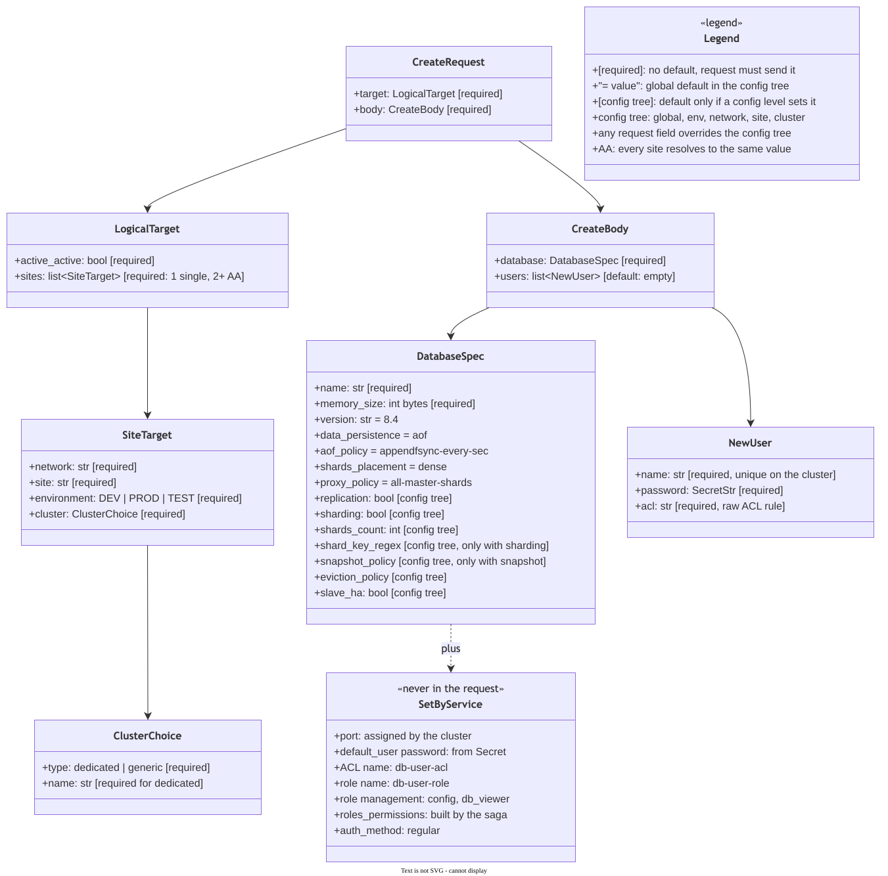
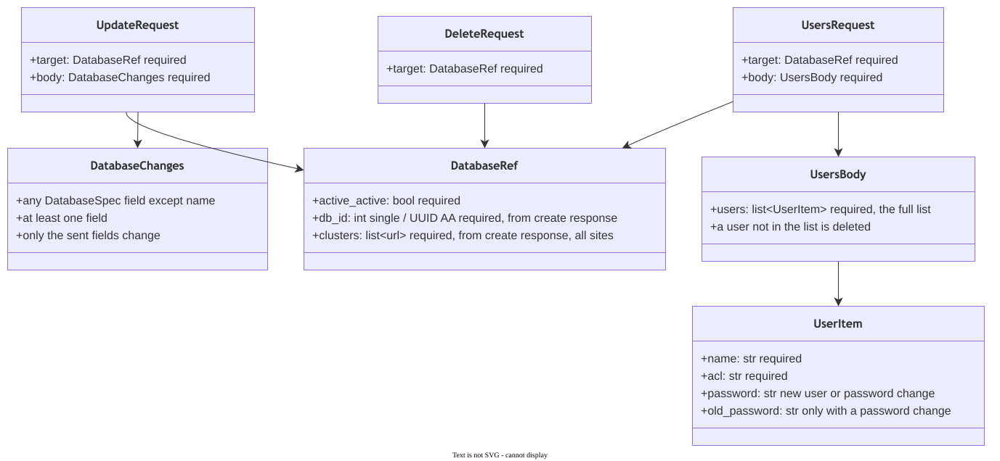
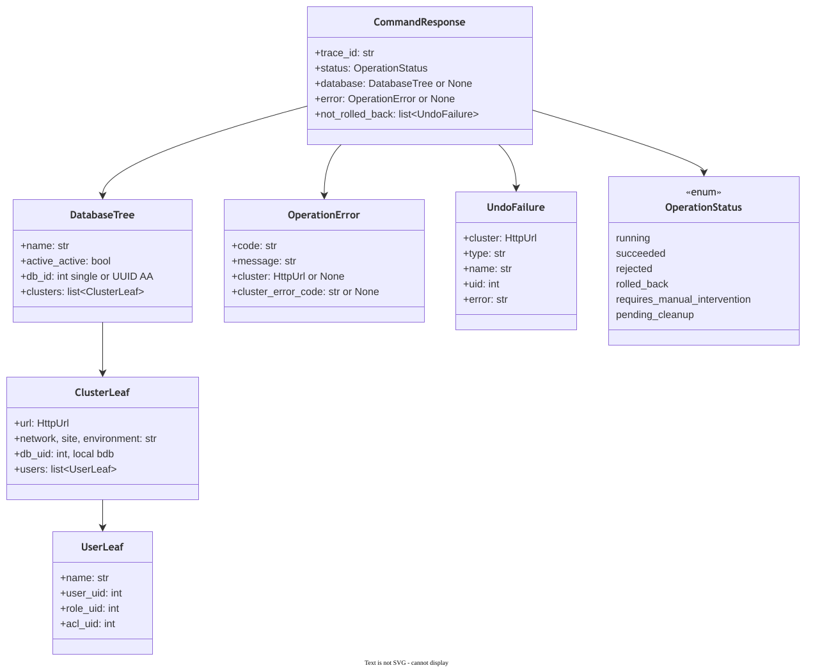
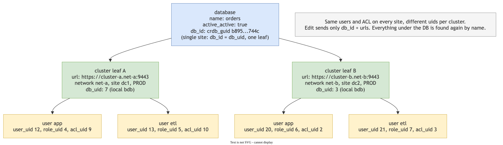
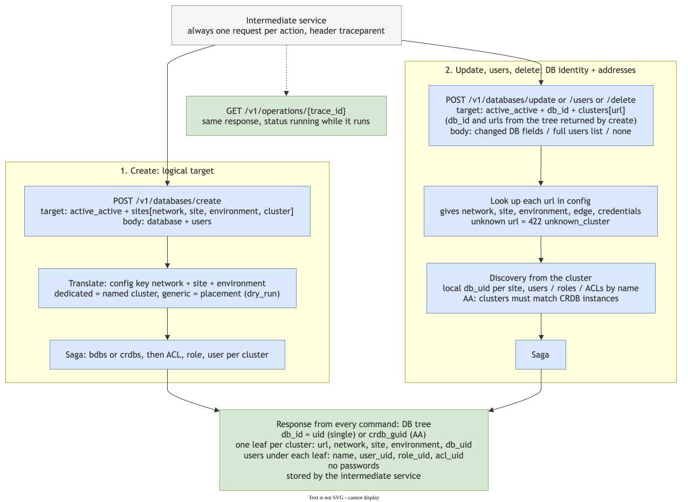
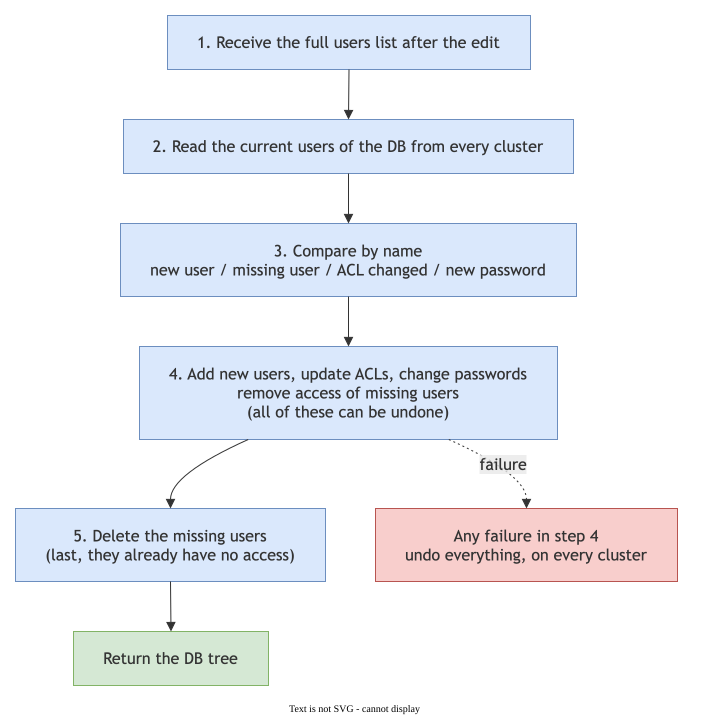
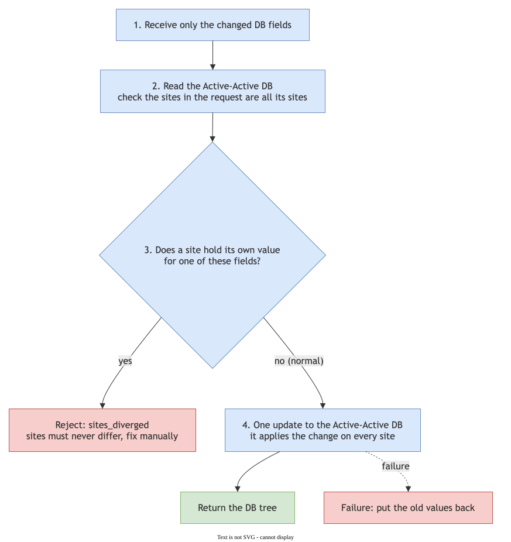

# redis-enterprise-services

המסמך המלא, עם כל ההחלטות והבדיקות מול הקלאסטר: `spec.md`.

---

## הבעיה

יצירת DB היא כמה פעולות נפרדות מול Redis: DB, ואז לכל יוזר ACL, role, user והרשאה. ב-Active-Active כל זה קורה
בכמה קלאסטרים. כשפעולה נכשלת באמצע, נשאר מצב חלקי: DB בלי יוזרים, יוזר בלי הרשאה, או אתר אחד בלי השני. מישהו
צריך לנקות ידנית.

**השירות מבטיח שכל פעולה מצליחה כולה, או שהקלאסטר חוזר בדיוק למצב שלפני הבקשה.**

## מילון

| מונח | משמעות |
|---|---|
| **Saga** | פעולה שמורכבת מכמה צעדים, ולכל צעד יש פעולה שמבטלת אותו |
| **ביטול** | הפעולה ההפוכה של צעד: יצירה ⇐ מחיקה, עריכה ⇐ החזרת הערך הקודם |
| **צעד שאי אפשר לבטל** (pivot) | למשל מחיקת DB. אחריו רק ממשיכים קדימה |
| **AA / CRDB** | Active-Active: DB אחד שרץ בכמה אתרים ומסתנכרן ביניהם |
| **uid** | המזהה ש-Redis נותן למשאב. ב-AA לכל אתר uid משלו |

---

## 1. מה השירות עושה

- מקבל פעולה עסקית אחת משירות הביניים: יצירה, עריכה או מחיקה של DB.
- מפרק אותה לצעדים מול Redis Enterprise: DB, ACL, role, user והרשאות.
- כשצעד נכשל, מבטל את מה שכבר נעשה, והקלאסטר חוזר למצב שלפני הבקשה.
- **לא באחריותו:** הרשאות עסקיות (ה-UI), המרת הפורמט של ה-UI (שירות הביניים), והגישה לרשת (שירות הקצה).

---

## 2. איפה הוא רץ

- השירות רץ ברשת הניהול. כל קריאה לקלאסטר עוברת דרך חומת אש ושירות קצה של רשת היעד.
- הרשת, האתר והסביבה קובעים את הקלאסטרים, את שירות הקצה ואת פרטי הגישה. הכל בקונפיג, והסודות ב-Secret.
- ב-Active-Active הסנכרון רץ ישירות בין הקלאסטרים, ולא דרכנו.

---

# חלק א: ה-API

מה שירות הביניים שולח, ומה חוזר אליו. החוזה המלא, עם כל השדות וקודי השגיאה: `docs/contracts/service-api.md`.

## 3. Routes

| פעולה | route |
|---|---|
| יצירה | `POST /v1/databases/create` |
| עריכת DB | `POST /v1/databases/update` |
| עריכת יוזרים | `POST /v1/databases/users` |
| מחיקה | `POST /v1/databases/delete` |
| סטטוס | `GET /v1/operations/{trace_id}` |
| קריאה ישירה לקלאסטר | `POST /v1/cluster-requests` |

- **אסינכרוני:** פקודה מחזירה מיד `202` עם `trace_id`. הפעולה רצה ברקע, והתוצאה ב-`GET /v1/operations/{trace_id}`.
  כך שירות הביניים לא מחזיק חיבור פתוח לאורך הפעולה.
- בקשה שלא עוברת הזדהות, ולידציה או כתובת מוכרת נדחית מיד, לפני `202`.
- כל בקשה נושאת `traceparent`. בקשה חוזרת עם אותו trace לא מתחילה פעולה חדשה, ומקבלת את המצב הנוכחי.
- כל בקשה בנויה מ-`target` (איפה) ומ-`body` (מה). אתר בודד ו-AA נשלחים באותו מבנה.
- ביצירה לא שולחים IDs. הם חוזרים בתוצאה, ונשלחים בבקשות הבאות.

---

## 4. מה נשלח ביצירה

- **חובה:** היעד, `name` ו-`memory_size` של ה-DB, ולכל יוזר `name`, `password` ו-`acl`.
- **כל השאר אופציונלי.** לחלק מהשדות יש ברירת מחדל, כמו שמופיע בדיאגרמה.

---

## 5. מה נשלח בעריכה ובמחיקה

- **`target` אחד לכל הבקשות:** `active_active`, `db_id` וכתובות הקלאסטרים, כמו שחזרו ביצירה.
- **עריכת DB:** רק השדות שמשתנים.
- **עריכת יוזרים:** הרשימה המלאה. יוזר שחסר בה נמחק. סיסמה נשלחת רק ליוזר חדש, או בהחלפה יחד עם הישנה.
- **מחיקה:** רק `target`.

---

## 6. מה חוזר

**דוגמה ל-AA בשני אתרים:**

- התוצאה של כל פקודה, בשאילתת הסטטוס, היא ה-DB כעץ: קלאסטר לכל אתר, ומתחת לכל קלאסטר היוזרים, עם ה-uids שלהם שם.
- באתר בודד זה אותו עץ, עם עלה אחד.
- בכישלון: `status`, `error`, ומה שלא בוטל (`not_rolled_back`).
- סיסמאות לא חוזרות אף פעם.

---

# חלק ב: הלוגיקה

## 7. הדרך של בקשה בתוך השירות

- **יצירה:** היעד הלוגי מתורגם לקלאסטר לפי הקונפיג, ו-generic בוחר קלאסטר עם מקום.
- **עריכה ומחיקה:** כל כתובת מאותרת בקונפיג, ומשם נלקחים הרשת, שירות הקצה ופרטי הגישה. כתובת לא מוכרת נדחית.
- **כל מה שמתחת ל-DB** (uid מקומי, יוזרים, roles, ACLs) נקרא מחדש מהקלאסטר. **הקלאסטר הוא מקור האמת.**
- **ברירות המחדל** מגיעות מקובץ הקונפיג.
- **בדיקה לפני שינוי:** שמות תפוסים ומקום פנוי נבדקים לפני שמשהו נוצר. רוב הכשלים נעצרים כאן, ואין מה לבטל.

---

## 8. Saga וביטול

- **לכל צעד יש פעולה מבטלת.** יצירה ⇐ מחיקה, עריכה ⇐ החזרת הערך הקודם.
- **כלל הסדר:** כל הצעדים שאפשר לבטל קודם. אחריהם לכל היותר צעד אחד שאי אפשר לבטל (pivot), ובסוף צעדים שחוזרים
  עליהם עד הצלחה.
- **בכשל:** מבטלים את מה שהסתיים, בסדר הפוך.
- **שם קבוע לכל משאב** (`{db}-{user}-acl`, `{db}-{user}-role`). כשתשובה הולכת לאיבוד בדרך, מוצאים את המשאב
  לפי השם ולא לפי ה-uid שלא הגיע.

---

## 9. הפעולות

**יצירה:** DB, ואז לכל יוזר ACL, role ו-user, ובסוף חיבור ההרשאות ל-DB. ב-AA ה-CRDB נוצר פעם אחת, והיוזרים
נוצרים בכל קלאסטר, כי ב-Redis יוזרים שייכים לקלאסטר.

**עריכת רשימת היוזרים:** שירות הביניים שולח את הרשימה המלאה. השירות משווה אותה למה שיש בקלאסטר: יוזר חדש
נוסף, יוזר שחסר נמחק, ACL שהשתנה מתעדכן, וסיסמה מתחלפת רק כשנשלחה.

**עריכת DB ב-AA:** קריאה אחת ל-CRDB, וה-CRDB מפיץ לכל האתרים. אין הבדל בין אתרים, חוץ מהיוזרים. אתר עם ערך
שונה הוא תקלה, והעריכה נדחית במקום להצליח רק בחלק מהאתרים.

**מחיקה:** כל מה שאפשר לבטל קודם, ומחיקת ה-DB אחרונה. כשל לפניה מחזיר הכל למצב הקודם.

הרצפים המלאים, עם כל קריאה ל-Redis, נמצאים ב-`spec.md` סעיף 6.2.

---

## 10. מה קורה בכשל

| מצב סופי | מה קרה |
|---|---|
| `succeeded` | הכל הצליח |
| `rolled_back` | צעד נכשל, הכל בוטל. שום דבר לא השתנה |
| `requires_manual_intervention` | ביטול נכשל, או שהשירות קרס באמצע. התשובה כוללת רשימה מדויקת של מה שנשאר |
| `pending_cleanup` | timeout ביצירת AA. נשלח ביטול, ושאילתת הסטטוס מראה אם הניקוי הסתיים |

- **אחרי קריסה** השירות לא ממשיך ולא מבטל לבד. הוא עוצר לטיפול ידני, וה-DB נשאר נעול.
- **נעילה ברמת DB** לכל משך הפעולה, כך ששתי פעולות על אותו DB לא רצות במקביל.
- **מצב ה-Saga והנעילה נשמרים ב-Redis,** ולכן השירות יכול לרוץ בכמה עותקים.

---

## 11. מה עוד פתוח

| שאלה | חוסם את הפיתוח? |
|---|---|
| שיטת בחירת קלאסטר generic: עדיפות או מקום פנוי | לא. נדחה: כרגע קלאסטר אחד לכל יעד |
| מדיניות שמות יוזרים | לא |
| שינוי שם של DB | לא. ההחלטה לא רק שלנו |
| התראות ו-`tags` | לא |
