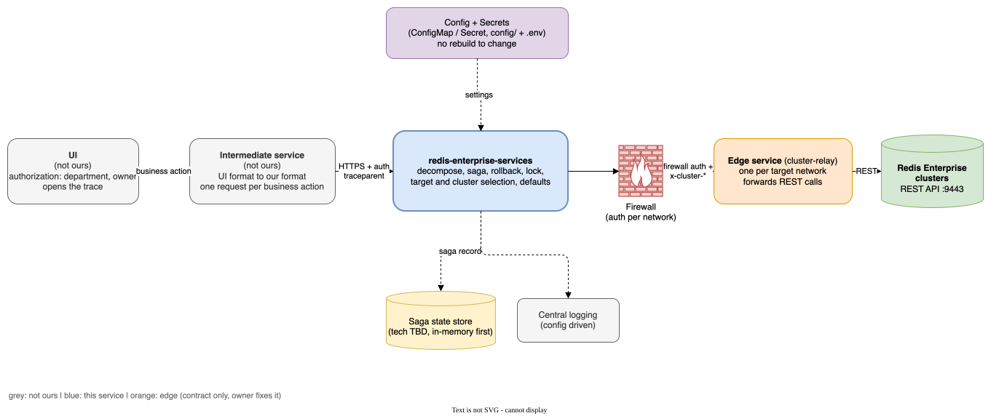
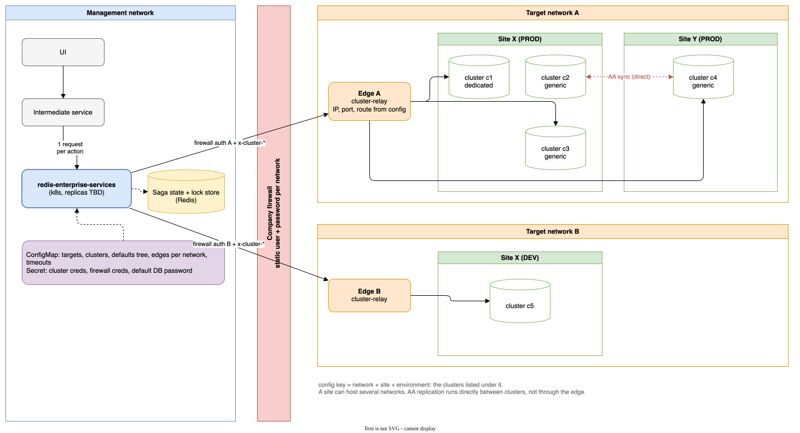
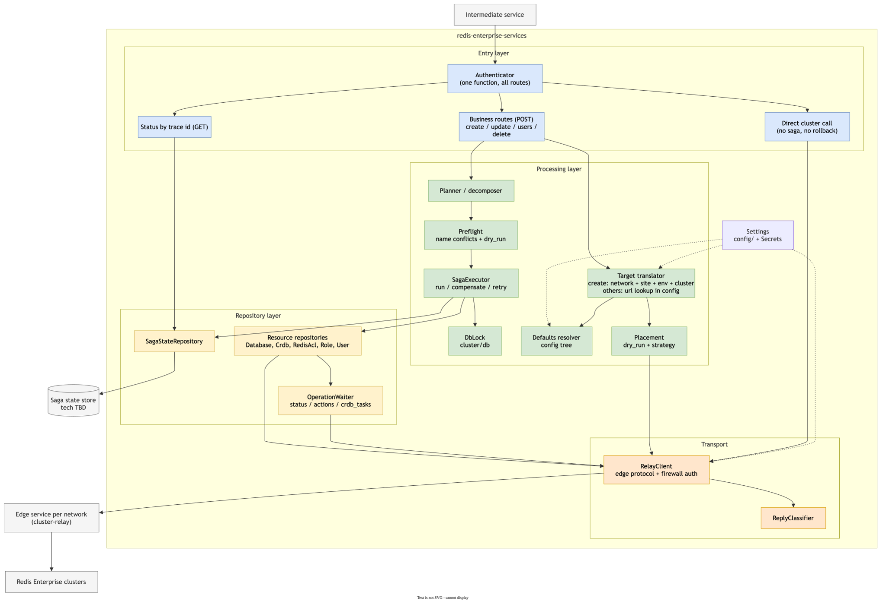
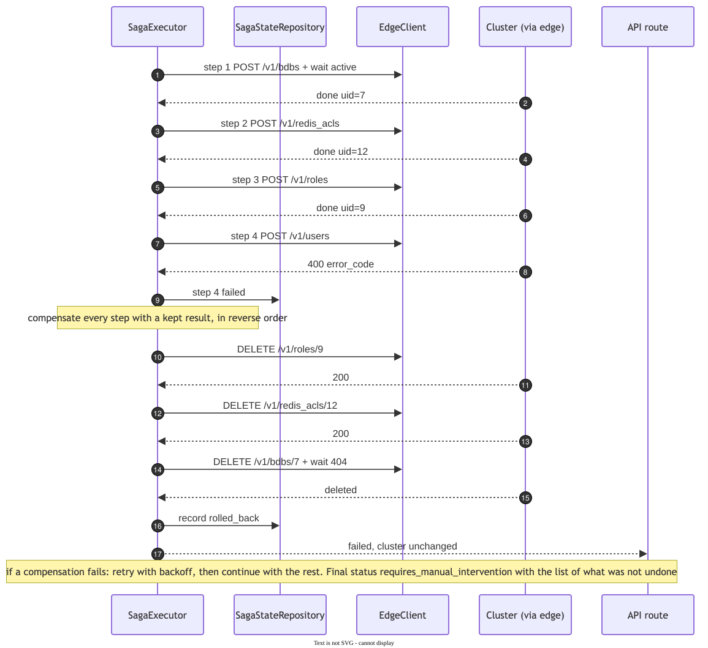
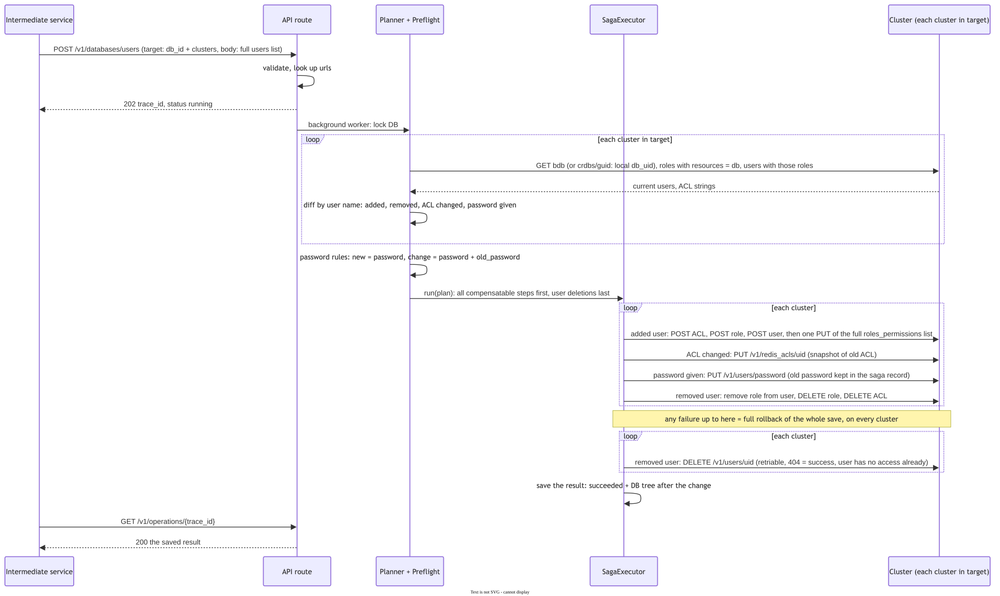
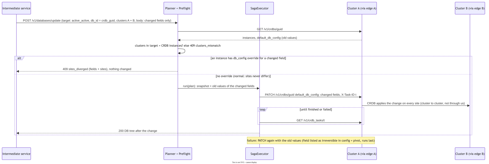
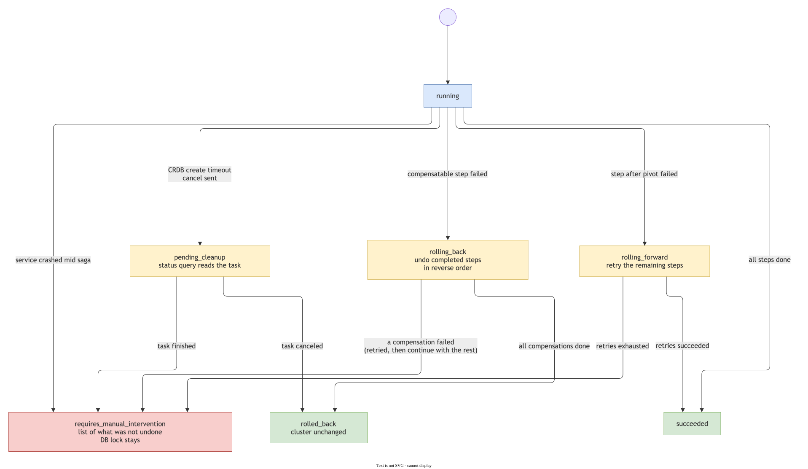

# redis-enterprise-services: הלוגיקה

המסמך המלא, עם כל ההחלטות והבדיקות מול הקלאסטר: `spec.md`.

---

## 1. מה השירות עושה

- מקבל פעולה עסקית אחת משירות הביניים: יצירה, עריכה או מחיקה של DB.
- מפרק אותה לצעדים מול Redis Enterprise: DB, ACL, role, user והרשאות.
- כשצעד נכשל, מבטל את מה שכבר נעשה, והקלאסטר חוזר למצב שלפני הבקשה.
- **לא באחריותו:** הרשאות עסקיות (ה-UI), המרת הפורמט של ה-UI (שירות הביניים), והגישה לרשת (שירות הקצה).

---

## 2. איפה הוא רץ

- השירות רץ ברשת הניהול. כל קריאה לקלאסטר עוברת דרך חומת אש ושירות קצה של רשת היעד.
- הרשת, האתר והסביבה קובעים את הקלאסטרים, את שירות הקצה ואת פרטי הגישה. הכל בקונפיג, והסודות ב-Secret.
- ב-Active-Active הסנכרון רץ ישירות בין הקלאסטרים, ולא דרכנו.

---

## 3. החוזה מול שירות הביניים

| פעולה | route |
|---|---|
| יצירה | `POST /v1/databases/create` |
| עריכת DB | `POST /v1/databases/update` |
| עריכת יוזרים | `POST /v1/databases/users` |
| מחיקה | `POST /v1/databases/delete` |
| סטטוס | `GET /v1/operations/{trace_id}` |

- **כל בקשה בנויה מ-`target` ומ-`body`.** ה-`body` לא יודע כלום על אתרים, ולכן אתר בודד ו-AA זהים מבחינת ה-UI.
- **ביצירה ה-`target` הוא יעד לוגי:** רשת, אתר, סביבה וקלאסטר (dedicated או generic). השירות בוחר את הקלאסטר.
- **בכל השאר ה-`target` הוא `db_id` וכתובות הקלאסטרים,** כמו שחזרו ביצירה. בלי רשת: הכתובת מאותרת בקונפיג.
- **ביצירה לא שולחים IDs.** הקלאסטר מייצר אותם, והם חוזרים בתשובה.
- **מזהה הבקשה הוא `traceparent`.** בקשה חוזרת עם אותו trace מקבלת את אותה תשובה, ולא רצה פעמיים.

---

## 4. מה חוזר

- כל פקודה מחזירה את ה-DB כעץ: ה-DB, קלאסטר לכל אתר עם ה-uid המקומי, ומתחת לכל קלאסטר היוזרים עם ה-uids שלהם.
- באתר בודד זה אותו עץ, עם עלה אחד.
- שירות הביניים שומר את העץ לתצוגה. בעריכה הוא שולח רק `db_id` וכתובות, וכל מה שמתחת ל-DB השירות שלנו קורא
  מחדש מהקלאסטר. **הקלאסטר הוא מקור האמת.**
- סיסמאות לא חוזרות אף פעם.

---

## 5. איך בקשה מעובדת

| # | שלב | משנה את הקלאסטר? |
|---|---|---|
| 1 | **תרגום:** יעד לוגי ⇐ קלאסטר, או כתובת ⇐ רשומה בקונפיג | לא |
| 2 | **גילוי:** קריאת המצב הקיים, בעריכה ובמחיקה | לא |
| 3 | **פירוק:** רשימה מסודרת של צעדים | לא |
| 4 | **בדיקה מוקדמת:** שמות תפוסים, מקום פנוי (dry_run) | לא |
| 5 | **הרצה:** Saga | כן |

רוב הכשלים הצפויים נתפסים בשלבים 1–4, לפני שנוצר משהו שצריך לבטל.

---

## 6. Saga וביטול

- **לכל צעד יש פעולה מבטלת.** יצירה ⇐ מחיקה, עריכה ⇐ החזרת הערך הקודם.
- **כלל הסדר:** כל הצעדים שאפשר לבטל קודם. אחריהם לכל היותר צעד אחד שאי אפשר לבטל (pivot), ובסוף צעדים שחוזרים
  עליהם עד הצלחה.
- **בכשל:** מבטלים את מה שהסתיים, בסדר הפוך.
- **שם קבוע לכל משאב** (`{db}-{user}-acl`, `{db}-{user}-role`). כשתשובה הולכת לאיבוד בדרך, מוצאים את המשאב
  לפי השם ולא לפי ה-uid שלא הגיע.

---

## 7. הפעולות

**יצירה:** DB, ואז לכל יוזר ACL, role ו-user, ובסוף חיבור ההרשאות ל-DB. ב-AA ה-CRDB נוצר פעם אחת, והיוזרים
נוצרים בכל קלאסטר, כי ב-Redis יוזרים שייכים לקלאסטר.

**עריכת רשימת היוזרים:** שירות הביניים שולח את הרשימה המלאה. השירות משווה אותה למה שיש בקלאסטר: יוזר חדש
נוסף, יוזר שחסר נמחק, ACL שהשתנה מתעדכן, וסיסמה מתחלפת רק כשנשלחה.

**עריכת DB ב-AA:** קריאה אחת ל-CRDB, וה-CRDB מפיץ לכל האתרים. אין הבדל בין אתרים, חוץ מהיוזרים. אתר עם ערך
שונה הוא תקלה, והעריכה נדחית במקום להצליח רק בחלק מהאתרים.

**מחיקה:** כל מה שאפשר לבטל קודם, ומחיקת ה-DB אחרונה. כשל לפניה מחזיר הכל למצב הקודם.

---

## 8. מה קורה בכשל

| מצב סופי | מה קרה |
|---|---|
| `succeeded` | הכל הצליח |
| `rolled_back` | צעד נכשל, הכל בוטל. שום דבר לא השתנה |
| `requires_manual_intervention` | ביטול נכשל, או שהשירות קרס באמצע. התשובה כוללת רשימה מדויקת של מה שנשאר |
| `pending_cleanup` | timeout ביצירת AA. נשלח ביטול, ושאילתת הסטטוס מראה אם הניקוי הסתיים |

- **אחרי קריסה** השירות לא ממשיך ולא מבטל לבד. הוא עוצר לטיפול ידני, וה-DB נשאר נעול.
- **נעילה ברמת DB** לכל משך הפעולה, כך ששתי פעולות על אותו DB לא רצות במקביל.
- **מצב ה-Saga והנעילה נשמרים ב-Redis,** ולכן השירות יכול לרוץ בכמה עותקים.

---

## 9. מה עוד פתוח

| שאלה | חוסם את הפיתוח? |
|---|---|
| ה-UI שולח את הסיסמה הישנה בהחלפת סיסמה | לא. ממתין לאישור סופי |
| שיטת ההזדהות מול השירות (טוקן או שם משתמש וסיסמה) | לא. פונקציה אחת |
| שיטת בחירת קלאסטר generic: עדיפות או מקום פנוי | לא. בקונפיג |
| מדיניות שמות יוזרים | לא |
| שינוי שם של DB | לא. ההחלטה לא רק שלנו |
| התראות ו-`tags` | לא |
