# מסמך אפיון: redis-enterprise-services

**סטטוס:** לסקירת תכנון (DR)
**תאריך:** 2026-10-21
**מסמכים מפורטים:**
- `docs/design/saga.md`: כל משאב, כל פעולה, ואיך מבטלים אותה.
- `docs/design/db-model.md`: מודל ה-DB, היוזר, ה-ACL וה-role.
- `docs/contracts/edge-service.md`: החוזה מול שירות הקצה.

הדיאגרמות נמצאות ב-`docs/dr/diagrams/`, כקבצי `.drawio.svg`. אפשר לפתוח ולערוך אותן ב-draw.io.

---

## 1. מטרה והיקף

השירות מקבל **פעולה עסקית אחת** על משאבי Redis Enterprise, למשל "צור DB עם שלושה יוזרים", ומבצע אותה
כרצף של קריאות REST לקלאסטרים. אם צעד באמצע נכשל, הצעדים שכבר בוצעו מבוטלים, והקלאסטר חוזר למצב שלפני
הבקשה (Saga).

### באחריות השירות
- תרגום היעד (רשת, אתר, סביבה, קלאסטר) לקלאסטר ולשירות קצה.
- בחירת קלאסטר כשהקלאסטר generic.
- חישוב ברירות המחדל מעץ הקונפיג.
- פירוק הבקשה לצעדים, בדיקה מוקדמת, הרצה, וביטול בכשל.
- נעילה של DB בזמן ריצה.
- idempotency לפי trace ID.
- דיווח מדויק על מה שבוצע ועל מה שלא בוטל.

### לא באחריות השירות
- **הרשאות עסקיות** (מחלקה, אחראי, מי רשאי לבקש מה): ה-UI.
- **ייחודיות שם DB:** הפונה. הקלאסטר לא אוכף אותה ב-API (V2).
- **המרת הפורמט של ה-UI:** שירות הביניים.
- **שירות הקצה (cluster-relay):** השירות נבנה לפי חוזה. התאמת cluster-relay לחוזה באחריות הבעלים שלו.

---

## 2. מיקום בארכיטקטורה

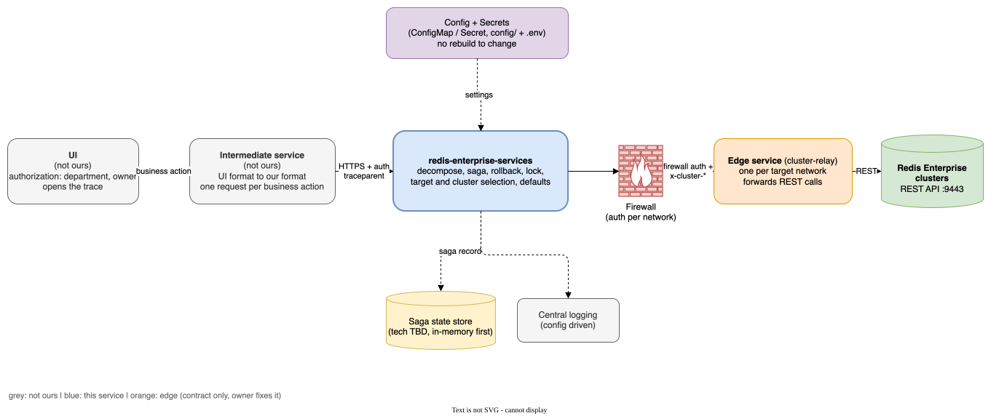

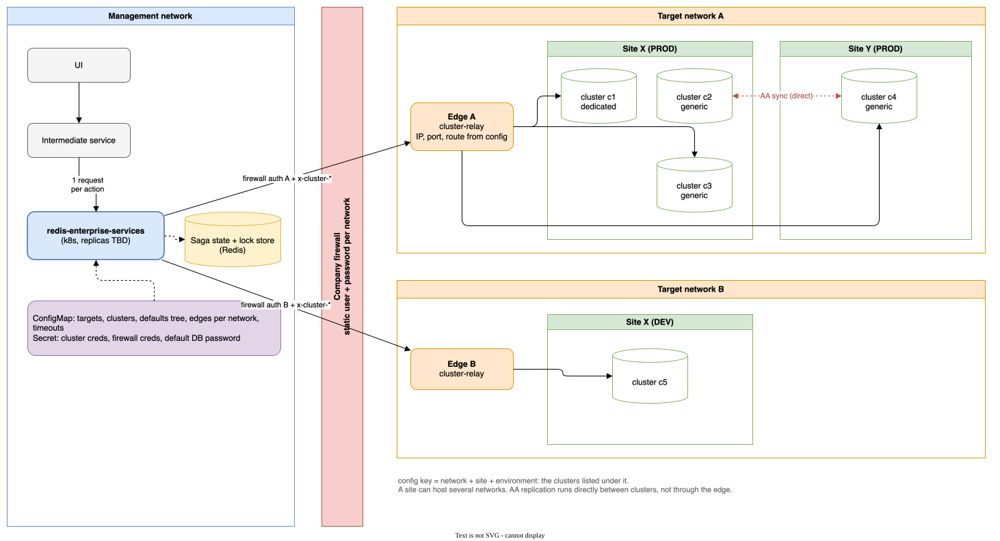

- **כל הניהול ברשת הניהול.** בכל רשת יעד יש רק שירות קצה וקלאסטרים.
- **כל קריאה לקלאסטר חוצה חומת אש.** לכל רשת יש כתובת שירות קצה משלה (IP, פורט, route), ושם משתמש וסיסמה
  קבועים לחומת האש. כל בקשה נושאת שני אימותים: מול חומת האש, ומול הקלאסטר (`x-cluster-authorization`).
- **השירות לא פונה ישירות לקלאסטר.** כל קריאה עוברת דרך שירות הקצה של הרשת.
- **סנכרון AA** רץ ישירות בין הקלאסטרים, ולא דרך שירות הקצה.

---

## 3. מודל הבקשה

**כלל ה-IDs:** ביצירה לא שולחים שום ID. הקלאסטר מייצר את כל ה-IDs (`uid`, וב-AA `crdb_guid`), והם חוזרים
בתשובה, יחד עם הקלאסטר שנבחר בכל אתר. בעריכה ובמחיקה השירות שמעל שולח את ה-IDs ואת הקלאסטר שחזרו. המזהה היחיד
שהשירות מייצר בעצמו הוא `X-Task-ID`, מספר מעקב פנימי של task ב-CRDB. הוא לא משאב, ולא יוצא מהשירות.

### 3.1 יעד וגוף

כל בקשה בנויה משני חלקים נפרדים:

| חלק | מה בו | משתנה לפי הפעולה? |
|---|---|---|
| `target` | איפה הבקשה רצה, ובעריכה ובמחיקה גם איזה DB | רק בין יצירה לשאר הפעולות |
| `body` | תוכן הפעולה: יצירה, עריכת DB או רשימת יוזרים | כן. לא יודע כלום על אתרים |

ל-`target` יש שתי צורות. **ביצירה** מגיע יעד לוגי, והשירות בונה ממנו את כתובת הקלאסטר. **בכל השאר** מגיעים
ה-`db_id` וכתובות הקלאסטרים שחזרו בתשובה ליצירה (4.4).

#### יצירה: יעד לוגי

```json
"target": {
  "active_active": true,
  "sites": [
    {"network": "net-a", "site": "dc1", "environment": "PROD", "cluster": {"type": "generic"}},
    {"network": "net-b", "site": "dc2", "environment": "PROD", "cluster": {"type": "dedicated", "name": "orders-c2"}}
  ]
}
```

| שדה | ערך |
|---|---|
| `network` | מזהה חד-ערכי של רשת |
| `site` | אתר |
| `environment` | `DEV` / `PROD` / `TEST` |
| `cluster` | `{"type": "dedicated", "name": …}`, או `{"type": "generic"}` (השירות בוחר, 5.1) |

הצירוף `network + site + environment` הוא מפתח בקונפיג. תחתיו רשומים הקלאסטרים של היעד, ולכל קלאסטר: URL,
FQDN, סוג (dedicated או generic), עדיפות, והפניה לפרטי הגישה ב-Secret.

#### עריכה ומחיקה: זהות ה-DB וכתובות

```json
"target": {
  "active_active": true,
  "db_id": "b89590d5-b17f-4047-b9c0-debeaa6a744c",
  "clusters": ["https://cluster-a.net-a:9443", "https://cluster-b.net-b:9443"]
}
```

| שדה | ערך |
|---|---|
| `active_active` | בוליאני |
| `db_id` | ה-`uid` של ה-DB באתר בודד (מספר), ה-`crdb_guid` ב-AA (UUID). מה שחזר ביצירה |
| `clusters` | הכתובות המלאות של הקלאסטרים, כמו שחזרו ביצירה |

- **`db_id` הוא חלק מה-`target`, ולא ב-path.** באתר בודד ה-`uid` ייחודי רק בתוך קלאסטר, ולכן רק הצירוף שלו עם
  הכתובת מזהה DB. כשהשניים באותו מודל, הולידציה של הסוג מול `active_active` נעשית במקום אחד, וכל השכבות (תרגום,
  נעילה, saga record, לוגים) מקבלות את אותו אובייקט זהות.
- **בלי רשת, אתר וסביבה.** השירות מחפש כל כתובת ברשימת הקלאסטרים בקונפיג. הרשומה שנמצאה כבר שייכת לרשת, לאתר
  ולסביבה, ומשם השירות לוקח את שירות הקצה ואת פרטי הגישה.
- **כתובת שלא רשומה בקונפיג נדחית**, כדי שפרטי גישה לא יישלחו לכתובת שלא מוכרת.
- **ב-AA, `clusters` כולל תמיד את כל הקלאסטרים של ה-CRDB.** אין עריכה של חלק מהאתרים. בשלב הגילוי השירות משווה
  את הרשימה ל-`instances` של ה-CRDB, ואי-התאמה נדחית (`409 clusters_mismatch`).
- **אין בחירת קלאסטר.** היא קיימת רק ביצירה.
- **כל מה שמתחת ל-DB מאותר בשלב הגילוי, ולא נשלח:** ה-uid המקומי של ה-DB בכל אתר (`GET /v1/crdbs/{guid}` בכל
  קלאסטר), והיוזרים, ה-roles וה-ACLs לפי השם (V16, `saga.md` סעיף 10). ה-uid של יוזר משתנה כשהוא נוצר מחדש (V8),
  ושינוי מחוץ לשירות משנה את מה שבקלאסטר. לכן עץ ששמור אצל השירות שמעל לא משמש לעריכה, והקלאסטר הוא מקור האמת.

#### ולידציה במודל

| מצב | תוצאה |
|---|---|
| `active_active: false`, איבר אחד ב-`sites` או ב-`clusters` | תקין |
| `active_active: false`, יותר מאיבר אחד | נדחה |
| `active_active: true`, פחות משני איברים | נדחה |
| `active_active: false` ו-`db_id` שאינו מספר | נדחה |
| `active_active: true` ו-`db_id` שאינו UUID | נדחה |
| אותה כתובת או אותו אתר פעמיים | נדחה |

**היעד הוא באחריות השירות שמעל.** אתר בודד ו-AA זהים מבחינת ה-UI: אותם routes ואותו `body`. השירות שמעל אומר מה
לערוך ואיפה, והשירות שלנו לא מגלה אתרים בעצמו.

### 3.2 הפעולות

**כלל (D9):** שתי בקשות מכילות כמה אובייקטים: היצירה הראשונה, ועריכת רשימת היוזרים. עריכת DB נוגעת רק
באובייקט ה-DB. ב-AA כל פעולה רצה על כל האתרים, ועדיין כ-Saga.

| # | פעולה | תוכנית | pivot |
|---|---|---|---|
| 1 | יצירת DB (אתר בודד), עם 0..N יוזרים | DB ⇐ לכל יוזר ACL, role, user ⇐ הרשאות | אין |
| 2 | יצירת DB ב-AA, עם 0..N יוזרים | CRDB ⇐ איתור bdb מקומי בכל אתר ⇐ אותם צעדים בכל אתר | אין |
| 3 | עריכת DB / CRDB | שדות הפיכים ⇐ שדות לא הפיכים. ב-AA קריאה אחת ל-CRDB | שדה לא הפיך (רשימה בקונפיג) |
| 4 | עריכת רשימת היוזרים: הוספה, מחיקה ועריכה בכל צירוף | השוואה מול הקלאסטר ⇐ כל הצעדים ההפיכים ⇐ מחיקות user | אין. מחיקת user באה אחרונה וניתנת לחזרה |
| 5 | מחיקת DB / CRDB עם היוזרים | הסרת roles ⇐ מחיקת roles ⇐ מחיקת ACLs ⇐ **מחיקת DB** ⇐ מחיקת users | מחיקת DB |
| 6 | שאילתת סטטוס לפי trace ID | קריאה מ-saga record | - |
| 7 | קריאה ישירה לקלאסטר | כתובת קלאסטר + method + path + body כמו שהם, בלי Saga ובלי rollback | - |

**עריכת רשימת היוזרים** (פירוט ב-`saga.md` סעיף 7.4):
- ה-UI שולח את הרשימה המלאה אחרי העריכה. יוזר שחסר ברשימה נמחק.
- סיסמה היא שדה מפורש: סיסמה חדשה מחליפה, ובלעדיה לא נוגעים. עם סיסמה חדשה נשלחת גם הישנה (D2).
- שינוי המפתח של יוזר הוא מחיקה ויצירה.

### 3.3 מודל ה-DB

פירוט מלא ב-`docs/design/db-model.md`. בקצרה:

- **חובה:** `name`, `memory_size`.
- **שדות במודל**, כולם עם ברירת מחדל מהקונפיג שה-UI יכול לדרוס:
  - `version` (8.4)
  - `replication`
  - `sharding`, `shards_count`, `shard_key_regex`
  - `data_persistence` (aof), `aof_policy` (every-sec), `snapshot_policy`
  - `eviction_policy`
  - `shards_placement` (dense), `proxy_policy` (all-master-shards)
  - `slave_ha`
- **לא נשלחים:**
  - `port`: הקלאסטר מקצה אותו אוטומטית.
  - `tls_mode`: אין TLS. החיבור בשם משתמש וסיסמה.
- **סיסמת `default_user`:** קבועה, מ-Secret. נשלחת ביצירה ב-`authentication_redis_pass` (נבדק, bdb ו-CRDB).
- **עריכה:** כל שדה במודל יכול להגיע בבקשת עריכה. מגבלות של התשתית, כמו הקטנת shards, נאכפות על ידי הקלאסטר.

### 3.4 יוזר, ACL ו-role

- **ACL:**
  - `name`: `{db}-{user}-acl`.
  - `acl`: מחרוזת ACL גולמית מה-UI.
- **role:**
  - `name`: `{db}-{user}-role`.
  - `management`: מהקונפיג, `db_viewer`.
  - `resources`: ה-DB של היוזר בלבד.
- **user:**
  - `name`: המפתח, מה-UI. הקלאסטר אוכף ייחודיות, תלוית רישיות (V16).
  - `password`: מה-UI.
  - `email`: לא נשלח. אין מיילים ליוזרים.
  - `auth_method`: `regular`.
  - `role_uids`: נקבע על ידי ה-Saga.
- **שיתוף:** ACL ו-role אף פעם לא משותפים בין DBs או בין יוזרים.

### 3.5 ברירות מחדל

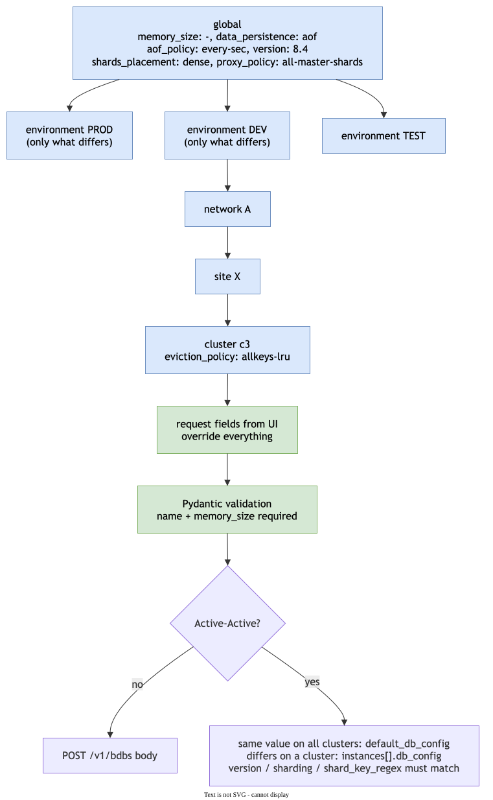

`global ⇐ סביבה ⇐ רשת ⇐ אתר ⇐ קלאסטר ⇐ הבקשה`

- כל רמה מגדירה רק את מה ששונה אצלה.
- הדריסה היא לפי שדה, גם בתוך אובייקט מקונן.
- **ב-AA:**
  - **אין הבדל בין אתרים, חוץ מהיוזרים.** כל הבדל אחר הוא תקלה.
  - כל ערכי ה-DB נשלחים ב-`default_db_config`, ומופצים לכל האתרים. השירות אף פעם לא שולח `instances[].db_config`.
  - עץ ברירות המחדל חייב לתת ערך זהה בכל האתרים. אם רמה של רשת, אתר או קלאסטר נותנת ערך שונה, זו שגיאת קונפיג:
    היצירה נדחית לפני ששום דבר נוצר (`500 configuration_error`, לוג `ERROR`).

---

## 4. API

### 4.1 עקרונות
- **הזדהות חובה בכל route.** פונקציה אחת שמוחלת על כל ה-routes. השיטה (טוקן או שם משתמש וסיסמה) תיקבע בהמשך
  (שאלה 14).
- **ולידציה:** כל קלט עובר ולידציה במודל Pydantic לפני עיבוד.
- **מזהה בקשה:** `traceparent`. ה-trace נפתח ב-UI.
- **סינכרוני:** הבקשה מחכה עד סוף הפעולה ומחזירה את התוצאה הסופית.

### 4.2 routes (D10)

שירות הביניים נבנה לפי החוזה הזה, ולכן ה-methods נבחרו לפי מה שנכון לשירות: `POST` לכל פקודה, `GET` לקריאה.

| פעולה | route | `target` | `body` |
|---|---|---|---|
| יצירה | `POST /v1/databases/create` | יעד לוגי | DB ו-0..N יוזרים |
| עריכת DB | `POST /v1/databases/update` | זהות וכתובות | שדות של ה-DB בלבד |
| עריכת יוזרים | `POST /v1/databases/users` | זהות וכתובות | הרשימה המלאה של היוזרים אחרי העריכה |
| מחיקה | `POST /v1/databases/delete` | זהות וכתובות | - |
| שאילתת סטטוס | `GET /v1/operations/{trace_id}` | - | - |
| קריאה ישירה לקלאסטר | `POST /v1/cluster-requests` | כתובת אחת | `method`, `path` ו-`body` כמו שהם |

- **כל פקודה היא `POST` עם גוף.** כל בקשה מריצה Saga ונושאת `target`, כולל מחיקה. כך אין `DELETE` עם גוף.
- **ה-routes בלי פרמטרים.** הזהות של ה-DB נמצאת ב-`target` (3.1), וכל route הוא שם של פעולה.
- **שאילתת הסטטוס היא `GET`,** כי היא קריאה בלבד. ה-`trace_id` מזהה שלם בפני עצמו, ולכן הוא ב-path.
- **כל route ממיר את הבקשה לפקודה אחת.** ה-Planner וה-Saga משותפים לכולם, ולכן route חדש לא משנה אותם.

### 4.3 בקשות

כל בקשה נושאת header של `traceparent` (4.5) ושל ההזדהות (4.1).

**יצירה: `POST /v1/databases/create`**

```json
{
  "target": { "active_active": …, "sites": [ … ] },
  "body": {
    "database": {"name": "orders", "memory_size": 1073741824, "replication": true},
    "users": [
      {"name": "app", "password": "…", "acl": "+@all ~orders:*"}
    ]
  }
}
```

- `database`: מודל ה-DB (3.3). חובה רק `name` ו-`memory_size`. כל שדה אחר מקבל ברירת מחדל מעץ הקונפיג (3.5).
- `users`: 0..N יוזרים. לכל יוזר `name`, `password` ו-`acl` (מחרוזת ACL גולמית). כולם חובה.
- ב-AA אותם `database` ו-`users` נוצרים בכל האתרים. אין הבדלים בין אתרים (3.5).

**עריכת DB: `POST /v1/databases/update`**

```json
{
  "target": { "active_active": …, "db_id": …, "clusters": [ … ] },
  "body": {"memory_size": 2147483648, "eviction_policy": "volatile-lru"}
}
```

- כל שדה במודל ה-DB, חוץ מ-`name` (שינוי שם עוד פתוח, סעיף 11). לפחות שדה אחד.
- רק השדות שנשלחו משתנים. שדה שלא נשלח לא נוגעים בו.
- **ב-AA העריכה היא קריאה אחת ל-CRDB:** `PATCH /v1/crdbs/{guid}` עם השדות ב-`default_db_config`, וה-CRDB מפיץ
  לכל האתרים. אין עריכה לפי אתר.
- **אתר עם override הוא תקלה.** `PATCH` על `default_db_config` לא מגיע לאתר שיש לו override לאותו שדה (V17), כך
  שהעריכה הייתה מצליחה רק בחלק מהאתרים. לכן בגילוי השירות בודק את `instances[].db_config`. אם יש override לשדה
  שבבקשה, העריכה נדחית (`409 sites_diverged`) עם רשימת השדות והאתרים, לטיפול ידני.

**עריכת יוזרים: `POST /v1/databases/users`**

```json
{
  "target": { "active_active": …, "db_id": …, "clusters": [ … ] },
  "body": {
    "users": [
      {"name": "app", "acl": "+@all ~orders:*"},
      {"name": "reporter", "acl": "+@read ~*", "password": "…", "old_password": "…"},
      {"name": "etl", "acl": "+@all ~*", "password": "…"}
    ]
  }
}
```

- **הרשימה המלאה אחרי העריכה.** יוזר שחסר בה נמחק (פירוט ב-`saga.md` סעיף 7.4).
- לכל יוזר `name` ו-`acl` חובה. `password` רק כשמחליפים סיסמה או ליוזר חדש.
- הכללים לסיסמה נבדקים אחרי הגילוי, כי רק אז ידוע אם היוזר קיים:

| יוזר | `password` | `old_password` |
|---|---|---|
| חדש | חובה | אסור |
| קיים, הסיסמה לא משתנה | אסור | אסור |
| קיים, הסיסמה משתנה | חובה | חובה (D2) |

- ב-AA, ההשוואה נעשית בכל קלאסטר בנפרד מול מה שיש בו, ואותה רשימה מוחלת על כל האתרים.

**מחיקה: `POST /v1/databases/delete`**

```json
{ "target": { "active_active": …, "db_id": …, "clusters": [ … ] } }
```

**קריאה ישירה: `POST /v1/cluster-requests`**

```json
{ "cluster": "https://cluster-a.net-a:9443", "method": "GET", "path": "/v1/bdbs", "body": null }
```

הכתובת עוברת את אותה בדיקה מול הקונפיג (3.1). הבקשה עוברת כמו שהיא, בלי Saga ובלי rollback.

### 4.4 תשובות

#### הצלחה: עץ ה-DB

כל פקודה שהצליחה מחזירה את ה-DB כעץ, כמו שהוא אחרי הפעולה:

```json
{
  "trace_id": "4bf92f3577b34da6a3ce929d0e0e4736",
  "status": "succeeded",
  "database": {
    "name": "orders",
    "active_active": true,
    "db_id": "b89590d5-b17f-4047-b9c0-debeaa6a744c",
    "clusters": [
      {
        "url": "https://cluster-a.net-a:9443",
        "network": "net-a", "site": "dc1", "environment": "PROD",
        "db_uid": 7,
        "users": [ {"name": "app", "user_uid": 12, "role_uid": 4, "acl_uid": 9} ]
      },
      {
        "url": "https://cluster-b.net-b:9443",
        "network": "net-b", "site": "dc2", "environment": "PROD",
        "db_uid": 3,
        "users": [ {"name": "app", "user_uid": 20, "role_uid": 6, "acl_uid": 2} ]
      }
    ]
  }
}
```

- **שורש:** ה-DB. `db_id` הוא ה-`uid` באתר בודד וה-`crdb_guid` ב-AA. זה הערך שנשלח ב-`target` בבקשות הבאות.
- **עלה לכל קלאסטר:** הכתובת, הרשת, האתר והסביבה, וה-uid המקומי של ה-DB. ב-AA לכל אתר uid משלו.
- **מתחת לכל עלה:** היוזרים באותו קלאסטר, עם ה-uids שלהם שם. אותו יוזר מקבל uids שונים בכל אתר.
- **באתר בודד** זה אותו עץ, עם עלה אחד. מודל תשובה אחד לשני המקרים.
- **השירות שמעל שומר את העץ לתצוגה ולתיעוד.** לעריכה הוא שולח רק את `db_id` ואת ה-`url`-ים (3.1).
- **סיסמאות לא מוחזרות אף פעם.**
- **מחיקה שהצליחה** מחזירה `status: succeeded` ואת `db_id`, בלי עץ.

#### כישלון

```json
{
  "trace_id": "4bf92f3577b34da6a3ce929d0e0e4736",
  "status": "rolled_back",
  "error": {
    "code": "step_rejected",
    "message": "…",
    "cluster": "https://cluster-b.net-b:9443",
    "cluster_error_code": "insufficient_resources"
  },
  "not_rolled_back": []
}
```

| `status` | מה קרה | HTTP |
|---|---|---|
| `rejected` | נדחה לפני שמשהו השתנה: ולידציה, גילוי או בדיקה מוקדמת | לפי הסיבה, בטבלה הבאה |
| `rolled_back` | צעד נכשל, והכל בוטל. שום דבר לא השתנה | `422` כשהקלאסטר דחה את הצעד, `502` כשהוא לא זמין |
| `requires_manual_intervention` | הביטול לא הושלם (D6), או שהשירות קרס באמצע (D5) | `500` |
| `pending_cleanup` | timeout ביצירת CRDB. נשלח cancel, והניקוי עוד לא אושר (D8) | `504` |

- **`not_rolled_back`** ממולא רק ב-`requires_manual_intervention`. לכל פריט: `cluster`, `type`, `name`, `uid` ו-`error`.
- **`error.cluster` ו-`error.cluster_error_code`** מופיעים כשהכשל הגיע מקלאסטר מסוים.
- **`pending_cleanup`** נפתר בשאילתת הסטטוס. מזהה ה-task הפנימי (`X-Task-ID`) לא יוצא מהשירות.

**`error.code` ב-`rejected`:**

| `code` | HTTP |
|---|---|
| `validation_error`, עם `details` לכל שדה | `422` |
| `unknown_cluster`: כתובת או יעד שלא בקונפיג | `422` |
| `unauthenticated` | `401` |
| `database_not_found`: `db_id` לא נמצא בקלאסטר | `404` |
| `clusters_mismatch`: `clusters` לא תואם ל-`instances` של ה-CRDB | `409` |
| `name_taken`: שם DB או יוזר תפוס | `409` |
| `insufficient_resources`: אין מקום באף קלאסטר מתאים (dry_run) | `409` |
| `database_locked`: ה-DB נעול גם אחרי ה-timeout | `409` |
| `operation_in_progress`: אותו `trace_id` עוד רץ | `409` |
| `sites_diverged`: לאתר ב-AA יש override לשדה שבעריכה (4.3, V17) | `409` |
| `configuration_error`: עץ ברירות המחדל נותן ערכים שונים לאתרים של AA (3.5) | `500` |
| `password_rules`: הפרה של כללי הסיסמה (4.3) | `422` |

#### שאילתת סטטוס: `GET /v1/operations/{trace_id}`

מחזירה את אותה תשובה שהפקודה החזירה או תחזיר, ואת `status` הנוכחי. בזמן ריצה `status` הוא `running`. ב-`pending_cleanup`
השאילתה קוראת את ה-task: `canceled` ⇐ `rolled_back`, `finished` ⇐ `requires_manual_intervention` (D8). `trace_id`
לא מוכר ⇐ `404`.

### 4.5 idempotency ונעילה

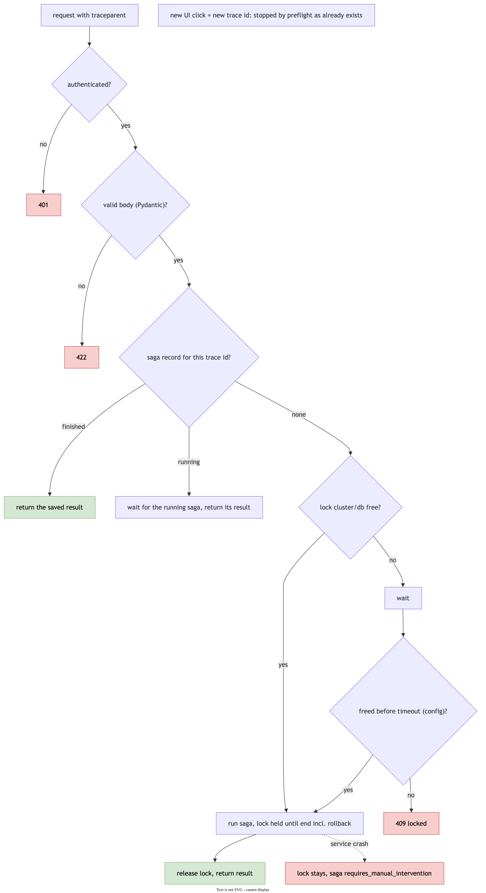

- **בקשה חוזרת עם אותו `traceparent`** מקבלת את התשובה של הריצה הקיימת. אם הריצה עוד רצה: `409 operation_in_progress`,
  והתשובה הסופית זמינה בשאילתת הסטטוס.
- **נעילה:** ראו 6.6.

---

## 5. זרימת עיבוד

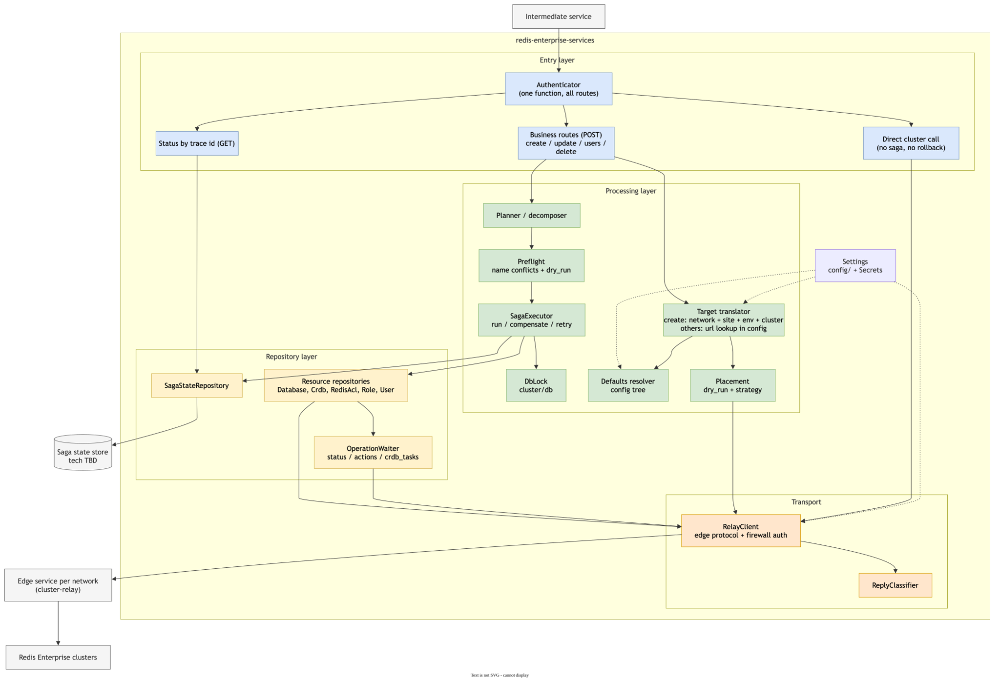

| # | שלב | משנה את הקלאסטר? |
|---|---|---|
| 1 | **תרגום:** יעד ⇐ קלאסטר(ים), שירות קצה, ברירות מחדל | לא |
| 2 | **גילוי:** קריאת המצב הנוכחי, בעריכה ובמחיקה | לא |
| 3 | **פירוק:** בניית תוכנית, רשימה מסודרת של צעדים | לא |
| 4 | **בדיקה מוקדמת:** שמות תפוסים, dry_run | לא |
| 5 | **הרצה:** Saga, וביטול או המשך קדימה בכשל | כן |

רוב הכשלים הצפויים נתפסים בשלבים 1–4, לפני שנוצר משהו שצריך לבטל.

### 5.1 בחירת קלאסטר

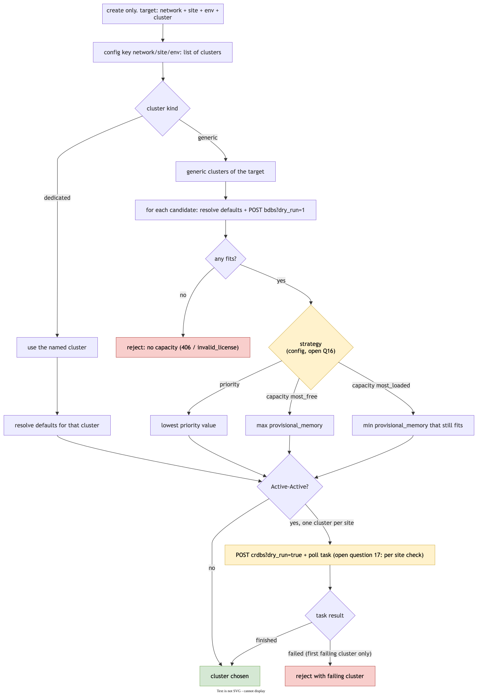

- **dry_run של bdb** מחזיר `406 insufficient_resources` או `400 invalid_license`, בלי ליצור כלום.
- **dry_run של CRDB:**
  - מחזיר תמיד `200` עם task. התוצאה מגיעה רק ב-task.
  - הוא בודק כל אתר: מקום, פורט ופרטי גישה.
  - כשכמה אתרים נכשלים, מדווח רק הראשון (V12, V14).
- **שיטת הבחירה ב-generic:** `priority`, `capacity most_free` או `capacity most_loaded`. כולן נתמכות בקונפיג.
  ההחלטה איזו מהן פתוחה (שאלה 16).

---

## 6. Saga

### 6.1 סוגי צעדים וכלל הסדר

| סוג | בכשל |
|---|---|
| הפיך | מבטלים בסדר הפוך |
| pivot | אין ביטול. אחריו רק ממשיכים קדימה. |
| ניתן לחזרה | חוזרים עליו עד הצלחה, ואחר כך התערבות ידנית |

**הכלל:** כל הצעדים ההפיכים קודם, אחריהם לכל היותר pivot אחד, ובסוף צעדים שניתנים לחזרה. המנוע דוחה תוכנית
שלא עומדת בכלל.

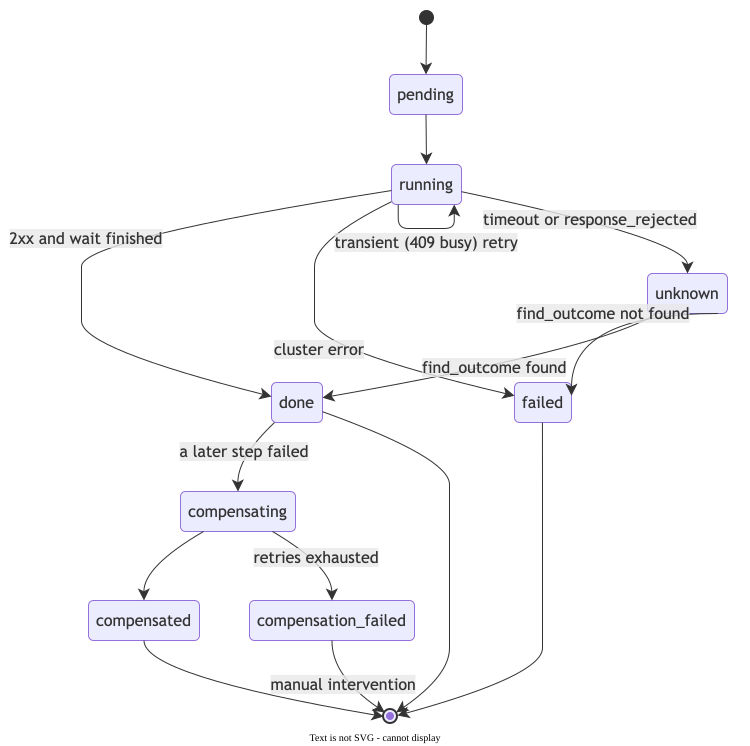

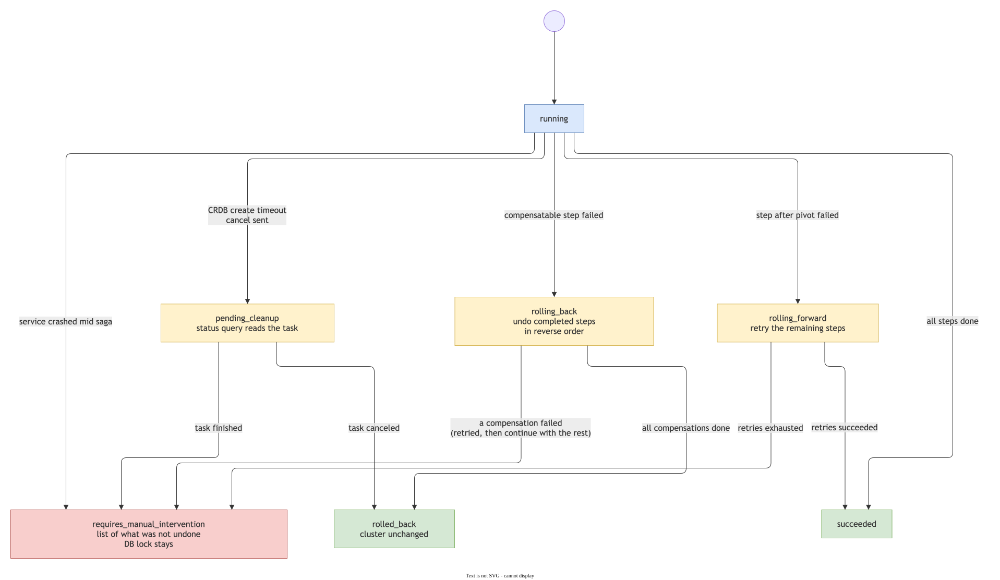

### 6.2 תרחישים

**יצירת DB:**
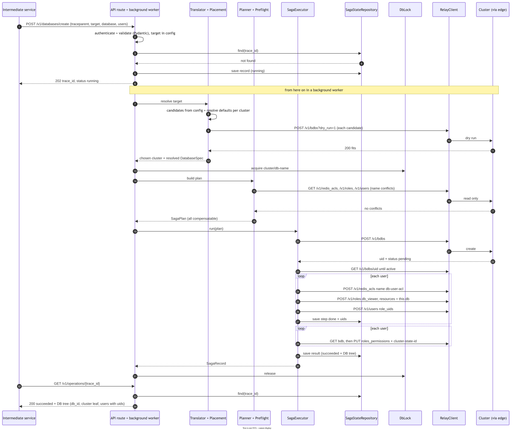

**כשל באמצע יצירה, ו-rollback:**
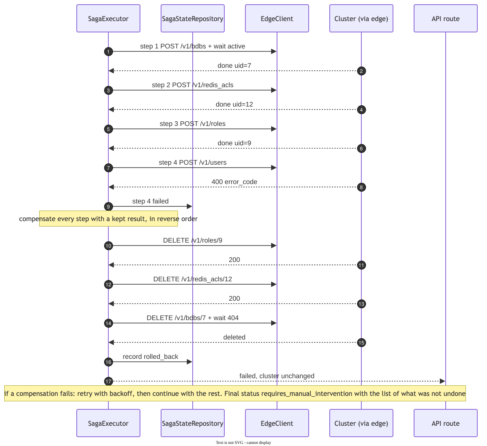

**יצירה ב-AA:**
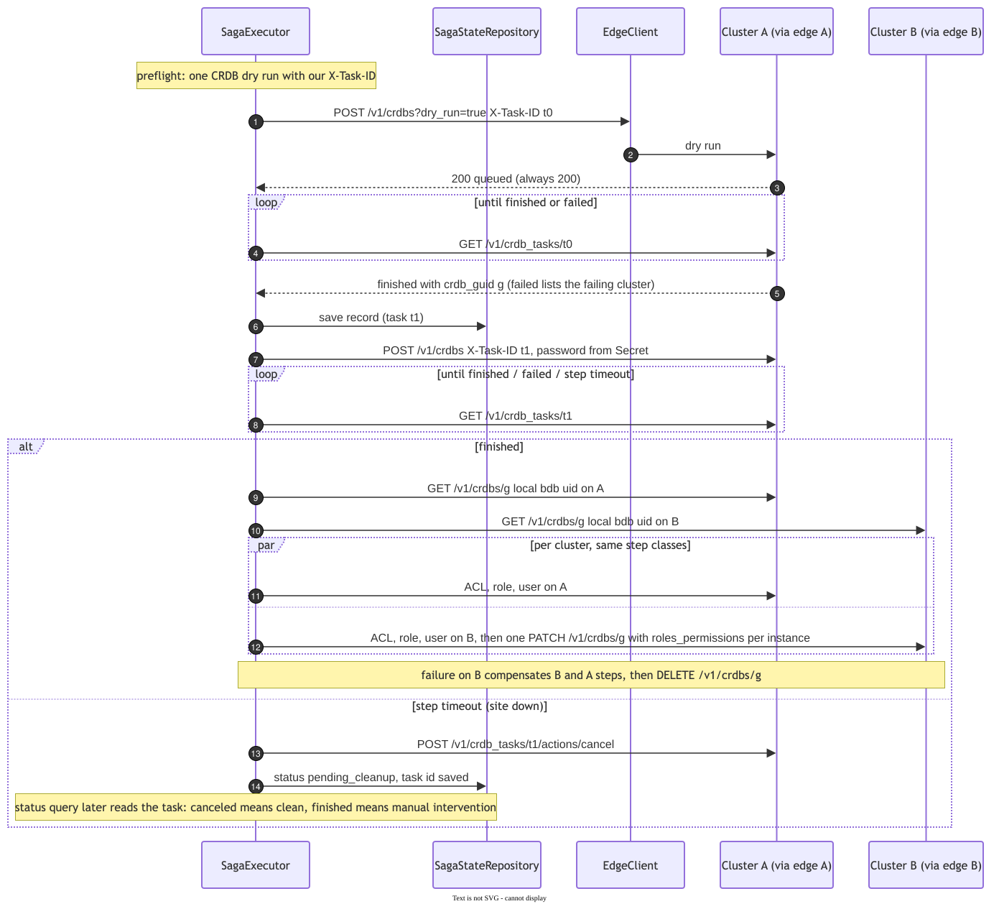

**מחיקת DB עם יוזרים.** כל מה שהפיך קודם, ומחיקת ה-DB אחרונה (D1):
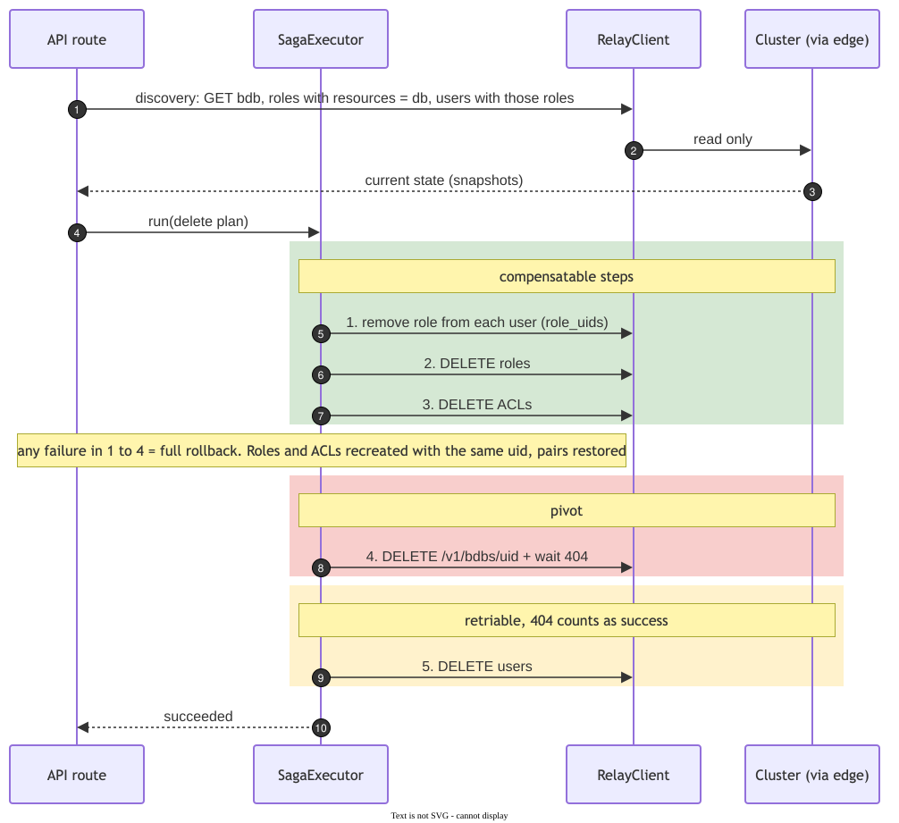

**עריכת DB ועדכון מותנה:**
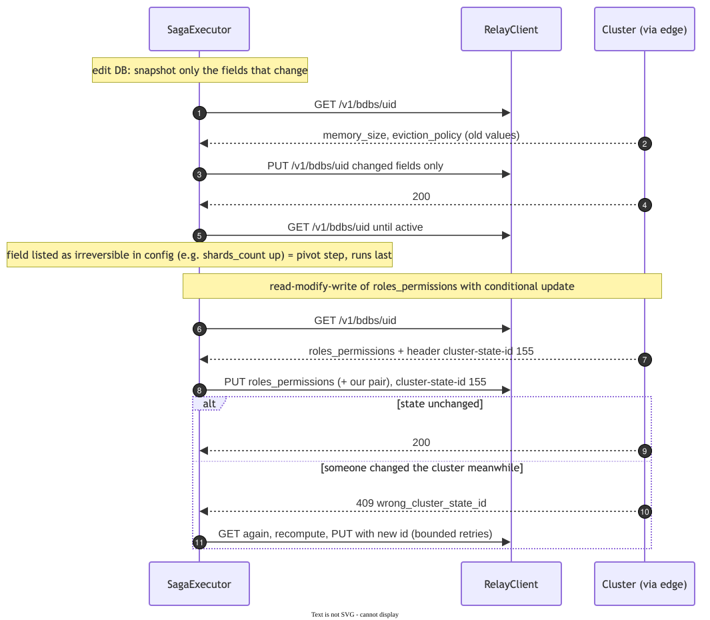

### 6.3 תוצאה לא ידועה ומיון תשובות

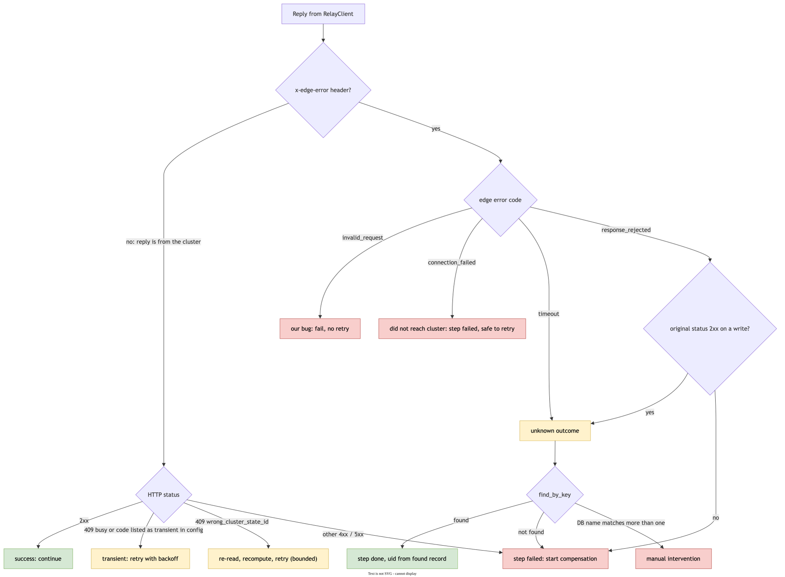

- **מפתח זיהוי לכל משאב:**
  - ACL ו-role: `name`.
  - user: `name`.
  - DB: `name`.
  - CRDB: `X-Task-ID` שאנחנו קובעים. ה-task מחזיר את ה-`guid` שהקלאסטר יצר.
- **איך מאתרים משאב:** ל-API אין חיפוש לפי שם. `find_by_key` שולף את הרשימה ומסנן אותה בקוד.

### 6.4 כשל של ביטול
1. retry עם backoff, לפי הקונפיג.
2. ממשיכים לבטל את שאר הצעדים (D6).
3. ה-Saga מסומן `requires_manual_intervention`, ונרשם לוג `CRITICAL`.
4. הפונה מקבל כישלון עם רשימה של מה שלא בוטל.

### 6.5 קריסה של השירות
- **בעלייה:** Sagas שלא הסתיימו לא ממשיכים ולא מתבטלים אוטומטית. הם מסומנים `requires_manual_intervention`
  (D5).
- **הנעילה נשארת** עד שמישהו מטפל ב-Saga.
- **מה נשמר:** ה-saga record נכתב לפני כל צעד ואחריו. סיסמאות לא נשמרות בו אף פעם.

### 6.6 ריצות במקביל
- **נעילה:** ברמת DB, לפי `{cluster}/{db}`, לכל משך ה-Saga. DB חדש ננעל לפי השם שלו. ב-AA נועלים את ה-DB בכל
  קלאסטר משתתף.
- **כשה-DB נעול:** הבקשה מחכה עד timeout מהקונפיג, ואחר כך מקבלת `409`.
- **עדכון מותנה:** כל קריאה ואחריה כתיבה של `roles_permissions` שולחת `cluster-state-id`. על
  `409 wrong_cluster_state_id` הצעד קורא שוב ומנסה שוב, עם מגבלת ניסיונות (V11).
- **ביטול מבוסס דלתא:** ביטול מסיר או מחזיר רק את מה שהצעד עצמו שינה (D3).

---

## 7. מבנה המחלקות

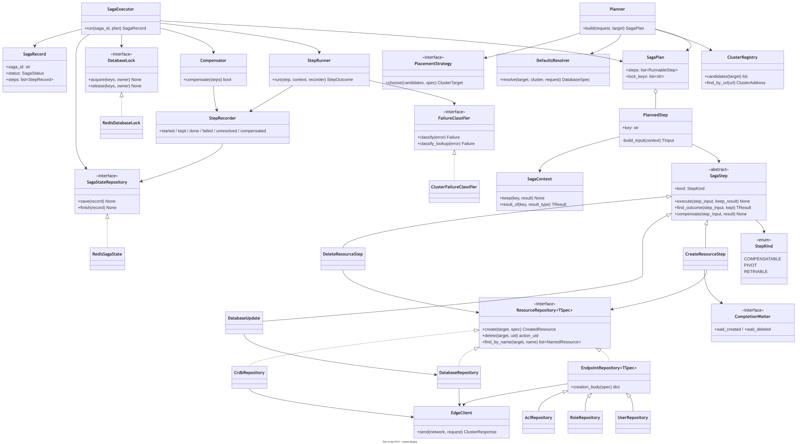

- **שלושה צעדים גנריים** (`Create`, `Update`, `DeleteResourceStep`) על כל `ResourceRepository`.
- **פיצוי בלי קוד חדש:** הפיצוי של יצירה הוא אותו `delete`, והפיצוי של עדכון הוא אותו `update`.
- **AA בלי מחלקות נוספות:** אותו צעד מקבל קלאסטר אחר.
- **הקריאה הישירה** משתמשת ב-`ClusterRegistry` וב-`RelayClient`, בלי Saga.
- **עקרונות:** DI, Repository pattern, Pydantic v2 לכל מבנה נתונים, והיררכיית exceptions ב-`exceptions/`.

---

## 8. החוזה מול שירות הקצה (תקציר)

פירוט מלא ב-`docs/contracts/edge-service.md`.

| נושא | דרישה |
|---|---|
| בקשה | `POST /<route>` עם `x-cluster-method`, `x-cluster-url`, `x-cluster-authorization`, `traceparent` ו-body כמו שהוא |
| חומת אש | header אימות לכל רשת, מהקונפיג. נפרד מ-`x-cluster-authorization`. |
| headers נוספים | `cluster-state-id`, `x-task-id`, `x-result-ttl` (חסרים היום: C4, C5) |
| תשובה | status, headers ו-body של הקלאסטר בלי שינוי, גם בשגיאה |
| שגיאה של שירות הקצה | `x-edge-error`: `invalid_request` / `connection_failed` / `timeout` / `response_rejected` (חסר היום: C9–C11) |
| סודות | לא לרשום ללוג סודות מגוף התשובה (חסר היום: C13) |

---

## 9. קונפיגורציה, סודות ולוגים

- **שום ערך בקוד.** כל ערך נטען ממקור חיצוני (ConfigMap/Secret, ומקומית `config/` ו-`.env`), ואפשר לשנות
  אותו בלי לבנות את הקונטיינר מחדש. דרך Pydantic Settings.
- **מה בקונפיג:**
  - יעדים וקלאסטרים, ושירות קצה לכל רשת.
  - עץ ברירות המחדל, ושדות DB שאי אפשר להחזיר (D7).
  - שיטת בחירת קלאסטר.
  - timeouts, מרווחי המתנה ומדיניות retry.
  - קודי שגיאה שנחשבים זמניים, ושמות headers.
  - רמות לוג.
- **סודות, רק ב-Secret:**
  - פרטי גישה לקלאסטרים ולחומות האש.
  - סיסמת `default_user`.
- **הסתרת סודות:** תשובות bdb ו-CRDB כוללות `authentication_admin_pass` ו-`authentication_redis_pass` בטקסט
  גלוי. הם מוסתרים בלוגים וב-saga record. גוף בקשת יצירת CRDB ובקשות יוזר לא נרשמים ללוג.
- **לוגים:** logger מרכזי, עם handlers, formatters ורמות מהקונפיג. `CRITICAL` על התערבות ידנית. ה-trace ID
  בכל רשומה.

---

## 10. בדיקות

- **שלוש רמות:** unit, integration ו-e2e. כיסוי של 80% לפחות לקוד חדש.
- **e2e:** מול קלאסטרים אמיתיים ב-docker compose:
  - שני קלאסטרים.
  - node שני ל-cluster1, בפרופיל `multinode`.
  - proxy שמחליף זמנית את שירות הקצה.
- **הגדרת "גמור" לכל שלב:** הפעולה עובדת דרך שירות הקצה, וכשל מוזרק בכל צעד משאיר את הקלאסטר נקי.
- **פיתוח ב-vertical slices:**
  - שלב 1: יצירה באתר בודד.
  - שלב 2: יצירה ב-AA.
  - שלב 3: מחיקה.
  - שלב 4: עריכה.
  - אחרי שלב 4: מעבר ל-cluster-relay.

---

## 11. החלטות

### הוחלטו
| # | החלטה |
|---|---|
| D1 | מחיקה: כל מה שהפיך קודם, ומחיקת ה-DB אחרונה. כשל לפניה ⇐ rollback מלא. |
| D2 | ה-UI שולח את הסיסמה הישנה. ממתין לאישור סופי. |
| D3 | ביטול מבוסס דלתא: רק השינוי של הצעד עצמו. |
| D4 | מצב Saga ב-storage מתמשך. ממשק מהיום הראשון, ומימוש בזיכרון לפיתוח. |
| D5 | אחרי קריסה: התערבות ידנית. לא ממשיכים ולא מבטלים. |
| D6 | כשל של ביטול: ממשיכים לבטל את השאר, ומחזירים כישלון עם רשימה של מה שלא בוטל. |
| D7 | שדות DB שאי אפשר להחזיר: ברשימה בקונפיג. |
| D8 | timeout ביצירת CRDB: cancel, וסטטוס `pending_cleanup`. |
| D9 | שתי בקשות מכילות כמה אובייקטים: היצירה הראשונה, ועריכת רשימת היוזרים. עריכת DB נוגעת רק באובייקט ה-DB. |
| D10 | API: `POST` לכל פקודה ו-`GET` לסטטוס. routes בלי פרמטרים. ביצירה יעד לוגי, ובשאר `target` עם `db_id` וכתובות. כל פקודה מחזירה את עץ ה-DB. ראו 4.2–4.4. |

### פתוחות
| # | שאלה | חוסם? |
|---|---|---|
| 1 | הטכנולוגיה של storage ה-Saga והנעילה | לא. יש ממשק |
| 14 | שיטת ההזדהות | לא. פונקציה אחת |
| 15 | מדיניות שמות יוזרים | לא |
| 16 | שיטת בחירת קלאסטר ב-generic | לא. קונפיג |
| 17 | בדיקה של כל אתר בנפרד ב-AA | לא |
| - | שינוי `name` של DB (מחייב שינוי שמות ACL ו-role) | לא. ההחלטה לא רק שלנו |
| - | `tags`, התראות (DB ויוזר) | לא |

---

## נספח: עובדות שנבדקו מול הקלאסטר

הבדיקות רצו על Redis Software 8.2.0, עם DB בגרסאות 8.2 ו-8.4, על שני קלאסטרים ו-node שני. הפירוט ב-`saga.md`
סעיף 11 וב-`db-model.md`.

| # | ממצא |
|---|---|
| V1 | role שיוזר משתמש בו לא נמחק (`406 role_in_use`). מחיקה של role או ACL שמחוברים ל-DB מסירה את הזוגות שלהם. |
| V2 | שם DB לא ייחודי ב-API |
| V3 | יצירת DB: `action_uid`, ו-`pending` ⇐ `active` תוך 2–6 שניות |
| V4–V6 | CRDB: `X-Task-ID` שאנחנו קובעים. בקשה כפולה ⇐ `406 job_exists`. אפשר גם לקבוע `guid`, אבל לא משתמשים בזה: הקלאסטר מייצר אותו. |
| V7, V10 | אילו שינויי DB הפיכים, כולל `replication` |
| V8 | role ו-ACL נוצרים מחדש עם אותו uid. ביוזר ה-uid לא נשמר. |
| V9 | מחיקת DB מסירה אותו מ-`resources` של roles |
| V11 | `cluster-state-id`: עדכון מותנה עובד. המזהה שייך לכל הקלאסטר. |
| V12, V14 | dry_run של CRDB בודק כל אתר. התוצאה רק ב-task. |
| V13 | אתר שנופל באמצע יצירת CRDB: ה-task תקוע, cancel מנקה |
| V15 | `db_config` לכל instance דורס את ה-default |
| V17 | `PATCH` על `default_db_config` של CRDB לא מגיע לאתר שיש לו override לאותו שדה. לכן override הוא תקלה, ועריכה נדחית כשיש כזה |
| V16 | `name` של יוזר ייחודי (`409 name_already_exists`), תלוי רישיות. `email` לא חובה. |
| - | סיסמת `default_user` דרך `authentication_redis_pass` ב-bdb וב-CRDB, ומוחזרת בטקסט גלוי ב-GET |
