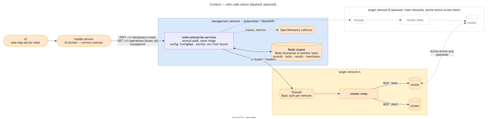
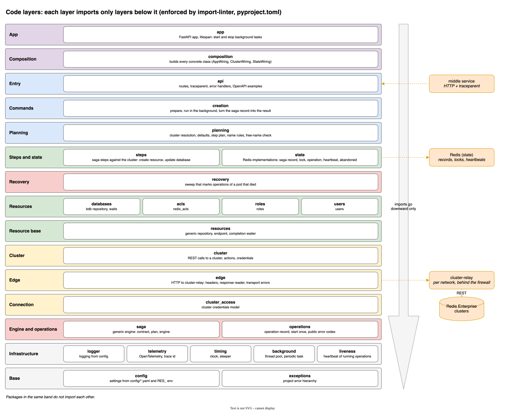

# redis-enterprise-services: סקירה

נקודת הכניסה למי שבודק את הפרויקט: מה השירות עושה, מה בנוי, מה חסר, ואיפה לקרוא עוד.

---

## 1. מה השירות עושה

השירות מקבל פעולה עסקית אחת על Redis Enterprise, למשל "צור DB עם שלושה יוזרים", ומבצע אותה כרצף של קריאות REST
לקלאסטר. הביצוע בנוי כ-**Saga**: לכל צעד יש פעולה מפצה, ואם צעד נכשל, מה שכבר נעשה מבוטל בסדר הפוך, והקלאסטר חוזר
למצב שלפני הבקשה. כשאי אפשר לדעת מה קרה, השירות לא מנחש: הוא עוצר ומסמן את הפעולה לטיפול ידני.

```
management network                                  | firewall |  target network (A / B / C)
UI -> middle service -> redis-enterprise-services  ->   auth    ->  cluster-relay -> clusters
                                  |
                                  +-> Redis (state, locks, results)
```

| רכיב | אחריות | בעלות |
|---|---|---|
| UI | מי מורשה לבקש מה | חיצוני |
| שירות ביניים | המרה מהפורמט של ה-UI לחוזה של השירות | חיצוני |
| **redis-enterprise-services** | פירוק לצעדים, Saga, ביטול, נעילה, מציאת הקלאסטר | הפרויקט הזה |
| cluster-relay | העברת כל קריאה לקלאסטר בתוך רשת היעד | פרויקט נפרד |
| Redis של המצב | saga records, נעילות, תוצאות, heartbeats | Redis Enterprise של צוות אחר |



- **השירות לעולם לא פונה ישירות לקלאסטר.** כל קריאה עוברת דרך cluster-relay של הרשת, מאחורי חומת אש
  (`contracts/edge-service.md`).
- **השירות לא בודק הרשאות עסקיות.** הבקשה כבר אושרה ב-UI.
- **אין ערכים בקוד.** כל ערך בקונפיג (`config/*.yaml`, עם דריסה ממשתני סביבה `RES_`), וסודות רק ממשתני סביבה.

---

## 2. מה בנוי

**יצירת DB באתר אחד, מקצה לקצה.**

- **ממשק:** (`contracts/service-api.md`) `POST /v1/databases/create` מחזיר `202`, והריצה ברקע.
  `GET /v1/operations/{trace_id}` מחזיר את המצב. `traceparent` (W3C) חובה, וה-trace id שבו מזהה את הפעולה.
  אותו trace פעמיים לא מריץ פעמיים.
- **הכנה:** בדיקת שם, מציאת הקלאסטר לפי היעד מ-`config/clusters.yaml`, וברירות מחדל לפי תוויות של הקלאסטר.
- **צעדים:** קודם ה-DB, אחריו לכל יוזר ACL, role ו-user, ובסוף קישור ההרשאות על ה-DB. כל צעד מחכה לסיום הפעולה
  בקלאסטר.
- **בטיחות:**
  - נעילה על ה-DB ועל היוזרים לכל משך הריצה, ובדיקה תחתיה שכל השמות פנויים.
  - תוצאה לא ידועה (timeout, שירות קצה שלא ענה) נבדקת בקלאסטר לפני ניסיון חוזר.
  - ביטול רק אחרי כישלון ודאי. כל השאר ⇐ `requires_manual_intervention`, והנעילה נשארת.
- **התאוששות:** heartbeat לכל פעולה, וסריקה בכל pod שמסמנת פעולות של pod שנפל.
- **תוצאה:** עץ ה-DB עם ה-uids, או קוד שגיאה ציבורי, הקלאסטר וקוד השגיאה שלו, ורשימה של מה שלא בוטל.
- **תצפית:** traces ו-metrics ב-OpenTelemetry, וה-trace ממשיך ללוגים ול-cluster-relay.

**נבדק מול קלאסטר אמיתי:** הצלחה עם הרשאות שנבדקו בחיבור ל-DB, כשל בכל אחד מחמשת הצעדים שהסתיים בביטול מלא,
בקשות במקביל, אותו trace, וקריסה באמצע ריצה (`design/creation.md` סעיף 5).

---

## 3. מה חסר

פירוט ועיצוב: `design/planned.md`.

| נושא | מה חסר |
|---|---|
| בחירת קלאסטר | היום קלאסטר `generic` אחד לכל יעד. בחירה בין כמה לפי מקום (dry_run) |
| הזדהות | אין הזדהות מול השירות |
| Active-Active | יצירה, עריכה ומחיקה של CRDB |
| מחיקה | מחיקת DB עם היוזרים שלו |
| עריכה | עריכת DB ועריכת רשימת היוזרים |
| קריאה ישירה לקלאסטר | route שמעביר בקשה כמו שהיא |
| פרטי גישה לכל קלאסטר | היום פרטי admin אחד לכל הקלאסטרים |
| טיפול ידני | אין כלי. נעשה ב-`redis-cli` (`design/saga-engine-and-state.md` סעיף 10) |

---

## 4. מבנה הקוד



`src/redis_enterprise_services/`. כיווני הייבוא נאכפים ב-`import-linter` (`pyproject.toml`), מלמעלה למטה. כל שורה
בטבלה מקבצת כמה שכבות. הסדר המדויק בתוך שורה (למשל `resources` מתחת לארבע חבילות המשאבים, ו-`recovery` מעל
`saga` ו-`operations`) נמצא ב-`pyproject.toml`.

| שכבה | חבילות | מה יש בה |
|---|---|---|
| הרכבה | `app`, `composition` | בניית האפליקציה וכל המחלקות הקונקרטיות |
| כניסה | `api` | routes, `traceparent`, טיפול בשגיאות |
| פקודות | `creation` | הכנה, ריצה ברקע, תרגום התוצאה |
| תכנון | `planning` | בקשה ⇐ קלאסטר, ברירות מחדל, תוכנית צעדים, בדיקת שמות |
| צעדים ומצב | `steps`, `state` | צעדי ה-Saga מול הקלאסטר; המימושים ב-Redis |
| משאבים | `databases`, `acls`, `roles`, `users`, `resources` | repository לכל סוג משאב |
| תעבורה | `cluster`, `edge`, `connection` | קריאה ל-REST של הקלאסטר דרך cluster-relay |
| מנוע ופעולות | `recovery`, `saga`, `operations` | מנוע ה-Saga, רשומת הפעולה, זיהוי קריסה |
| תשתית | `logger`, `telemetry`, `timing`, `background`, `liveness`, `config`, `exceptions` | |

- המנוע (`saga/`) גנרי: הוא לא מכיר קלאסטר, DB או שירות קצה.
- המשאבים והתעבורה לא מכירים את ה-Saga.
- טסטים: `tests/unit/`, על הלוגיקה המרכזית. אין טסטי אינטגרציה אוטומטיים. הזרימה נבדקה ידנית מול הקלאסטרים
  המקומיים (`design/creation.md` סעיף 5).

---

## 5. איפה לקרוא עוד

| מסמך | מה יש בו |
|---|---|
| `README.md` | התקנה, הרצה, קונפיג |
| `contracts/service-api.md` | ה-API: שדות, תשובות, קודי שגיאה |
| `contracts/edge-service.md` | מה השירות דורש מ-cluster-relay |
| `design/creation.md` | איך בקשת יצירה רצה |
| `design/saga-engine-and-state.md` | המנוע, Redis, heartbeat וזיהוי קריסה, טיפול ידני |
| `design/database-and-user-model.md` | שדות ה-DB והיוזרים, ומה נשאר בחוץ |
| `design/redis-rest-api-behaviour.md` | התנהגויות של ה-REST API של הקלאסטר שהעיצוב נשען עליהן |
| `design/planned.md` | כל מה שלא בנוי, ושאלות פתוחות |

### דיאגרמות

כל הדיאגרמות ב-`docs/diagrams/`, כקבצי `.drawio.svg`: נפתחים כתמונה, ונערכים ב-draw.io.

| דיאגרמה | מה היא מראה |
|---|---|
| `01-layers` | כל השכבות, מלמעלה למטה, והגורמים החיצוניים |
| `02-context` | מי קורא למי, ומה מתוכנן |
| `03`–`09` `layer-*` | כל שכבה מבפנים: מי משתמש בה, מה יש בה, ובמה היא משתמשת |
| `10-seq-create-single-site`, `11-seq-rollback-single-site` | יצירה מוצלחת, וביטול אחרי כישלון |
| `12-flow-admission` | קבלה, trace חוזר, נעילה ובדיקת שמות |
| `13-flow-cluster-and-defaults` | מציאת הקלאסטר וברירות המחדל |
| `14-flow-failure-classification` | מה המנוע עושה בכל סוג כישלון |
| `15-state-step`, `16-state-operation` | הסטטוסים של צעד ושל פעולה |
| `17-flow-heartbeat-and-abandoned-sweep` | heartbeat וזיהוי קריסה |
| `18-redis-keys` | המפתחות ב-Redis |
| `19-api-models-create` | מודלי הבקשה והתוצאה |
| `planned/p1`–`p6` | העיצוב של מה שעוד לא בנוי: Active-Active, מחיקה, עריכה |
